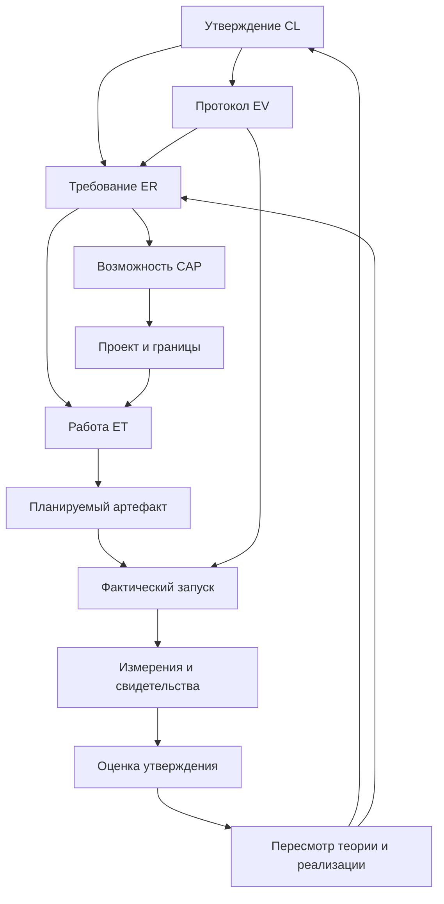

> **Редакторская копия.** Терминология унифицирована; научный статус — `concept_draft`. Основной текст и поздние дополнения сохраняют собственные области проверки и ограничения. Редактура не добавляет предметных опытов и не объединяет их выборки.

Словарь (glossary, not in this release) · [История уточнений и проверок](#editorial-technical-appendix) · [Навигация по статьям](../README.md#current-papers)

<!-- editorial-main:start -->
<a id="document"></a>

# Проверка, контрпримеры и границы утверждений

<a id="section-001"></a>

## Аннотация

Предлагается программа проверки управления смыслами как полного процесса: запрос → поиск → оценка покрытия → построение ограниченного пакета → применение → наблюдаемый результат → обратная трассировка и пересмотр. Проверка извлечения из книги — только один из её этапов. Научный вопрос состоит в том, помогает ли явное представление смысловых объектов, условий, зависимостей и происхождения человеку или модели получать более обоснованный результат при ограниченном доступе к источникам и ограниченном бюджете.

Этот документ содержит постановку исследования, различения, условия опровержения и поздние отчёты об ограниченных наблюдениях при разработке R37–R44. Эти наблюдения не превращают каталог из 320 синтетических планов и 18 отдельно подготовленных EX-иллюстраций в выборку успешно решённых задач и не заменяют подтверждающие испытания. Утверждения об общем преимуществе архитектуры сохраняют статус гипотез до предусмотренного сравнения с сильными альтернативами.

<a id="section-002"></a>

## 1. Что именно может быть проверено

Программа разделяет предметы проверки и отдельно учитывает вид свидетельства, необходимый для каждого вывода.

| Предмет | Что проверяется | Чего такая проверка не устанавливает |
| --- | --- | --- |
| Формальное свойство | Следует ли свойство представления или оператора из явных предпосылок | Корректность OCR, человеческого толкования и практического применения |
| Соответствие реализации | Соблюдает ли программа зафиксированную спецификацию | Пригодность самой спецификации для задачи |
| Верность источнику | Сохранены ли утверждение, условия, модальность, единицы и контекст | Истинность утверждения о мире |
| Согласованность разметки | Насколько совпадают независимые оценки по рубрике | Истинность по большинству голосов |
| Эмпирическая полезность | Изменились ли качество, время, стоимость и проверяемость на данной выборке | Универсальное превосходство на произвольных текстах |
| Актуальная применимость | Достаточны ли основания использовать вывод сейчас и в данной ситуации | Автоматическое разрешение внешнего действия |
| Межсистемный перенос | Сохранены ли заявленные обязательства между закреплёнными реализациями | Совместимость из одного совпадения названий полей |
| Надёжность и стоимость | Что происходит при повторах, изменениях, отказах и нагрузке при заданном качестве | Производственный SLO из одного удачного ответа |

Источник может верно описывать устаревшую практику; правильное извлечение сохранит именно историческое утверждение. Два оценщика могут одинаково ошибиться. Валидный JSON может содержать неверную связь. Поэтому одна метрика «точность смысла» не заменяет эту таблицу.

Программа исследует наблюдаемое поведение. Она не измеряет внутреннее понимание непосредственно и не восстанавливает скрытый внутренний ход рассуждений модели. Опубликованное обоснование — самостоятельный объект с посылками, правилами, свидетельствами и проверками.

<a id="section-003"></a>

## 2. Единица проверки и фиксированные требования

Единица наблюдения — задача с зафиксированным запросом, контекстной рамкой (`ContextFrame`), разрешённым снимком источников, профилем применения (`ApplicationProfile`) и бюджетом. До запуска фиксируется снимок требований R. В него входят требуемые факты, условия, операции, полнота перечисления и допустимость частичного ответа.

Формулировка «все исключения» создаёт обязательство полноты в конечной объявленной области. Формулировка «два подходящих примера» этого обязательства не создаёт. Если система после ошибки незаметно меняет «все» на «несколько», это нарушение постановки, даже когда найденные примеры верны.

Отчёт о покрытии (`CoverageReport`) всегда содержит поля `target_stage`, `target_id` и `requirements_snapshot_id`. Отчёты для набора кандидатов (`candidate_set`), пакета контекста (`context_package`) и выходного результата (`output`) раздельны. В найденном наборе может присутствовать всё необходимое, но часть условий может потеряться при упаковке. Полный пакет также не гарантирует поддержанного ответа: потребитель может проигнорировать исключение.

Статус покрытия `coverage_status` принимает значения `supported`, `partial`, `unsupported`, `conflicted`, `unknown`. Причина остановки S08 `stop_reason` задаётся отдельной осью; примеры — completed, clarification_needed, budget_insufficient, retrieval_limit, stale_evidence. Полный словарь, включая ошибки, отмену и ожидание согласования, находится в [модели состояний](../../spec/ru/STATUS_MODEL.md). Причина остановки не выводится автоматически из `coverage_status`. Поле `assurance` отдельно характеризует процедуру поиска: candidate_only, retrieval_incomplete либо exhaustive_declared_scope. Последнее означает полный обход конечной области по зафиксированному критерию, а не безошибочность интерпретации.

В целевой модели I05 используется оценка S03 `check_result` с объявленной областью: pass, fail, unknown, not_applicable. У каждой проверки указан предмет, критерий, версия метода и снимок требований. Отсутствующая проверка не заполняется unknown автоматически. Старое validation_status сохраняется только при явном разборе прежних записей. Проверка структуры пакета и проверка поддержки ответа имеют разные предметы и не переносят вердикт друг на друга.

<a id="section-004"></a>

## 3. Направления проверки

<a id="subsection-001"></a>

### 3.1. Прямое преобразование

Нужно проверить переход от фрагмента источника (`SourceFragment`) к смысловому объекту (`MeaningObject`) и связи (`Relation`), сохранение контекстной рамки, корректность записи преобразования (`TransformationRecord`) и записи проверки (`EvidenceRecord`). Для текста существенны отрицание, модальность, кванторы и референты. Для схем — соединения, обозначения и состояние элементов. Для формул — индексы, знаки, область определения и единицы. Для таблиц — заголовки, координаты и сноски.

Ошибка в распознавании минуса и ошибка в применении правильно распознанной формулы — разные события. Поэтому предусмотрены отдельные режимы с исходным изображением, проверенной транскрипцией и эталонной семантической структурой.

<a id="subsection-002"></a>

### 3.2. Использование

Проверяется, может ли потребитель выполнить запрос на основании именно переданного пакета контекста (`ContextPackage`). Доступность источника поисковой системе не равна его доступности пользователю или модели на стадии применения.

Нужно сравнить наблюдаемые результаты объяснения, диалога, расчёта, документа и работы с применением контракта знаний (Knowledge Contract, KC). Качество документа включает соответствие утверждений источникам и сохранение оговорок; качество работы — ещё и соблюдение предусловий, доступных возможностей и границы полномочий. План не считается исполнением, симуляция не считается внешним действием.

<a id="subsection-003"></a>

### 3.3. Обратная трассировка и изменение

Обратная проверка начинается с конкретного результата: можно ли найти его основания, преобразования и исходную область страницы? Следующий тест изменяет источник и проверяет, какие выводы, документы и рабочие обязательства нужно пересмотреть.

Обратная трассировка не означает математическую обратимость любого сжатия. Утраченные при проекции детали нельзя восстановить только из короткого пакета; для этого должна сохраняться ссылка на доступный исходный объект. Модель происхождения PROV-DM служит опорой для представления производности и деятельности, но сама запись происхождения не подтверждает содержание вывода [E1].

<a id="section-005"></a>

## 4. Фальсифицируемые гипотезы

| Гипотеза в ограниченной области | Наблюдение против неё | Возможный пересмотр |
| --- | --- | --- |
| Явные условия и зависимости уменьшают критические потери при одинаковых свидетельствах и бюджете | Потери не уменьшаются либо возрастает доля ошибочных связей | Упростить представление или сузить типы задач |
| Раздельные отчёты покрытия помогают корректно сообщать пробелы | Система систематически выдаёт найденность за достаточность пакета | Изменить механизм проверки и интерфейс |
| Типизированный пакет улучшает повторное использование | Сильный структурированный конспект даёт не хуже качество и меньшую полную стоимость | Ограничить структурирование задачами аудита или пересмотра |
| Зависимости позволяют точнее находить последствия изменения | Пропущены существенные производные либо необоснованно ограничивается применение почти всего материала | Пересмотреть отношение зависимости и процедуру обновления |
| Публичная трасса помогает человеку проверять результат | Пользователи медленнее проверяют ответ или чаще доверяют неподдержанному выводу | Сократить интерфейс, изменить раскрытие оснований |
| Междоменная композиция сохраняет ограничения | Аналогия переносит неподдержанные причинные или нормативные выводы | Ограничить аналогии объяснением, запросить отдельные основания |

Каждая гипотеза требует заранее заданного измерения, области и сравнения. Неудача конкретной реализации не всегда опровергает всякое возможное управление смыслами. Однако ссылаться на «плохую реализацию» без проверяемого изменения и нового испытания также нельзя. Различение проектной конструкции, эмпирической гипотезы и формального свойства фиксируется в реестре утверждений (MM_A0053, not in this release).

<a id="section-006"></a>

## 5. С чем сравнивать

RAG связывает получение внешних документов с генерацией; исходная исследовательская постановка описана Lewis et al. [E2]. Поэтому честное сравнение должно включать сильную реализацию поиска с релевантными фрагментами, а не только модель без источника.

Предлагаются два разных эксперимента. В сравнении при одинаковых свидетельствах всем методам передаются одни и те же исходные регионы: различается представление и его использование. В сквозном сравнении каждый метод использует свой полный конвейер, но имеет одинаковый корпус, доступ, модель потребителя, задачу и объявленный ресурсный режим. Эти результаты отвечают на разные вопросы.

Обязательные альтернативы: сильный RAG, качественный структурированный конспект с условиями и ссылками, и типизированный пакет. Полный исходный материал при допустимом размере служит диагностическим сравнением; вариант без источников — диагностикой зависимости от корпуса. Ни один из них не является автоматически достижимым верхним или нижним пределом.

Нужно учитывать подготовку, ручную разметку, валидацию, поиск, упаковку, использование, повторные попытки и пересмотр. Более короткий пакет может оказаться дороже в подготовке и хуже по качеству. Амортизация подготовки при многократном использовании — отдельная гипотеза с указанным числом запросов. Она проверяется в сравнении режима без кэша (`cache-off`), сильного кэша точных совпадений (exact cache), шаблонов, сохранённых пакетов и полного механизма; кандидат по смысловому сходству оценивается только вместе с проверками допустимости. Компиляция добавляет вторую экспериментальную ось к B2–B4, а не заменяет сравнение самих представлений.

<a id="section-007"></a>

## 6. Каталог как карта испытаний

Каталог содержит 32 семейства по 10 конкретных планов, MM-C001–MM-C320. Они проверяют намерение, терминологию, сущности, отсутствие свидетельств, область действия, версии, зависимости, бюджет, порядок, противоречия, OCR, мультимодальность, языки, диалог, обучение, вычисления, документы, KC, инструменты, аналогии, враждебные данные, происхождение, использование человеком и эксплуатационные ограничения. F25–F32 добавляют идентичность повторного запроса, свежесть, зависимости области поиска, шаблоны, конкурентную публикацию, изоляцию доступа, допуск к хранению и вытеснение, а также экономику нагрузки.

Это матрица проектируемого поведения, а не таксономия всех смыслов. CheckList показывает полезность систематического сочетания способностей и типов поведенческих тестов; конкретные 32 семейства и 320 сценариев здесь являются собственным проектным решением [E3].

Положительные тесты должны сопровождаться отрицательными и метаморфными. Согласованное переименование переменной может сохранять вычисление. Перестановка независимых фактов может сохранять поддержку. Перестановка шагов зависимой процедуры не обязана сохранять результат. Каждое требование инвариантности имеет собственные предпосылки; сравнение строк ответа недостаточно.

<a id="section-008"></a>

## 7. Защита от утечки и ложной уверенности

Готовые решения и производные от них подсказки скрываются до создания индексов, графов и конспектов. Если граф уже построен по полному тексту с решением, удаление страницы из поисковой выдачи не устраняет утечку.

Варианты одной задачи, соседние взаимосвязанные фрагменты и повторные генерации не считаются независимыми наблюдениями. Разбиение и интервалы неопределённости учитывают семейства задач и пакеты связанных источников. Изменения после просмотра закрытого теста переводят его в диагностический набор; новые подтверждающие выводы требуют нового закрытого материала.

Для старых книг нельзя исключить знакомство модели с текстом только по отсутствию доступа к текущему индексу. Новые параметры и искусственные мутации помогают исследовать зависимость от предоставленного источника, но не доказывают отсутствие обучения на исходном произведении. Работы по обнаружению контаминации предлагают проверки с конкретными предпосылками; отрицательный результат такой проверки не заменяет полного знания обучающего корпуса [E4].

<a id="section-009"></a>

## 8. План анализа и основания остановки

Сначала проверяются источник и рубрика, затем локальные преобразования, затем поиск и упаковка, затем применение и обратная трассировка. Контрольный переход означает решение о следующей фазе исследования, а не сертификат общей безопасности системы.

До получения итоговых результатов фиксируются основной показатель, критические ошибки, допустимая потеря качества, анализ неопределённости и стоимость. Если преимущество во времени сопровождается недопустимыми потерями условий, оно не считается полезным выигрышем. Порог допустимой потери должен вытекать из выбранного применения; универсальное число для рецепта, учебного расчёта и операционной навигации здесь не задаётся.

Отчёт показывает числитель, знаменатель, разбивку по доменам, семьи ошибок, парные различия и ограничения выборки. Повторные генерации одной модели характеризуют вариативность этого случая, а не создают новые независимые задачи.

Полный операционный план находится в протоколе эксперимента (MM_A0054, not in this release). Публикационные правила (MM_A0009, not in this release) требуют сохранять отрицательные результаты и ограничения воспроизведения.

<a id="section-010"></a>

## 9. Ожидаемый вклад и пределы

Планируемый вклад — связать формальные ограничения представления, проверку отдельных преобразований и наблюдаемую полезность полного процесса. Успешное исследование должно показать, какие операции работают в каких условиях, где структура помогает, где стоимость превышает пользу и какие контрпримеры требуют пересмотра.

На текущем этапе нет оснований заявлять универсальную теорию, превосходство над RAG, устойчивую экономию токенов, перенос между любыми областями или доказанную способность системы решать перечисленные 320 сценариев. Три книги дают разные типы материала и полезные трудные случаи; они не образуют репрезентативную выборку всех осмысленных текстов.

<a id="p11-reuse-scope"></a>

## 10. Проверка повторного использования как самостоятельный предмет

Применение теории в Arcanada и Talomnia требует проверить второй проход: уже подготовленное знание → новый запрос → допустимость использования → фактическая передача → новый результат. Быстро найти прежний ответ недостаточно. Нужно показать, что сохранены требования нового запроса, область, права, версия, достаточный пакет и ограничения действия.

Объекты проверки определены в [статье о компиляции и повторном использовании (P12)](P12_compilation_caching_and_reuse.md), [контракте компиляции](../../spec/ru/COMPILED_ARTIFACT_CONTRACT.md) и [политике](../../spec/ru/REUSE_POLICY.md). Режимы нагрузки, метрики и сравнения задаёт протокол повторного использования и нагрузки (MM_A0056, not in this release). Программа остаётся исследовательской: поздние разделы фиксируют действующую локальную реализацию и ограниченные проверки нагрузки при разработке. Они не устанавливают готовность полного контура с нативными адаптерами или общее преимущество при высокой нагрузке; такие выводы требуют отдельных измерений и исходной приёмки I30.

<a id="p11-reuse-properties"></a>

### 10.1. Какие свойства имеют разное основание

| Предмет | Возможная проверка | Ограничение вывода |
| --- | --- | --- |
| Сохранение обязательств при точном повторном применении | Условное доказательство для неизменяемого содержимого, совпавших требований и всех проверок допуска | Не доказывает правильность исходного содержания и полноту извлечённых зависимостей |
| Подстановка параметров | Проверка типов, области, единиц и постусловий контракта шаблона (`TemplateContract`) | Количество не создаёт времени приготовления; план не создаёт исполнения |
| Конкурентная публикация | Модель переходов, защита от устаревших исполнителей (fencing), атомарная смена поколения, внесение тестовых сбоев | Зависит от объявленных гарантий хранилища и координатора |
| Достаточность манифеста зависимостей | Мутации источника, области и прав против независимого эталона последствий | Точный обход неполного графа всё ещё пропускает смысловые зависимости |
| Экономическая полезность | Сравнение R0–R5 при общей рубрике качества, cold/warm/hot и полной стоимости | Вывод ограничен распределением повторов, интенсивностью изменений, ёмкостью и профилем использования |

Жизненный цикл S16, физическое наличие S17, свежесть S18 и допустимость нового использования S19 независимы. Полные словари закреплены в [модели состояний](../../spec/ru/STATUS_MODEL.md). Историческое поле `validity` не имеет автоматического взаимно однозначного соответствия этим осям. Их нельзя переносить в coverage_status. Даже ready/fresh/resident не заменяет проверки нового запроса, текущих прав и зависимости от источников. ReuseDecision.kind принимает exact_reuse, instantiate, reuse_and_revalidate, rebuild, bypass, reject; это решение пути, а не экспериментальный вердикт.

<a id="p11-reuse-falsification"></a>

### 10.2. Контрпримеры, которые обязаны влиять на архитектуру

В первую очередь проверяются близкие запросы с противоположным отрицанием; переход от двух примеров к «все»; новый объект, опровергающий сохранённое отсутствие; отзыв права до TTL; обновление источника между началом сборки и публикацией; повторное выполнение внешнего действия после потерянного ответа; дорогой манифест зависимостей для дешёвого ответа.

Каждый такой случай связан с CL31–CL42 (MM_A0053, not in this release) и F25–F32. Нарушение условного свойства требует контрмодели или исправления реализации. Отсутствие выигрыша над простым кэшем точных совпадений является полноценным основанием убрать уровень компиляции либо сузить область его применения. Высокая общая доля попаданий в кэш (raw hit rate) не опровергает такой отрицательный вывод.

Нагрузка измеряется вместе с качеством. Нужны распределения задержек по пути и организации, число предложенных, принятых, завершённых и сброшенных запросов (offered/accepted/completed/shed), полезная проверенная доля повторного применения, выдачи вне области (wrong-scope) и устаревшие выдачи (stale), задержка инвалидации, стоимость обновления и человеческой работы. Порог качества и допустимое ухудшение фиксируются до подтверждающего опыта; иллюстративные TTL-профили не являются промышленными SLO.

<a id="p11-reuse-trace"></a>

### 10.3. Что публикуется при попадании кэша

Новый запрос получает новую трассу использования и квитанцию повторного применения (`ReuseReceipt`) со ссылками на исходную сборку, текущие проверки и фактически переданное содержимое. Ранее выполненный поиск не выдумывается заново. Если готовый ответ отправлен без создания нового пакета контекста, такой пакет не появляется фиктивно в журнале. Реально возникшие отчёты о покрытии сохраняют поля `target_stage`, `target_id`, `requirements_snapshot_id` и проверяемую связь с предыдущими отчётами.

Повторное использование может вернуть корректный частичный ответ или обоснованное отсутствие в конечной области. Оно не повышает заявленную полноту процедуры поиска, не снимает пробелы и не даёт полномочий внешнего действия. Для Talomnia новое применение профессионального пакета учитывается отдельно от новой генерации, первоначальной подготовки и выполнения единицы работы (`WorkItem`); коммерческие правила оплаты не выводятся из технического счётчика.

<a id="section-011"></a>

## Опорные первоисточники

- [E1] W3C. [PROV-DM: The PROV Data Model](https://www.w3.org/TR/prov-dm/). Используется для происхождения и производности; не как доказательство истинности.
- [E2] Patrick Lewis et al. [Retrieval-Augmented Generation for Knowledge-Intensive NLP Tasks](https://arxiv.org/abs/2005.11401), 2020. Используется как исследовательская основа RAG-сравнения.
- [E3] Marco Tulio Ribeiro et al. [Beyond Accuracy: Behavioral Testing of NLP Models with CheckList](https://aclanthology.org/2020.acl-main.442/), 2020. Используется как основание поведенческого тестирования по способностям и преобразованиям.
- [E4] Yonatan Oren et al. [Proving Test Set Contamination in Black Box Language Models](https://arxiv.org/abs/2310.17623), 2023. Используется для постановки проблемы контаминации и ограниченных проверок.

Собственные числа выборки, типы отчётов и критерии этого проекта — предложения протокола; они не приписываются перечисленным публикациям.

<a id="i06-p11-operationalization"></a>
## 11. Операционализация утверждений в I06

Реестр CL01–CL42 включает разные виды высказываний: определения границ, нормативные требования к устройству, условные формальные свойства и эмпирические гипотезы. Они не становятся 42 одинаковыми статистическими гипотезами. Для каждого CL создана отдельная операционная карточка (MM_A0181, not in this release): что наблюдать, на какой единице, каким эталоном проверять, с чем сравнивать, какой исход требует пересмотра.

Принято 12 семейств протоколов EV01–EV12 (MM_A0187, not in this release). Семейство — повторно используемый способ проверки, а не выполненный эксперимент. Один реальный запуск может дать несколько измерений, но это не делает их независимыми случаями. И наоборот, один CL может требовать и проверки реализации, и исследования полезности, и испытания при изменении источника.

Три вопроса к каждому выводу обязательны. **Что именно оценено?** Конкретный предмет оценки, его редакция, требования и область. **На каком основании?** Условное рассуждение, конечный тест, оценка содержания, реальное использование или нагрузочный прогон. **Как далеко распространяется вывод?** От частного сценария до явно выбранной популяции задач, без автоматического расширения.

Например, CL04 о существенном смысле изображения получает контрпример к текстовому замещению, проверку сохранения локатора и оригинала, оценку существенных визуальных отношений и опыт использования человеком/агентом. Успех проверки PNG-байтов подтверждает только соответствующий технический критерий. Он не доказывает распознавание условного знака. Корректное описание знака не доказывает его совпадение с наблюдаемым объектом. Каждая из этих границ имеет отдельное измерение.

<a id="i06-p11-engineering"></a>
## 12. Связь научной программы с реализацией

Научная программа включает практические обязательства с первого прохода. Для каждого проверяемого утверждения указываются нужная возможность, требование, предполагаемое место изменения, исполняемый пакет работ и ожидаемое свидетельство. Канонические документы: реестр областей реализации (MM_A0076, not in this release), требования (MM_A0078, not in this release), список запланированных работ (MM_A0077, not in this release), правила трассировки (MM_A0079, not in this release).



Граф различает планируемый результат и фактический. В I06 добавлена первая половина этой цепочки и требования ко второй. Рёбра к запускам и свидетельствам в диаграмме показывают будущую процедуру; они не создают несуществующие запуски. Наличие связного графа — проверяемое свойство документации, а не доказательство полезности архитектуры.

Граница реализации выбирается последовательно: проверить существующую возможность; переиспользовать подходящий интерфейс; дополнить модуль или адаптер; выделить новый модуль; только затем рассматривать отдельный сервис. Решение о новом проекте требует подтверждённого пробела, владельца, потребителей, устойчивого интерфейса и обоснования отдельного жизненного цикла. Отсутствие имени на сайте не является подтверждённым пробелом. Системные зависимости и скрытые потребители — известный источник сложности ML-систем I06-R01 (MM_A0193, not in this release); наши правила распределения ответственности являются собственным проектным ответом, не выводом о конкретном коде Arcanada.

<a id="i06-p11-ecosystem"></a>
## 13. Состав и границы экосистемы как проверяемый вход

На дату обзора публичная таблица содержит 48 записей. Дополнительно сохранены 12 контекстных направлений, ранее обсуждавшихся в проектной работе. Это 60 записей инвентаря, а не 60 проверенных работающих сервисов. Полные источники и ограничения сведены в аудит I06 (MM_A0184, not in this release). Публичное описание, пользовательское требование, прежнее предложение ассистента и проверка реализации имеют разные основания.

Роли для интеграции предлагаются по интерфейсам: Wiki Arcana — каталог и разрешение знаний; Scrutator — кандидаты и поисковые индексы; Disk Arcana — возможная синхронизация разрешённых копий; Shared Component Library — общие схемы и проверки; Muneral — единицы работы и зависимости; Talomnia — профессиональное применение общего ядра. Адресуемый архив, компоновщик ограниченного контекста, компилятор готовых артефактов и семантический журнал имеют отдельные обязательства, которые нельзя считать реализованными по наличию соседнего проекта.

Сайт обнаруживает и неоднозначности. Общий каталог и карточки Wiki/Talomnia используют разные формулировки стадии. Комбатека названа ареной оценки в каталоге, тогда как отдельная карточка описывает игру. Поэтому исследовательский стенд проектируется переносимым и не объявляется готовой функцией Комбатеки. Не установлено тождество разных названий Atlas. I28 должен проверить владельцев, репозитории, версии, API, данные и фактические гарантии; I06 фиксирует конкретный список этих вопросов.

Научные статьи сохраняют независимость от брендов. Определение ограниченного контекста не меняется при смене владельца реализации, а список инженерных работ переотображается на фактические проекты. Общие возможности Arcanada доступны продуктам через согласованные интерфейсы; Talomnia не получает автоматически владение общими сервисами или их базами данных.

<a id="i06-p11-measurement"></a>
## 14. Что означает «практически подтверждено»

Для архитектуры требуется наблюдать конкретный конвейер на зафиксированных входах и версиях. Для пользователя — дополнительно измерить фактическое решение задачи и проверку результата. Для агента — фактический вход, действия, выходы и результат исполнения. Для нагрузки — распределение запросов, изменения, отказы, хвосты задержек, качество и полную стоимость. Одно из этих свидетельств не заменяет остальные.

Минимальный контракт наблюдений (MM_A0188, not in this release) разделяет план, манифест запуска, измерение и исследовательскую оценку. Наблюдаемая трасса должна позволять проверить связь входа с выходом и существенные решения включения/исключения. Скрытый внутренний ход рассуждений не является требуемым артефактом. Полная трасса хранится отдельно от ограниченного ответа.

Для задачи поиска блюда одновременно проверяются корректность состава, покрытие требований и объём лишнего контекста. Для объяснения приготовления добавляются процедура, существенные условия и изображения, если без них теряется нужный шаг. Для исполнения работы отдельно оцениваются способности, инструменты, полномочия и внешние эффекты. Профессиональная роль не загружается целиком при простом поиске рецепта; она материализуется в необходимой проекции, если её обязательства влияют на применение.

Для отрицательного ответа фиксируется объявленная область поиска. Не найденное в разрешённом корпусе не объявляется несуществующим вообще. Если часть сведений недоступна из-за бюджета, доступа или неполного поиска, сохраняется соответствующая неопределённость. Повторная выдача такого ответа не повышает заявленную полноту процедуры поиска.

Издержки измеряются на нескольких горизонтах. Подготовка, разметка, извлечение, индексирование, проверка и обновление относятся к полному циклу. Отдельно видны стоимость одного уникального запроса, полезного повтора и пересмотра после изменения. Если сложная архитектура при равном качестве оказывается дороже сильного конспекта или кэша точных совпадений, это основание упростить её или сузить область, а не скрыть такой режим.

<a id="i06-p11-kcv3"></a>
## 15. KC v3, замораживание и последующий пересмотр

Целевой контракт — самостоятельный `3.0.0-draft.1`, объединяющий общее ядро и выборочные профили. Профессиональное выполнение — один профиль наряду с диалогом, документом, рассуждением, изображениями и повторным использованием. V2 используется как историческая исходная точка для сравнений и миграции.

Проверка миграции устанавливает сохранение исходника, существенных полей и происхождения; выявление потерь; правильное обращение с неизвестными обязательными профилями; структурную и поведенческую совместимость. Ни соответствие SemVer, ни успешный синтаксический разбор не подтверждают сохранение смысла. Тестируется и цена нового ядра: возможно, минимальный профиль достаточен для простого запроса, а полное представление создаёт издержки.

I06 задаёт раннюю проверяемую программу. I07 устанавливает точные источники и корпус; последующие предметные итерации уточняют определения; I28 закрепляет практические интерфейсы; I30 выполняет разведочный пилот; I31 фиксирует подтверждающий протокол; I32 проводит подтверждающие испытания; I33 пересматривает вводную работу по результатам. Статус замороженной другой публикации Arcanada не переносится на эту программу I06-R07 (MM_A0193, not in this release).

Изменение определения или реализации запускает анализ последствий: какие CL, EV, ER, ET, схемы, адаптеры, миграционные проверки и публикации зависят от изменения. Старый отрицательный результат сохраняется со своей версией. Исправление создаёт новый проверяемый объект и новый запуск. Это делает научную программу развиваемой, сохраняя возможность её критики.
<!-- editorial-main:end -->

<a id="editorial-technical-appendix"></a>
## Историко-техническое приложение: уточнения, проверки и основания

Здесь сохранены адресуемые передачи и результаты прежних проходов. Это часть научного материала: поздние наблюдения читаются вместе с их ограничениями. Исторические коды и обозначения оставлены для связи с источниками; написание единицы работы приведено к `WorkItem`. Уровни заголовков вложены в приложение; текст и порядок исторических блоков сохранены.

### Исходный паспорт и редакционная рамка

Ниже приведена исходная шапка читательской сборки; её отметка о замене только маршрутов ссылок относится к исходной сборке, а не к этой редакторской копии.

```text
<!-- Reading projection MM_PUB_READ_P11 r1; content source MM_A0208 / MM_G1_20261028_v1. Public release: link targets rewritten to repository routes or marked as not in this release; see receipts/meaning-management/. Not a new scientific acceptance. -->

---
paper_id: P11
document_status: concept_draft
experiment_status: planned
data_origin: synthetic
version: "0.10"
last_integrated_release: "0.35.0"
---

> **Текущая редакционная рамка G1 — 28 октября 2026.** Основание этой копии — R44 / 0.44.0; адресные поправки закреплены в G1-реестре. Унаследованная шапка и номера основных редакций ниже описывают исходные документы, а не сводный статус поздних опытов. Основной текст, датированные передачи и дополнения R37–R44 читаются в их собственных областях. I30 остаётся `in_progress_editorial`, I31–I33 — плановыми. Эта рецензия и исправления формулировок не являются новыми предметными опытами или подтверждением общего преимущества. Точный исходник R44 и прежние оценки сохранены отдельно; изменённые места перечислены в `PATCH_LEDGER.json`.

> **Текущая обязанность WP02 / PAP-F02:** отдельно проверить основания и эпистемический статус каждого видимого утверждения, включая побочные числа внутри общей оговорки. Новая рубрика фиксируется до новых ответов; исходные оценки R44 не пересчитываются.
```

<!-- preserved-history:start -->
<a id="i01-architecture-handoff"></a>
### Передача архитектурных обязательств I01

Добавлены AC01–AC24 planned, условные A1–A4 и требования проверки переноса; source coverage не является эмпирической валидностью.

**Вопрос следующего обзора:** Какие оракулы и сильные альтернативы выявят пользу именно наших дополнительных обязательств? Основание передачи: решение I01 (MM_A0093, not in this release). Стартовые источники и границы чтения: карта P00–P12 (MM_A0099, not in this release), реестр (MM_A0216, not in this release). В следующем проходе применяется протокол исследования (MM_A0215, not in this release); имеющийся список не объявляется полным обзором этого направления.

**Следующий глубокий проход:** I06/I31. Полные тексты книг и системные результаты остаются отдельными входами.

<a id="i02-artifact-contract"></a>
### Согласованный вход I02

I02 добавил 6 положительных групп и 23 отрицательных варианта конечного конверта. Фактические результаты находятся в локальном отчёте; они не увеличивают число системных executed/validated. Сильный baseline включает стандартные метаданные, версии, provenance, retrieval и прикладные проверки. Эмпирическую пользу дополнительных типов нельзя выводить из числа найденных ошибок в специально построенных мутациях.

**Определения:** [реестр](../../spec/ru/ARTIFACT_REGISTRY.md#i02-registry-envelope), решения (MM_A0105, not in this release), обзор оснований (MM_A0115, not in this release). **Ответственный следующий проход:** I06. Редакционное согласование не означает полного испытания этого потребителя.

<a id="i03-multimodal-handoff"></a>
### Уточнение I03: содержание и медиа

I03 добавляет отдельные 72 planned-сценария и 48 planned-проб, а также конечные контрактные проверки настоящих синтетических PNG/SVG. Проверки не являются VLM-бенчмарком. Нужны oracle отношения и oracle допустимости вывода по доступным входам; случайно верная догадка при закрытой детали считается overreach.

**Основание профиля:** MULTIMODAL_EVALUATION_PLAN (MM_A0127, not in this release). **Основная спецификация:** [SEMANTIC_TYPES](../../spec/ru/SEMANTIC_TYPES.md). **Ответственный следующий проход:** I06. Это редакционная передача требований; она не означает реализованного мультимодального сервиса или успешного испытания по книгам.


<a id="i04-operation-handoff"></a>
### Передача требований I04: контракты операций

Работа получает из гипотез H04 (MM_A0144, not in this release) проверяемые утверждения о снижении ложного success, повторении, доставке изображений и полезности профилей с возможными опровержениями. Из сильных сравнений и абляций (MM_A0144, not in this release) принимается сопоставление при согласованном бюджете с качественным конспектом, поиском и типизированным workflow, а структурная фикстура не заменяет эмпирического испытания.

**Владелец следующей проработки:** I06. Это редакционное согласование требований; оно не завершает будущую итерацию и не объявляет реализацию или предметные испытания выполненными.

<a id="i05-state-kcv3-handoff"></a>
### Передача I05: состояния и целевой KC v3

**Владелец следующего углубления:** I06. **Входной интерфейс:** S20/S21/S22; finite fixtures; KC v3 migration.

Ранний проход I06 сопоставляет определениям и центральным утверждениям оракулы, сильные альтернативы, абляции, наблюдаемую ошибку и возможное опровержение. Редакционная готовность, конечная проверка, реальные запуски и научная оценка разделены.

**Критерий будущей проверки:** Полная scoped-модель может оказаться неоправданно дорогой или хуже простой; такое измерение должно считаться результатом, а не исключаться из выборки.

Основания и точные значения: [STATUS_MODEL](../../spec/ru/STATUS_MODEL.md), [KC v3](../../spec/ru/KNOWLEDGE_CONTRACT_V3.md), переходы I05 (MM_A0177, not in this release). Это требование к следующему проходу; соответствующая промышленная/предметная проверка здесь не заявляется.


<a id="i07-corpus-handoff"></a>
### Передача I07: происхождение, версии и доступный корпус

**Следующий владелец углубления:** I31. **Контракт входа:** I07 (MM_A0248, not in this release).

Development-пилот с известными искусственными ответами не считается подтверждающей выборкой. Разбиение по lineage, независимая разметка и проверка утечек предшествуют выводам о качестве.

Основания и материалы: реестр корпуса (MM_A0030, not in this release), правила версий (MM_A0261, not in this release), пилот (MM_A0252, not in this release). Это требование к дальнейшей проработке; полнота извлечения реальных книг, качество OCR/VLM и продуктовые испытания здесь не заявляются.


<a id="i08-extraction-handoff"></a>
### Передача I08: извлечённое содержание и его основания

**Следующий владелец углубления:** I31. **Опора:** профиль I08 (MM_A0274, not in this release).

I08 уточняет единицы оценки при неоднозначной декомпозиции и раздельные знаменатели поддержки, покрытия, отказов и критических ошибок.

**Обязательство следующего прохода.** Сравнивать с сильными методами, уже сохраняющими контекст; оценивать весь выход, а не только принятые системой кандидаты. Допускать несколько корректных границ и неизвестный gold. Разделять OCR/layout/semantic ошибки, сохранять независимые метки и результаты adjudication.

**Как проверять.** До опыта закрепить scope, рубрики, lineage splits и контроль oracle. Тридцать карточек и девять редакционных разборов не образуют тридцать девять испытаний; положительный schema check не подтверждает CL о полезности. Проверочная постановка: I08-C030 (MM_A0274, not in this release).


<a id="i09-context-identity-handoff"></a>
### Передача I09: контекст, идентичность и неповторяющийся результат

**Следующий владелец углубления:** I31. **Основание:** профиль I09 (MM_A0298, not in this release).

Сокращение числа записей не является достаточной метрикой качества.

**Обязательство следующего прохода.** Предрегистрировать false merge/false split, source retention, distinct coverage, unknown и cost; разбивать данные по lineage и сохранять disagreements.

**Как проверять.** Публичный authored fixture не становится независимым semantic gold или доказательством универсальности. Проверочная постановка: I09-C039 (MM_A0298, not in this release).

Передача согласует научные интерфейсы; предметный случай сохраняет planned/not_executed. Новая ссылка не означает готовую реализацию или подтверждённое качество на трёх книгах.


<a id="i10-transformation-handoff"></a>
### Передача I10: преобразования, условия и потери

**Следующий владелец углубления:** I31. **Основание:** I10 (MM_A0318, not in this release).

Корректность конечного преобразования не подтверждает весь NLP-путь.

**Обязательство следующего прохода.** Разделить finite, semantic extraction и downstream utility; включить ложный допуск, ненужный отказ, остаточную потерю и полную стоимость при сильных baselines.

**Как проверять.** Публичные авторские примеры и только успешные ответы не становятся подтверждающим gold. Постановка: I10-C036 (MM_A0318, not in this release).

Предметный случай остаётся planned/not_executed. Это адресуемое требование к следующему проходу; ссылка не означает проведённую продуктовую интеграцию или научное подтверждение на реальных книгах.


<a id="x01-interaction-routing-handoff"></a>
### Передача X01: взаимодействие и выбор необходимой обработки

**Следующий владелец:** I31. **Основание:** модель/политика X01 (MM_A0343, not in this release).

**Обязательство.** Разделить точность распознавания актов и корректность маршрутизатора; добавить baselines и стоимость допустимого результата.

**Проверка.** Выигрыш заявляется только на выполненной выборке при сохранении обязательств и интервалов неопределённости; сейчас результат planned. Постановка: X01-C048 (MM_A0338, not in this release).

Передача согласует границы взаимодействия, поиска, действия и памяти. Кейсы сохраняют planned/not_executed; будущий основной проход, продуктовый API и нагрузочные свойства не объявляются выполненными.

<a id="i11-revision-handoff"></a>
### Передача I11: версии, пересмотр и публикационный допуск

**Следующий владелец:** I31. **Основание:** профиль I11 (MM_A0359, not in this release).

**Обязательство.** Проверять границы последовательной модели отдельно от распределённой реализации, причинного порядка и аутентификации.

**Проверка.** История содержит обоих кандидатов и исход обеих попыток.; Повтор не использует слепую безусловную запись.. Постановка: I11-C10 (MM_A0357, not in this release).

Кейс остаётся planned/not_executed. Принятые редакционные интерфейсы и конечная модель не означают выполненной продуктовой интеграции.

<a id="i12-scientific-stance"></a>
### Научный паспорт текущей редакции

**Предмет:** Программа проверки и пределы вывода. **Статус:** исследовательское предложение; редакционная готовность отделена от эмпирического подтверждения.

**Центральное проверяемое утверждение:** Раздельные протоколы и независимые отрицательные контроли обнаруживают необоснованное повышение научного статуса.

**Наблюдаемые исходы:** Воспроизводимость, утечки, независимость oracle, пропущенные контрпримеры и надёжность оценки.

**Сильная альтернатива и контраргумент:** Обычный benchmark с сильной внешней разметкой; сложный протокол тоже может разделять общую ошибку.

**Основание пересмотра:** Протокол принимает заведомо неверные claims или его оценки не воспроизводятся.

**Следующая ответственность:** I31/I32. Подробная постановка: опорный материал (MM_A0187, not in this release). Общие правила: виды утверждений (MM_A0388, not in this release), перенос результатов (MM_A0388, not in this release), эксперимент (MM_A0388, not in this release).

Определения проверяются на ясность, различимость и воспроизводимое применение. Формальные свойства действуют при указанных предпосылках. Чужие результаты не объявляются нашей репликацией, а конечные примеры и статические проверки не доказывают эффективность на реальных книгах или в продуктах.

<a id="i12-query-handoff"></a>
### Передача I12: запрос, поиск и покрытие

**Следующий владелец:** I31. **Основание:** профиль I12 (MM_A0384, not in this release).

**Обязательство.** Заморозить H12-01..08, oracle, grouped splits, сильные baselines, metrics/intervals/N plan и критерии поражения.

**Проверка.** Ни параметры, ни исключения, ни первичный исход не выбираются после просмотра подтверждающего результата без disclosure. Постановка: I12-C06 (MM_A0376, not in this release).

Кейс остаётся planned/not_executed. Согласованный интерфейс и конечный checker не подтверждают предметную эффективность или реализацию продукта. Научные требования, определения и наблюдения имеют отдельные статусы.

<a id="i13-composition-handoff"></a>
### Передача I13: достаточный контекст и фактический бюджет

**Следующий владелец:** I31. **Основание:** профиль I13 (MM_A0404, not in this release).

**Обязательство.** Обосновать N, первичную метрику, эффект, сильные baselines, blind oracle и различие формального/эмпирического вывода.

**Проверка.** Согласованные ошибки parser и evaluator проверяются независимой разметкой. Постановка: I13-C15 (MM_A0400, not in this release).

Это адресуемое требование к следующему углублению. Кейс сохраняет planned/not_executed; конечная модель и редакционная приёмка не означают выполненной продуктовой интеграции либо эмпирического преимущества.


<a id="i14-package-handoff"></a>
### Передача I14: контекст как проверяемый пакет

**Следующий владелец:** I31. **Основание:** I14 (MM_A0441, not in this release).

**Обязательство:** Зафиксировать независимую проверку человеческой интерпретации и отсутствующих свидетельств.

**Отрицательная проверка:** Отсутствующий optional report не превращается в успешный outcome. Постановка: I14-C20 (MM_A0436, not in this release).

Это адресуемая передача следующей проработке. Предметный случай сохраняет planned/not_executed; собственный конечный профиль не подтверждает полезность на реальных источниках и не означает готовую продуктовую интеграцию.


<a id="x02-utility-handoff"></a>
### Передача X02: условная полезность и полная стоимость

**Следующий владелец:** I31. **Основание:** X02 (MM_A0427, not in this release).

**Обязательство:** Зафиксировать estimands, exposure, lineage splits, горизонты, selective labels и план контраргументов.

**Отрицательная проверка:** Непроверенные жалобы не превращаются в отрицательную обучающую метку. Постановка: X02-C10 (MM_A0422, not in this release).

Это адресуемая передача следующей проработке. Предметный случай сохраняет planned/not_executed; собственный конечный профиль не подтверждает полезность на реальных источниках и не означает готовую продуктовую интеграцию.


<a id="i15-reuse-handoff"></a>
### Передача I15: проверяемое повторное применение

**Следующий владелец:** I31. **Научное основание:** I15 (MM_A0458, not in this release), [P12](P12_compilation_caching_and_reuse.md).

**Обязательство:** Закрепить шесть H15 гипотез, сильные альтернативы, критерии практической пользы, uncertainty и условия ограничения области метода.

**Проверка:** Нулевая ошибка в малом fixture не доказывает отсутствие редкого ущерба. Постановка I15-C22 (MM_A0455, not in this release).

Это адресный вход будущей итерации. Конечная модель I15 проверяет объявленный локальный профиль; предметные кейсы, распределённые сервисы и экономическая эффективность остаются отдельными запусками.

<a id="i16-compiled-contract-handoff"></a>
### Вход I16: точный контракт и границы проверки

**Следующий владелец:** I31. Основание: I16 (MM_A0480, not in this release); адресная передача I16-D17 (MM_A0472, not in this release).

**Обязательство:** Предрегистрировать шесть H16 гипотез, сильные альтернативы, единицы анализа, независимые оракулы и пороги практического эффекта.

**Проверка:** Согласие двух structural engines не доказывает смысловую достаточность; ноль ошибок малого fixture не универсальная гарантия. Связанный сценарий: I16-C16 (MM_A0474, not in this release).

Статус этой передачи — плановое обязательство получателя. Завершение редакции I16 и конечного профиля не выполняет будущий системный опыт и не повышает научную доказанность принимающего документа.


<a id="i17-reuse-policy-handoff"></a>
### Передача I17: сроки, допуск и независимое хранение

**Следующий владелец:** I31. **Основание:** I17-D08 (MM_A0494, not in this release).

**Обязательство:** После development-пилота зафиксировать policy revision, параметры, сильные сравнения, единицы/кластеры, primary outcome, допустимую потерю качества, uncertainty, exclusions и stopping до доступа к подтверждающим исходам.

**Проверка:** Порог не выбирается по held-out ошибкам; одинаковый баг производителя и потребителя не независимый oracle; проектные 54 задания и 6–12 участников не считаются обоснованием финальной мощности.

Калибровка и подтверждение решают разные задачи; неизвестные исходы и изменённый после просмотра план должны сохранять свои статусы. Это принятое редакционное обязательство следующего прохода; оно не объявляет выполненными системные сценарии, интеграцию или эмпирическую проверку.

<a id="x03-responsibility-handoff"></a>
### Принятое дополнение X03: ответственность и границы полномочий

Для X03 отдельно проверяются нарушения scope, пропущенные ошибки, ложные остановки, нагрузка, затраты и достигнутая цель. Baseline уже включает действующие grants и обычный checklist. Протокол фиксируется I31 после development I30, до held-out I32.

**Основание:** профиль X03 (MM_A0517, not in this release), протокол (MM_A0507, not in this release), карта всех проходов (MM_A0508, not in this release). Это редакционное обязательство принимающей главы; оно не объявляет реализацию, эффективность защиты или юридическую атрибуцию. Прежние результаты и 34 основных прохода сохраняют свои статусы.


<a id="i22-query-route-handoff"></a>
### Принятое уточнение I22: полный ограниченный маршрут запроса

Сравнивать полный маршрут с B0–B4 при равных целях/правах/качестве и полном cost; учитывать query/task dependence.

**Проверочное обязательство:** Победа над бесконечной петлёй или суммирование reruns не создаёт эмпирическое преимущество.

**Основание:** I22 (MM_A0627, not in this release), адресная передача I22-D15 (MM_A0617, not in this release). Текущий owner — I06. Это редакционно записанное обязательство; конечная модель, продуктовая интеграция, публичный deployment и предметный опыт имеют самостоятельные gates.

<a id="i23-evidence-handoff"></a>
### Передача I23: рассуждение, свидетельства и самостоятельная проверка

Публичные материалы, задачи и oracles готовит команда; freeze и проверка переноса отделены от настройки.

**Критерий:** Протокол содержит решаемые и отказные случаи, правильные знаменатели и все исходы.

Основание: I23 (MM_A0655, not in this release). Владелец принимающего решения — I06; инженерная реализация и предметное подтверждение имеют собственные статусы.


<a id="i24-dialogue-learning-handoff"></a>
### Передача I24: диалог, память и условия обучения

**Владелец следующей проработки:** I06. **Статус:** адресное редакционное обязательство; реализация и общий эмпирический вывод не объявлены.

Раздельные ошибки интерпретации, перехода, фактического результата, памяти и учебного переноса.

**Проверка:** Сильный baseline и положительные случаи не заменяются отказом по всем входам.

Основание: контракт I24 (MM_A0713, not in this release).


<a id="i26-kc-synthesis-handoff"></a>
### Передача I26: ядро KC v3 и профессиональное применение

**Следующий владелец:** I31. **Основание:** I26 (MM_A0799, not in this release).

**Обязательство:** Отделять сильный baseline от абляции и post-R0 exploratory сравнения.

**Проверка:** Четыре ложных trusted inputs не входят в основной pass rate; равенство strong comparator раскрывается.

Это адресуемое редакционное обязательство. Production-интеграция и эмпирическая полезность требуют собственных свидетельств; конечный профиль I26 не снимает эти условия.


<a id="i27-work-execution-handoff"></a>
### Передача I27: исполнение, исход и точная приёмка

**Следующий владелец:** I31. **Основание:** I27 (MM_A0850, not in this release).

**Обязательство:** Фиксировать сильный comparator, human intents и concrete oracle до соответствующих запусков.

**Критерий:** Равенство решений, unsupported intents и принятые false-trust stress раскрываются отдельно.

Локальный профиль I27 сохраняет один SQLite effect на стабильный work_id, точный KC pin и проверку фактической записи. Контекст прав/способностей доверенный; внешние сервисы, компенсация, семантическая полнота и эмпирическая полезность требуют отдельных свидетельств.


<a id="kc-atlas-review-20261026"></a>
### R34. Проверка выразимости и будущий эксперимент A/B

Смешанный корпус согласования является набором аналитических контрпримеров, а не новой серией эмпирических запусков. Пять будущих различающих проверок A/B должны иметь одинаковые scopes, сильную альтернативу, оракулы, правила unknown и полную цену: подбор, композиция, пересмотр, переносимость, прослеживание. Успех структурного аудита и historical replay R33 не подтверждает новые learning/economic/commitment profiles или их полезность.

**Статус:** редакционное уточнение; новые прикладные профили не реализованы. **Основание:** MIXED_CORPUS_REVIEW_CASES.json (MM_A0883, not in this release).


<a id="i28-integration-handoff"></a>
### I28. Раздельные области проверок I28

Source audit, Python translation, metadata validation, native integration и предметный A/B имеют разные denominators. Отдельные probes нашли два пропущенных latest alias при authored R0 24/24. R0 сохранён; R1 на известных случаях является regression, не held-out подтверждением. Смешанный A/B и нагрузка не выполнены.

**Статус:** адресное редакционное/архитектурное уточнение с отдельными runtime gates. **Следующий владелец:** I31. **Основание:** [правило эволюции](../../spec/ru/KNOWLEDGE_EVOLUTION_CONTRACT.md), точные интерфейсы и границы (MM_A0953, not in this release).


<a id="i29-test-specifications"></a>
### I29: конкретные спецификации будущих проверок

Структурные проверки, development reviews, калибровка и независимый эксперимент имеют разные области и знаменатели.

Связанные семейства исходного каталога: F01 (MM_A1041, not in this release), F02 (MM_A1042, not in this release), F03 (MM_A1043, not in this release), F04 (MM_A1044, not in this release), F05 (MM_A1045, not in this release), F06 (MM_A1046, not in this release), F07 (MM_A1047, not in this release), F08 (MM_A1048, not in this release), F09 (MM_A1049, not in this release), F10 (MM_A1050, not in this release), F11 (MM_A1051, not in this release), F12 (MM_A1052, not in this release), F13 (MM_A1053, not in this release), F14 (MM_A1054, not in this release), F15 (MM_A1055, not in this release), F16 (MM_A1056, not in this release), F17 (MM_A1057, not in this release), F18 (MM_A1058, not in this release), F19 (MM_A1059, not in this release), F20 (MM_A1060, not in this release), F21 (MM_A1061, not in this release), F22 (MM_A1062, not in this release), F23 (MM_A1063, not in this release), F24 (MM_A1064, not in this release), F25 (MM_A1065, not in this release), F26 (MM_A1066, not in this release), F27 (MM_A1067, not in this release), F28 (MM_A1068, not in this release), F29 (MM_A1069, not in this release), F30 (MM_A1070, not in this release), F31 (MM_A1071, not in this release), F32 (MM_A1072, not in this release)

Все соответствующие случаи остаются `specified_not_executed`; actual отсутствует. Подготовлены точные входы, требуемые промежуточные записи, required/forbidden criteria и human rubric. Положительные и отрицательные примеры являются авторскими кандидатами, независимая калибровка не выполнена.

Основания: I29 (MM_A1500, not in this release), границы выводов (MM_A1506, not in this release), история обзора (MM_A1502, not in this release), следующие gates (MM_A1499, not in this release). Исторические экспериментальные статусы и результаты этой статьи не повышаются задним числом.


<a id="i30-local-development-pilot"></a>
### I30. Фактические development-наблюдения и разные области проверки

Исторические формулировки предыдущих разделов сохраняют область соответствующих редакций; этот append-only раздел добавляет новые фактические наблюдения. Авторский функциональный пилот (MM_A2716, not in this release) дал 24/24 по конечному структурированному профилю. Отдельный reviewer заранее закрепил 11 известных после обзора контролей: первоначально прошли 6, пять выявили дефекты; после исправлений тот же набор прошёл 11/11. Второе число — регрессия известных ошибок, не оценка по новой отложенной выборке.

Исправленная нагрузочная серия (MM_A2719, not in this release) содержит 33 прогона: 2 094 предъявления, 1 582 ответа, 509 отказов и три отмены. Предыдущие неуспешные попытки сохранены. В cache baseline (MM_A2712, not in this release) шесть запусков образуют три пары; 864 последовательных запроса не объявлены независимыми репликациями. Медиана парных отношений 0,9982 не даёт вывода об устойчивом преимуществе. Критерий правильности применяется отдельно от времени и частоты hits.

Входы открытые synthetic development, исходники и критерии закреплены до соответствующих запусков; перенос этого набора в held-out переименованием запрещён. Модельная, человеческая и предметная валидация ещё отсутствует. Статус полной итерации (MM_A2728, not in this release) — `in_progress_editorial`, следующий этап I30; готовность общего подтверждающего протокола I31 не следует из локальных pass.


<a id="i30-model-boundary"></a>
### I30 / R38: Единица semantic A/B и пределы квалификации адаптера

Квалификация adapter и semantic A/B имеют разные единицы наблюдения. В первом случае проверяется конкретный transport attempt, нормализованная запись и связь с локальным решением. Во втором сравнивается одна предметная операция на одинаковом source lineage, вопросе, состоянии и контрактной основе, предъявленная двум действующим реализациям. Название carrier в prompt не создаёт самостоятельную архитектуру жизненного цикла.

Повторные вызовы, отдельные claims, операции одного источника и judge votes сохраняют вложение в исходный lineage. Они не увеличивают число независимых предметных случаев. Известный development corpus пригоден для поиска контрпримеров и калибровки, но не становится held-out после переименования. План оценки фиксирует положительные полезные ветви, forbidden inferences, unknown, неполную рубрику, перестановку порядка и условия adjudication. Missing execution, missing usage и oracle unknown выводятся раздельно и остаются в соответствующих знаменателях. Исходные failures сохраняются перед исправлением кода. Положительный результат статической проверки pack означает согласованность его файлов; вывод о модели, качестве носителя или переносе на новые источники требует самостоятельных raw observations и подходящей выборки.

Область R38: архитектура модельной границы (MM_A4499, not in this release), приёмка (MM_A4509, not in this release), парный протокол (MM_A2739, not in this release).


<a id="i30-structured-semantic"></a>
### I30 / R39: Сырые критерии, найденные контрпримеры и предел калибровки

Фактический R0 содержит 80 вызовов: 40 канонических вызовов для 20 пар «четыре исходные линии материала × пять операций» и 40 вызовов для 20 контрольных изменений, предъявленных обеим реализациям. Операции одной линии материала вложены в неё и не образуют независимую выборку новых источников. Пять авторских калибровочных контролей на материале C01-selection пройдены; это проверяет только их объявленные обязанности и не квалифицирует профиль C01 или рубрику целиком; они не устанавливают достаточность всей рубрики для остальных ролей, операций и представлений. Архитектура и результаты (MM_A5295, not in this release) сохраняют эту область наблюдения. Native-модельных и человеческих испытаний в срезе нет.

Исходные канонические оценки составляют A: 193 `met`, 7 `unknown` из 200; B: 197 `met`, 3 `unknown` из 200. Для контрольных изменений записано по 20 `met` из 20 на каждый вариант. Канонические векторы совпадают в 13 парах, различаются в семи; обратимость при перестановке проверена в 20 из 20. Это разные знаменатели: критерии, вызовы и пары нельзя суммировать как независимые предметные наблюдения. Указанные значения остаются сырыми результатами конкретной версии рубрики, а симметрия сравнения не доказывает полноту её требований.

Последующий разбор разделил причины открытых обязанностей. Четыре G05 `unknown` у A обусловлены неполным распознаванием оценщиком; три других пробела A относятся к отсутствующей явной ability-assessment. Три пробела B касаются области локальной proposal, связи export с unit и трассы поправки. Кроме того, семь assessment-записей B имеют P/S в `target.scope` при Q/T либо P без сезона в верхнем `scope`; в пяти канонических случаях G04 был `met`. Таким образом, обнаружены и неполное распознавание, и пропущенные противоречия. Разность сырых сумм не даёт вывода о превосходстве B, а простая замена нескольких оценок не создаёт заново квалифицированный итог.

Известные пробелы и следующий шаг (MM_A5300, not in this release) связывают дальнейшую проверку с точным кортежем assessment, явными записями способности и дополнительной квалификацией оценщика по областям и операциям. Исходный R0, код, rubric и оценки сохраняются; последующий разбор не сопровождался новым subject run. Будущий изменённый проверяющий механизм должен иметь отдельную версию и область квалификации. Сейчас не объявляются победитель, эквивалентность архитектур, допуск в канон, понимание языка или перенос на новые источники. Полный I30 остаётся `in_progress_editorial`.


<a id="i30-structured-regression"></a>
### I30 / R40: Квалификация оценщика и сохранённое опровержение

R40 проверяет не только исполнителей, но и достаточность квалификации измеряющего инструмента. Первая попытка R1 содержит 96 calls и исходный вектор totals: 660 `met`, 52 `violated`, 30 `unknown`, 19 `not_applicable`. Разбор отнёс все 82 исходные оценки `violated` или `unknown` к четырём причинам отображения полей. Даже первоначальные 24 диагностические findings потребовали пересмотра как артефакты той же проекции. Поэтому число обнаруженных ошибок не является самостоятельным показателем качества review.

Дополнительная проверка 1 012 адресных условий для 227 assessments и 76 applications не обнаружила конфликтов в перечисленной области. Это конечный аудит сохранённых записей, не новые subject calls и не доказательство отсутствия любых дефектов. Exact результаты (MM_A9112, not in this release) сохраняют все знаменатели. Claims о корректности должны явно указывать, какую область покрывает такая проверка и что остаётся неизвестным.

Q3 квалифицирован на 131 fixture и 201 ожидаемом predicate outcome: 100 преобразованных ранее предъявленных форм с неизменными expected vectors и 31 новый control. Новые controls разработаны после изучения R1, поэтому эксперимент остаётся development regression. Они проверяют полезную ветвь, ошибочный допуск, корректное ограничение и неполноту, включая противоположные случаи для исправленных adapters. Успех этой конечной квалификации не распространяется автоматически на все target kinds и будущие contract profiles.

R2 записал 732 `met`, 0 `violated`, 10 `unknown`, 19 `not_applicable`: один отсутствующий `source_conditions` повторно отражался пятью критериями в двух A records. Исправление A дало в R3 742 `met`, 0 `violated`, 0 `unknown`, 19 `not_applicable`, при 96/96 technical gates и неизменном Q3. Доменный `not_assessed` сохраняется. Три попытки содержат 288 calls известных материалов.

Сопоставление R1/R2 закрепляет те же 96 inputs/rules и те же A/B implementations; изменённый инструмент имеет отдельную версию и before-run manifest. Instrument-only delta (MM_A9110, not in this release) позволяет проверить причинную интерпретацию изменения оценок. Сравнение сохраняет literal inverse vectors и `winner=null`. Native inference, original human rubric и held-out population qualification отсутствуют; full I30 остаётся `in_progress_editorial`.


<!-- I30_READER_R41_APPENDIX -->
<a id="i30-r41-p11"></a>
### I30 / R41: реальный корпус с конечной областью опровержения

Книжная линия R41 имеет заранее подготовленный manifest: шесть базовых фрагментов и двенадцать производных контролей, по четыре для каждой иллюстрированной единицы. Изменяются внутренний fragment hash, document pin на реальный pin прежней версии, наличие quality record и наличие обязательного asset. Внешний packet hash пересчитан, поэтому проверка не должна ограничиваться транспортной целостностью. Ожидаемые исходы подготовлены до subject outputs. В первой OCR-попытке фактически исполнены 18 calls: 252 `met`, 0 `violated`, шесть базовых реконструкций `complete` и двенадцать контролей `partial`. Во всех случаях текущий допуск остаётся `false`. Основной структурированный `READER_R0` имеет другой исход: 57 технически завершённых calls, 786 `met` и 12 `violated`; их причины закреплены в завершённом независимом обзоре. Локальный OCR-успех не закрывает эти нарушения. Статус исполнения и область результата (MM_A10271, not in this release).

Эта выборка может опровергнуть конкретные обязанности: exact текст потерян, source revision подменена, отсутствующий рисунок объявлен присутствующим, качество стало известным без evidence. Она не оценивает среднюю OCR-точность, понимание 899 страниц или универсальность теории. Шесть фрагментов выбраны целевым образом до reader, а не случайной выборкой из генеральной совокупности.

Корпусный аудит также имеет конечные знаменатели. 5 594 flags — записи диагностики, 169 ledger rows — редакторские операции, 899 — PDF-страницы, три PNG — проверенные изображения. Эти количества нельзя складывать в общий размер эмпирической выборки. Изменение интерпретации ledger от 21/28 к 28/28 локальных навигационных операций сохраняется как развитие mapping; неполный full-file replay остаётся отрицательным ограничением.

Следующий опыт должен независимо квалифицировать новые mappings на полезных positive и направленных negative/missing cases, затем закрепить schedule. Известные пробелы R41 образуют development regression; для нового held-out утверждения нужны материалы, не использованные при уточнении правил. Native inference, исходная human rubric, люди и причинная полезность не заменяются deterministic реконструкцией. Новые условия фальсификации (MM_A10279, not in this release).

Финальные четыре группы дают исходные 5 + 3 + 2 + 2 = 12 нарушений: адрес заглушки и доступность содержания; несовместимая нормализация revision; разные пространства loss pointer; выбор первого конфликтующего endpoint. Предварительная Q1 включала 131 fixture и 1 834 ожидаемых исхода без mismatch, но она не доказывает полноту смыслового контракта. Независимый read-only обзор сверил 271 before-run pin, 731 evidence pin и все 75 raw outputs без новых subject/evaluator запусков. Этап принят как завершённый ограниченный эксперимент с частичной границей reader; оценки не переписаны. Final findings (MM_A9513, not in this release), Q1 (MM_A9292, not in this release).


<!-- I30_ADDRESSABILITY_R42_APPENDIX -->
<a id="i30-addressability-r42"></a>
### Дополнение R42. Раздельные знаменатели и контрпримеры сохранения условий

В R42 следует различать как минимум четыре единицы наблюдения. Qualification читателя содержит 38 вызовов: 26 prospective development cases и 12 известных R41 regression cases. В них проверены 772 критериальных исхода. Адресный пересмотр содержит 30 случаев и 60 исполнений двух ветвей. Корпусный аудит рассматривает 5 538 flags, 174 ledger edits и 917 импортированных модельных descriptions. Эти знаменатели нельзя объединять в общий процент точности Knowledge Contract. Результаты читателя (MM_A10474, not in this release), пересмотр (MM_A10830, not in this release).

Предварительное закрепление профиля и ожидаемых исходов поддерживает проверяемость конечного эксперимента. Оно не делает известный корпус скрытым тестом: диагностический serializer восстановлен после осмотра примеров, а новое derivative-правило сформулировано после обнаружения 153 пропущенных оговорок. Этот дизайн допустим для разработки и устранения конкретного дефекта, но его нельзя выдавать за популяционное подтверждение заранее неизвестного эффекта.

Контрпримеры сохранены и после положительных результатов. Двадцать flags остаются unresolved; пять correction rows Файна в двух блоках не позволяют воспроизвести полный document из raw доступным профилем. CER/WER не вычислены, поскольку независимый ground truth отсутствует. Эти неизвестности нельзя превращать в нули ошибок или в отрицательные оценки книги.

Обе ветви TARGETED_R0 используют общий evidence validator и совпали в 30/30 парах. Поэтому опыт не установил превосходства графа и не является независимой двойной проверкой validator. Для усиления вывода нужны иной проверяющий инструмент, новые заранее выбранные случаи и отдельная предметная рубрика. Внешняя человеческая экспертиза и native-model subject trials не выполнялись; старые R41 результаты не пересчитаны. Такое ограничение области является частью научного результата, а не приложением после общей декларации успеха. Следующий протокол (MM_A11037, not in this release).


<!-- I30_SEMANTIC_TRANSFER_R43_APPENDIX -->
<a id="i30-semantic-transfer-r43"></a>
### Дополнение R43. Парный смысловой результат и незакрытая исполняемая полнота

В R43 выполнены 16 свежих subject-ответов: восемь заранее заданных случаев, по одному ответу A_graph и B_strong_flat. Точные запросы, рубрика и source-based references зафиксированы до вызовов; все 37 закреплённых файлов сохранили свои пины. Случаи выбирались целевым образом из известного корпуса и образуют пять связанных source families. Поэтому восемь пар не являются восемью независимыми случайными подтверждениями, а отсутствие повторов не позволяет оценить вариативность модели. Протокол и freeze (MM_A11619, not in this release).

Все 16 ответов получили `semantic_fidelity=2` и `task_correctness=2`; каждая форма выполнила восемь ограниченных задач. Наблюдённых критических потерь условия, неизвестности или исторического состояния оценщик не отметил. Форматная проверка отдельно приняла 16/16 JSON-ответов. Равенство баллов не означает тождества текста или рёбер и не устанавливает превосходство одной архитектуры. Фактические оценки (restricted external basis).

Максимальные баллы не закрыли проверку исполняемых зависимостей. В S07A у `a_h` перечислен evidence `M_STEPS_R1`, для которого не проведено соответствующее ребро; у S02B source rows не повторяют собственные ссылки через `depends_on`, хотя claim rows такие зависимости содержат. Эти наблюдения сохранены отдельно, поскольку frozen смысловая рубрика не требовала полной исполняемой материализации каждой ссылки. Аналогично объектная revision в S08 допустима по исходной прозе контракта и должна быть типизирована в будущей версии, без изменения прежнего verdict.

Другие знаменатели выпуска остаются самостоятельными: 47 контролей проверяют перенос полей, один корпусный проход охватывает 917 ранее импортированных записей, 19 305 предикатов проверяют контракты, а структурные графы описывают экспортированные появления. Их нельзя складывать в общий процент смысловой точности. Двенадцать synthetic trace-controls также не закрывают 25 реальных unresolved-записей.

Закреплённая native-фаза не выполнена; параметры агентного backend раскрыты неполно, а оценивание было неслепым и принадлежит той же модельной семье; проектировщик и оценщик — одна агентная роль, отдельная от субъектов. Внешняя предметная экспертиза не проводилась. Следующий опыт должен заранее включить исполняемую замкнутость зависимостей, новые источники и повторения либо внешнюю оценку. Нынешний результат поддерживает точный локальный вывод о предъявленных задачах и сохраняет проверяемые основания для дальнейшего опровержения.


<!-- I30_EXECUTABLE_PROJECTION_R44_APPENDIX -->
<a id="i30-executable-projection-r44"></a>
### Дополнение R44. Квалифицированный контур и раздельные знаменатели проверки

R44 сохраняет три разных единицы оценки. Историческая диагностика — это 72 механических извлечения из прежних ответов, по 36 запросов при каждой политике. Квалификация нового потребителя — 102 исполнения контрольных входов, а новый модельный пилот — десять ответов по пяти парным задачам, из которых получены 24 отдельные проекции. Числа не суммируются в общую точность: технический контроль, модельный ответ и выдача по запросу проверяют разные утверждения. Сводная постановка (MM_A13350, not in this release).

Контрольные ожидания зафиксированы до запуска потребителя. Получены 24 корректных принятия и 78 блокировок некорректных входов, всего 102/102 ожидаемых исходов; все 51 A/B-пары эквивалентны. Независимо реализованный verifier отклонил двенадцать повреждённых проекций. Проверки включают не только JSON-форму, но и потерю требуемого узла, подмену типа сохранённого поля, нарушение слоёв истории, источникового scope и множества связей. Это конечная квалификация измерительного контура, не доказательство его безошибочности на всех входах.

Все 24 новые проекции получили semantic_fidelity=2 и task_correctness=2; обе формы выполнили пять задач. Это пять связанных пар из четырёх source families, с вложенными проекциями, не 24 независимых подтверждения. Общий qualifier T04B повторял дополнительные числа; наблюдение не меняет заранее заданных критериев. Смысловые результаты (MM_A13315, not in this release).

Сохранена и неудобная инженерная история. Первые интеграционные контроли дали 15/16 ожидаемых исходов: C04 содержал многострочный JSONL и неверное ожидаемое имя ошибки. Исправленный материал проверен отдельной попыткой; исходный результат не заменён на 16/16. Поздний риск отчётности после замены CURRENT привёл к отдельной версии runner и адресному контролю fsync. История интеграционных попыток (MM_A12526, not in this release).

Новый набор целевой, небольшой и разработан после знакомства с прежними затруднениями. Источниковый reviewer не является независимым человеком, native модель и полные ресурсы запуска не закреплены. Поэтому равенство A/B, даже при успешных оценках, не даёт статистического превосходства или универсальной гарантии. Следующая подтверждающая фаза требует заранее выбранного нового материала, независимой предметной проверки и порогов, не подстроенных к уже увиденным ответам.
<!-- preserved-history:end -->
