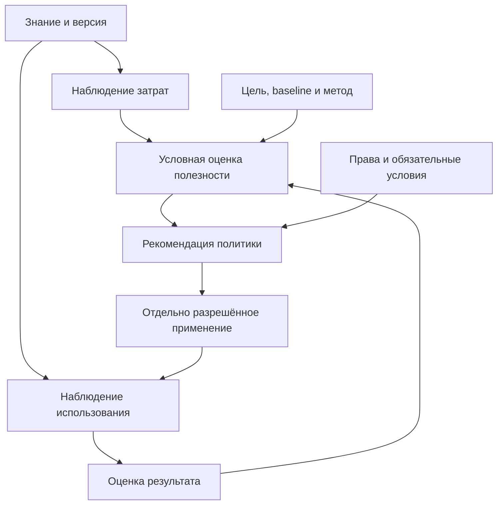

> **Редакторская копия.** Терминология унифицирована; научный статус — `concept_draft`. Основной текст и поздние дополнения сохраняют собственные области проверки и ограничения. Редактура не добавляет предметных опытов и не объединяет их выборки.

Словарь (glossary, not in this release) · [История уточнений и проверок](#editorial-technical-appendix) · [Навигация по статьям](../README.md#current-papers)

<!-- editorial-main:start -->
<a id="document"></a>
# Полезность знаний, стоимость смысловых артефактов и управление ресурсами

<a id="p13-abstract"></a>
## Аннотация

Работа предлагает способ связывать жизненный цикл смысловых артефактов с наблюдаемым расходом ресурсов, условиями применения и результатами для конкретных получателей. Предметом оценки является не универсальная «ценность текста», а вклад версии артефакта или набора артефактов в заранее заданную цель относительно явной альтернативы. Учитываются извлечение, проверка, преобразование, индексация, хранение, доставка, повторное применение, пересмотр и издержки самой оценки.

Разделены четыре уровня: факт расхода; факт участия знания; наблюдаемый результат; оценка добавочного вклада. Частота доступа, размер графа и число закрытых единиц работы (`WorkItem`) не заменяют последний уровень. Предлагаются вектор полезности, условный скаляр для конкретной политики и правила использования оценок при компиляции, ранжировании, переносе в архив и выборе дальнейшего исследования. Истинность, допустимость применения и ценность для получателя имеют самостоятельные статусы.

Предполагаемый вклад — **синтез и контрактный профиль**, связывающий существующие методы оценки информации, атрибуции вклада и экономического учёта с версионируемым циклом управления смыслами. Новая математическая теория ценности и эмпирическое превосходство не заявляются. Формальные свойства действуют при указанных предпосылках; конечные проверки не подтверждают причинную полезность в работающей организации.

<a id="p13-problem"></a>
## 1. Исследовательская постановка

Система приобретает артефакт k из источника, строит его связи, хранит версии и использует при запросах или работе. Инвестиция может окупиться многократным применением; может оказаться бесполезной; может породить вред или только административную активность. Одинаковый объект способен быть полезным для объяснения истории, непригодным для современной инструкции и обязательным для проверки происхождения ошибочного решения.

Исследовательский вопрос: при каких определениях целей, измерениях, сравнительных методах и ограничениях оценка полезности позволяет улучшать управление знанием? Он распадается на проверяемые вопросы: достаточно ли полон учёт затрат; различает ли метод участие и добавочный результат; устойчивы ли решения к редким важным знаниям, общим зависимостям и смене распределения запросов; превышает ли экономия стоимость наблюдения и оценки?

Информационные запросы, диалог, консультация, создание документа, исследование, планирование и действие имеют разные результаты. Универсальный критерий «задача закрыта» недостаточен. Для объяснения возможны понимание и корректность; для поиска — покрытие требуемых вариантов; для предупреждения — предотвращённый риск; для документа — проверяемость существенных утверждений; для действия — наблюдаемый эффект при соблюдённых условиях. Рубрика и адресат закрепляются до сравнения, а не выбираются после удобного исхода.

<a id="p13-related-work"></a>
## 2. Предшественники и границы переноса

Оценка информации в теории решений рассматривает изменение доступного выбора и ожидаемого результата. Экономическое метарассуждение позволяет сравнивать пользу вычисления с его ценой. Data Shapley предлагает распределение ценности обучающих данных для конкретной функции качества модели. Причинное оценивание и оценивание альтернативной политики (off-policy) требуют различать политику наблюдения и проверяемую альтернативу. Исследования петель обратной связи и эффектов типа Гудхарта объясняют, почему оптимизация удобного показателя способна испортить цель.

Эти результаты имеют разные объекты и предпосылки. Значимость обучающего примера не является готовой оценкой извлечённого знания в пакете контекста (`ContextPackage`). Наличие сведений о происхождении не устанавливает причинный эффект. Аддитивное распределение затрат в учёте не доказывает справедливость авторского вознаграждения. Метод вытеснения сетевого кэша не задаёт допустимость уничтожения источника знания. Точные карточки прочитанных разделов, альтернативы и ограничения: обзор X02 (MM_A0428, not in this release).

<a id="p13-estimand"></a>
## 3. Объект оценки и условность полезности

Оценка должна задаваться как функция области:

\[
V(k\mid q,c,\pi,h,b,r),
\]

где q — цель или распределение задач, c — получатель и контекст, π — политика применения и оценивания, h — горизонт наблюдения, b — альтернатива сравнения, r — закреплённые версии. Для множества S требуется V(S); в общем случае сумма оценок отдельных объектов не равна оценке множества. Легенда и схема, условие и инструкция, два источника подтверждения могут быть дополнениями или заменителями.

Предлагается сохранять вектор: качество результата; затраты потребителя; время; снижение неопределённости; предотвращённый ущерб; дополнительный ущерб; возможность будущего применения. Компоненты имеют единицы и статусы наблюдаемости. Некоторые выгоды могут быть прогнозными, а не измеренными. Отсутствующий результат обозначается unknown или pending; он не превращается в ноль.

Скаляр допустим только для конкретного решения с опубликованной политикой преобразования компонент. Например, две минуты задержки, один предотвращённый дефект и один рубль не складываются без заданного обменного отношения. Изменение весов, горизонта или набора заинтересованных сторон создаёт новую редакцию оценки. Если предпочтения не согласованы, сравнение остаётся многокритериальным; частичная упорядоченность является допустимым результатом. Если затем из полезности вычитаются затраты, политика отдельно закрепляет непересечение: один расход или его экономия учитывается либо в скаляре результата, либо в вычитаемой сумме реестра затрат. Для уже чистой полезности повторное вычитание тех же затрат недопустимо.

Качество источника, соответствие фактам, степень подтверждения, полезность для задачи и мотив автора не подменяют друг друга. Ложное утверждение может быть полезным как объект опровержения при точной атрибуции; это не делает его истинным. Достоверный факт может не помогать данному запросу. Отказ подтвердить жалобу не доказывает её ложность или злонамеренность автора.

<a id="p13-accounting"></a>
## 4. Учёт ресурсов по жизненному циклу

Для каждой операции фиксируется вектор фактического потребления: входные и выходные токены по принятой провайдером категории; CPU/GPU-время; длительность по часам; человеко-время; операции и объём I/O; трафик; занятые байты по времени; индексные обновления; проверки и повторные попытки. Счётчик операций и временные интервалы определяются явно. Сумма длительностей параллельных вызовов не равна задержке пользователя; физические реплики и логические сущности учитываются раздельно.

Денежный расчёт — производная от наблюдений, версии тарифов, валюты, даты и политики распределения общей инфраструктуры. Факт выставленного счёта, расчётная цена и прогноз не сливаются. Токены, их денежная цена и включающая их строка счёта не должны повторно увеличивать один итог. Реальная повторная попытка расходует ресурсы, а повторная доставка одной записи телеметрии не создаёт новый расход.

Идентичность расходного события должна включать область учёта и устойчивый event_id; несовместимая запись с тем же ключом выявляется как конфликт. Производное распределение затрат не копирует физический расход на каждого потребителя целиком. Общий оригинал, индекс и извлечение могут обслуживать множество смыслов. Записываются исходный расход, правило распределения, доли и остаток; сумма начислений в выбранной замкнутой области согласуется с расходом. Для другого вопроса возможно другое распределение затрат, но оно явно альтернативно первому.

Количество вершин и рёбер — показатель размера структуры. Оно не является денежной ценой, задержкой поиска или вычислительной сложностью без модели индекса, распределения запросов и измерений. Научный протокол должен измерять предельное изменение затрат при добавлении или переносе артефактов и учитывать их общие зависимости. Детальный профиль: учёт затрат и атрибуция (MM_A0418, not in this release).

<a id="p13-contribution"></a>
## 5. От участия к добавочному вкладу

Факт candidate_found, selected, delivered, consumed и cited описывает разные события. Указанный в ответе источник мог не повлиять на результат; доставленный фрагмент мог быть проигнорирован; невидимый потребителю локатор не является доставкой рисунка. Приёмка единицы работы подтверждает собственную процедуру приёмки, но не автоматически причинный вклад всех связанных знаний.

Для выбранной популяции задач D сначала фиксируются две интервенции и всё, что между ними изменяется. Для добавочного вклада k режимы \(\pi^{+k}\) и \(\pi^{-k}\) отличаются только объявленным доступом к точной версии k и заранее описанными следствиями этого доступа при остальных одинаковых правилах. В следующей формуле для этой постановки \(\pi+k=\pi^{+k}\), а \(\pi_b=\pi^{-k}\). Если меняются также другие компоненты политики, \(\Delta V(k)\) относится ко всему объявленному пакету изменений политики и не приписывается только k:

\[
\Delta V(k)=\mathbb E_{w\sim D}[U(Y_w(\pi+k))-U(Y_w(\pi_{b}))].
\]

Обе потенциальные реакции одного реального случая обычно одновременно не наблюдаются. Поэтому в реестре различаются наблюдение, ассоциация, модельный прогноз и причинная оценка. Случайная абляция на допустимом стенде, парные задания, кластерная рандомизация или корректная оценка иной политики требуют собственных предпосылок. Исторические журналы без вероятности назначения, поддержки альтернатив и условий идентифицируемости не создают причинный эффект по одной формуле.

Исключение одного участника (leave-one-out) характеризует разность конкретной полной коалиции и коалиции без k; суммы таких разностей могут повторно учитывать совместную выгоду. Shapley распределяет разность V(S)−V(∅) для заданной игры по всем порядкам добавления. Он полезен как правило распределения вклада при объявленных игроках и функции результата, но не создаёт отсутствующие V для реального мира и не доказывает единственный правильный способ вознаграждения. Преобразование одной записи в десять копий не должно менять число игроков без содержательного обоснования идентичности.

Сравниваются также число доступных возможностей применения, доля фактической экспозиции и зрелость наблюдений. Низкая частота использования может означать узкую область применимости, плохую находимость, отсутствие спроса, недоступность пользователю или короткий срок наблюдения. Если ранжирование исключает новые знания, они не получают результатов и остаются исключёнными — возникает эндогенная петля. Проверка требует исследовательского бюджета и независимых от ранжировщика выборок.

<a id="p13-complaint"></a>
## 6. Разбор примера жалобы

Письмо моделируется как сообщение с авторством, адресатом, временем и речевым актом жалобы (`complaint`). Из него извлекаются отдельные атрибутированные утверждения, требования, объекты и ограничения. Признаки анонимности, повторности, подтверждённости и предполагаемой намеренности имеют раздельные поля. Термины «клевета» или «злонамеренность» не присваиваются по отсутствию санкций.

Далее связываются рассмотрение, сбор свидетельств, решения и наблюдаемые последствия. Полезный результат определяется заранее: устранение подтверждённого нарушения, предотвращение ущерба, корректное установление отсутствия подтверждения, прекращение повторной бесполезной проверки, восстановление верной информации. Само появление расследования, наказания или большого числа документов не является такой метрикой.

Сценарий A: сообщение сообщает о реальном дефекте; проверка с независимыми основаниями позволяет устранить его. Сценарий B: нарушение не установлено, но корректная проверка предотвращает необоснованное наказание. Сценарий C: сообщение порождает десять закрытых бюрократических задач без дополнительного результата. Сценарий D: серия повторов добавляет новые независимые сведения, поэтому простое правило «часто жалуется — низкая полезность» теряет сигнал. Сценарий E: тот же текст не добавляет сведений; система связывает повтор с существующим делом и сокращает повторный расход, сохраняя сведения о происхождении.

Условия проверки и числовые синтетические разборы находятся в протоколе (MM_A0422, not in this release) и конечном профиле (MM_A0423, not in this release). Они исследуют качество решений и расход ресурсов, а не автоматически оценивают личные мотивы или полномочия людей.

<a id="p13-lifecycle"></a>
## 7. Решения по хранению и применению

Уже понесённая стоимость создания нужна для исторической экономики и распределения затрат. Для решения, держать ли объект в оперативном хранилище дальше, релевантны будущие изменения выгод и расходов. Выбор слоя a можно описать как максимизацию ожидаемой будущей ценности минус ожидаемых будущих затрат при фиксированном горизонте и обязательных ограничениях.

Ограничения включают необходимые зависимости, воспроизводимость, обязательную доступность, актуальные права и правила хранения в принятом контексте. Понижение слоя меняет задержку доступа, стоимость восстановления и вероятность недоступности в нужный срок. Высокая популярность не отменяет отзыв, устаревание или конфликт; отрицательная оценка не разрешает уничтожить единственный оригинал. Архивация, удаление индекса, прекращение прогрева, отзыв применимости и физическое удаление являются разными действиями.

Политика предусматривает режимы hot/warm/cold, наблюдение, исследовательское применение и отсутствие решения при недостаточных данных. Для редкого критического знания допускается обязательный оперативный доступ независимо от исторического счётчика использования. Для новых знаний требуется ограниченный бюджет исследования. Порог не назначается универсально: его калибруют на целевой нагрузке, с гистерезисом и учётом цены переходов.

Предварительная компиляция и кэширование становятся отдельной задачей ожидаемого выигрыша. Экономия сравнивает корректный холодный путь с подготовкой, хранением, проверкой пригодности, инвалидированием, обновлением и реальными повторами. Кэш входных вычислений провайдера (provider prompt/KV cache), кэш поиска, готовый пакет контекста и подготовленный профессиональный контракт имеют разные единицы и сроки; их выгоды нельзя складывать с повторным учётом одного сэкономленного вызова. Конкретная передача — I15–I18 (MM_A0419, not in this release).

<a id="p13-method"></a>
## 8. Программа проверки и опровержения

Вычислимость арифметики, правильность распределения затрат в учёте, точность прогнозной модели, идентифицируемость причинного эффекта и полезность управляющей политики требуют разных свидетельств. Проверка рациональной арифметики не подтверждает модель исходов; прогноз с низкой ошибкой не обязательно даёт лучшую политику хранения.

Исследовательская программа сравнивает простые альтернативы: отсутствие оценочного показателя, частоту/давность использования, затраты на восстановление, статические классы хранения, экспертную оценку и предложенную многокомпонентную политику. Корпус и разбиения фиксируются по происхождению источников, версиям, времени и случаям; зависимые повторы не считаются независимыми наблюдениями. Для экономии вводится заранее обоснованная граница допустимого ухудшения качества; для редких существенных исходов — отдельные страты и анализ чувствительности.

Сохраняются отрицательные результаты: дорогая оценка может съесть всю экономию; простая политика может оказаться не хуже; малая выборка не позволяет оценить редкий ущерб; новая политика меняет спрос и требует повторной проверки. Неподтверждённая жалоба и незрелый исход не объединяются в одну отрицательную метку. Абляция обязательного условия допускается только в контролируемом тестовом окружении с явной областью, а не как инструкция подвергать реальных людей риску.

Шесть адресуемых гипотез X02, альтернативы и критерии пересмотра: научные утверждения и свидетельства (MM_A0427, not in this release). Предметные кейсы остаются planned/not_executed до реальных наблюдений. Формальные свойства и конечные проверки публикуются отдельно от результатов таких кейсов.

<a id="p13-feedback-architecture"></a>
## Контур наблюдения, оценки и пересмотра



Стрелка обозначает зависимость данных или решения, а не автоматически установленную причинность. Обратная связь меняет доступность знания и распределение последующих наблюдений; поэтому версия политики, оценка наблюдаемости и независимая проверка результата входят в контракт. Полная телеметрия не передаётся в каждый пакет контекста. Цена сбора и пересчёта измеряется отдельно в инженерном контуре (MM_A0421, not in this release).

<a id="p13-engineering"></a>
## 9. Связь с инженерной реализацией

Существующая запись проверки (`EvidenceRecord`) получает отдельные профили наблюдения затрат (`CostObservation`), наблюдения использования (`UsageObservation`), оценки результата (`OutcomeAssessment`) и оценки полезности (`UtilityAssessment`). Они не добавляют четыре универсальных типа в онтологию. Различаются неизменяемые события и пересчитываемые представления. Рекомендация по слою оформляется профилем решения о хранении (`RetentionDecision`) той же записи проверки; она не равна фактически исполненному изменению хранилища. Пакет контекста передаёт закреплённые ссылки на применённую оценку и политику, а текущее решение проверяет новые права, требования и существенные условия самостоятельно.

Предлагаемые места реализации: Model Connector для происхождения сведений о потреблении ресурсов; Run Ledger и Observability для связанных событий; Muneral для единиц работы, попыток и приёмки; Wiki Arcana/Scrutator для наблюдений поиска и применения; Disk/DBS для физического хранения и стоимости слоёв; Canon для версий политики; Talomnia для рубрик результата и коммерческого учёта. Эти назначения требуют проверки конкретных API и владельцев. Run Ledger — контекстный кандидат локального реестра, а не подтверждённая этим проходом позиция публичного каталога; его интерфейс не обследован. Экономическая атрибуция результата не является сама по себе договором авторского вознаграждения.

Профиль и целевые интерфейсы: модель полезности (MM_A0430, not in this release), инженерные изменения (MM_A0421, not in this release). Закрепление в пакете: I14 (MM_A0440, not in this release). Общая схема исполнения: архитектура Arcanada/Talomnia (MM_A0075, not in this release).

<a id="i12-scientific-stance"></a>
## 10. Паспорт научного утверждения

Паспорт следует общему научному стандарту и градации свидетельств (MM_A0388, not in this release). Статус: исследовательское предложение с условными свойствами и выполненными конечными проверками; эмпирическая полезность политики не установлена.

**Предмет:** концептуальная модель условной полезности и ресурсной экономики; синтез предшественников с контрактным профилем. Якорь научного статуса сохранён в общем формате паспорта серии работ.

**Центральное проверяемое утверждение:** при корректном учёте стоимости, независимой оценке результатов и ограничениях доступности управляемая по условной полезности политика улучшает стоимость корректного результата относительно сильных простых альтернатив в заданной нагрузке.

**Наблюдаемые исходы:** полная цена, качество и вред по рубрике; задержка; потери редких знаний; стоимость переоценки; доверительные интервалы и причины отказов.

**Сильная альтернатива и контраргумент:** частота/давность плюс статические классы хранения при той же проверке актуальности и прав. **Основание пересмотра:** отсутствие практически значимого выигрыша, ухудшение защищённых исходов, неустойчивая атрибуция, слишком высокая цена наблюдения либо нарушение предпосылок причинного сравнения.

**Следующие владельцы:** I15–I18 — компиляция и повтор; I23–I27 — результаты разных взаимодействий; I28 — действующие интеграции; I30–I32 — пилот, фиксация и подтверждающие опыты; I33 — пересмотр итоговой теории. Завершение X02 означает подготовку адресуемой исследовательской программы и конечного профиля, не закрытие этих будущих работ.
<!-- editorial-main:end -->

<a id="editorial-technical-appendix"></a>
## Историко-техническое приложение: уточнения, проверки и основания

Здесь сохранены адресуемые передачи и результаты прежних проходов. Это часть научного материала: поздние наблюдения читаются вместе с их ограничениями. Исторические коды и обозначения оставлены для связи с источниками; написание единицы работы приведено к `WorkItem`. Уровни заголовков вложены в приложение; текст и порядок исторических блоков сохранены.

### Исходный паспорт и редакционная рамка

Ниже приведена исходная шапка читательской сборки; её отметка о замене только маршрутов ссылок относится к исходной сборке, а не к этой редакторской копии.

```text
<!-- Reading projection MM_PUB_READ_P13 r1; content source MM_A0446 / MM_G1_20261028_v1. Public release: link targets rewritten to repository routes or marked as not in this release; see receipts/meaning-management/. Not a new scientific acceptance. -->

---
project_version: "0.35"
id: P13
version: "0.1"
extension: X02
status: concept_draft
evidence_status: research_proposal
knowledge_contract_target: "3.0.0-draft.1"
language: ru
---

> **Текущая редакционная рамка G1 — 28 октября 2026.** Основание этой копии — R44 / 0.44.0; адресные поправки закреплены в G1-реестре. Унаследованная шапка и номера основных редакций ниже описывают исходные документы, а не сводный статус поздних опытов. Основной текст, датированные передачи и дополнения R37–R44 читаются в их собственных областях. I30 остаётся `in_progress_editorial`, I31–I33 — плановыми. Эта рецензия и исправления формулировок не являются новыми предметными опытами или подтверждением общего преимущества. Точный исходник R44 и прежние оценки сохранены отдельно; изменённые места перечислены в `PATCH_LEDGER.json`.
```

<!-- preserved-history:start -->
<a id="i15-reuse-handoff"></a>
### Передача I15: проверяемое повторное применение

**Следующий владелец:** I17. **Научное основание:** I15 (MM_A0458, not in this release), [P12](P12_compilation_caching_and_reuse.md).

**Обязательство:** Передавать UtilityAssessment с goal/population/baseline/horizon/policy/revisions; оценивать будущую маржинальную пользу reuse и цену её измерения.

**Проверка:** Наблюдаемая популярность, sunk cost и причинная полезность не отождествляются. Постановка I15-C26 (MM_A0455, not in this release).

Это адресный вход будущей итерации. Конечная модель I15 проверяет объявленный локальный профиль; предметные кейсы, распределённые сервисы и экономическая эффективность остаются отдельными запусками.


<a id="i17-reuse-policy-handoff"></a>
### Передача I17: сроки, допуск и независимое хранение

**Следующий владелец:** I33. **Основание:** I17-D11 (MM_A0494, not in this release).

**Обязательство:** Связать полезность с допустимым множеством действий, целью, baseline, stakeholders, горизонтом и полным ресурсным расходом. Различать наблюдаемое использование, ассоциацию, причинную оценку и отдельное решение о хранении.

**Проверка:** Популярность не равна полезности и не продлевает применимость; денежный выигрыш не оправдывает запрещённую выдачу; не измеренный эффект не получает числовой коэффициент из заполненных полей.

Пользовательская идея коэффициента полезности требует условной, проверяемой оценки и не должна отменять независимые ограничения знания. Это принятое редакционное обязательство следующего прохода; оно не объявляет выполненными системные сценарии, интеграцию или эмпирическую проверку.

<a id="i18-identity-invalidation-handoff"></a>
### Принятое уточнение I18: идентичность и пересмотр

Измерять стоимость field precision, authority reads, reconciliation и ложных пересмотров при одинаково допустимых результатах.

**Проверочное обязательство:** Рост hit rate при ошибочных выдачах не объявляется экономией; новые цены меняют utility projection без изменения source bytes.

**Основание:** I18 (MM_A0532, not in this release), адресная передача I18-D09 (MM_A0529, not in this release). Состояние — редакционно принятое требование; продуктовая реализация и предметные/нагрузочные испытания сохраняют свои отдельные статусы.


<a id="i19-ingestion-handoff"></a>
### Принятое уточнение I19: подготовка базы и согласованная видимость

Физический cost event учитывается один раз; атрибуция по производным не создаёт повторного расхода.

**Проверочное обязательство:** Два смысла из одной OCR-операции не удваивают физический cost event; новый оплаченный retry остаётся отдельным расходом.

**Основание:** I19 (MM_A0559, not in this release), адресная передача I19-D12 (MM_A0550, not in this release). Это редакционно принятое требование. Конечная модель проверяет свой локальный профиль; продуктовые, предметные и нагрузочные испытания сохраняют отдельные статусы.


<a id="i20-compilation-handoff"></a>
### Принятое уточнение I20: компиляция и публикация

Физические cost events, ограничение риска расхода, распределение совместной стоимости и приращение полезности разделены; unknown не равен нулю, отмена не возвращает уже потраченный ресурс.

**Проверочное обязательство:** Late charge после cancel не исчезает; общий physical cost не умножается по потребителям и не объявляется причинной выгодой.

**Основание:** I20 (MM_A0582, not in this release), адресная передача I20-D12 (MM_A0575, not in this release). Это редакционно принятое требование; конечная модель, продуктовая реализация и предметные испытания имеют отдельные области и статусы.


<a id="i21-reuse-refresh-handoff"></a>
### Принятое уточнение I21: повторение, обновление и публичные интерфейсы

Полная стоимость включает проверки, ожидание, refresh/retry, восстановление и выдачу; полезность считается для достигнутой цели. Неуспешный refresh сохраняет сроки и фактические расходы.

**Проверочное обязательство:** Hit или shared refresh не записывается как экономия, если итоговая цель не достигнута либо расходы вынесены из знаменателя.

**Основание:** I21 (MM_A0603, not in this release), адресная передача I21-D12 (MM_A0594, not in this release). Текущий owner — I15; это редакционно записанное обязательство. Конечная модель, продуктовая реализация, публичный deployment и предметные испытания сохраняют самостоятельные области и статусы.


<a id="i22-query-route-handoff"></a>
### Принятое уточнение I22: полный ограниченный маршрут запроса

Оценивать пригодный результат и полную стоимость всего маршрута, включая failed/late/unknown и shared physical work.

**Проверочное обязательство:** Меньше passages или citations не равно меньшей цене либо причинной полезности.

**Основание:** I22 (MM_A0627, not in this release), адресная передача I22-D17 (MM_A0617, not in this release). Текущий owner — I15. Это редакционно записанное обязательство; конечная модель, продуктовая интеграция, публичный deployment и предметный опыт имеют самостоятельные gates.

<a id="i23-evidence-handoff"></a>
### Передача I23: рассуждение, свидетельства и самостоятельная проверка

Польза evidence workflow требует сравнения с корректным baseline и совместного учёта ошибок/ресурса.

**Критерий:** Успех отрицательного контроля не становится доказательством экономической выгоды.

Основание: I23 (MM_A0667, not in this release). Владелец принимающего решения — I15; инженерная реализация и предметное подтверждение имеют собственные статусы.


<a id="i24-dialogue-learning-handoff"></a>
### Передача I24: диалог, память и условия обучения

**Владелец следующей проработки:** I15. **Статус:** адресное редакционное обязательство; реализация и общий эмпирический вывод не объявлены.

Стоимость уточнения/восстановления/проверки и польза общения измеряются отдельно от внешнего действия.

**Проверка:** Нулевая стоимость поиска при бесполезном отказе не считается преимуществом.

Основание: контракт I24 (MM_A0713, not in this release).


<a id="i26-kc-synthesis-handoff"></a>
### Передача I26: ядро KC v3 и профессиональное применение

**Следующий владелец:** I30. **Основание:** I26 (MM_A0806, not in this release).

**Обязательство:** Полезность профиля связывается с реальным результатом, baseline и полной ценой.

**Проверка:** Включение или цитирование не становится причинным вкладом; unknown outcome не равен нулю.

Это адресуемое редакционное обязательство. Production-интеграция и эмпирическая полезность требуют собственных свидетельств; конечный профиль I26 не снимает эти условия.


<a id="i27-work-execution-handoff"></a>
### Передача I27: исполнение, исход и точная приёмка

**Следующий владелец:** I30. **Основание:** I27 (MM_A0861, not in this release).

**Обязательство:** Учитывать failures, reconcile и подготовку в полной цене; сравнивать с сильным прямым workflow.

**Критерий:** Число passes, inclusion или receipt не доказывает causal utility и royalty.

Локальный профиль I27 сохраняет один SQLite effect на стабильный work_id, точный KC pin и проверку фактической записи. Контекст прав/способностей доверенный; внешние сервисы, компенсация, семантическая полнота и эмпирическая полезность требуют отдельных свидетельств.


<a id="kc-atlas-review-20261026"></a>
### R34. Применение, причинная полезность и денежное обязательство

Согласование сохраняет границы X02: retrieved, selected, included, used, recognized contribution и payable — разные события/решения. Доля в AttributionManifest не равна причинной полезности знания; lineage не задаёт бессрочную денежную долю. Для Talomnia нужны exact version bindings между use evidence, признанным вкладом, действующими правами, правилом расчёта и событием расчёта. Проверенная арифметика исходного kit не удостоверяет реальную оплату, права или identity. Производственная royalty-система остаётся отдельной работой.

**Статус:** редакционное уточнение; новые прикладные профили не реализованы. **Основание:** RECONCILIATION_REVIEW.md (MM_A0886, not in this release).


<a id="i28-integration-handoff"></a>
### I28. Цена эволюции и непрерывность расчётов

Цена политики включает impact search, повторные оценки, миграции, сохранение истории и ошибки допуска. Split/merge смыслов либо новый контракт не меняют прошлые вклады, доли и settlement автоматически: нужны отдельная экономическая политика, версия и основание корректировки.

**Статус:** адресное редакционное/архитектурное уточнение с отдельными runtime gates. **Следующий владелец:** I30. **Основание:** [правило эволюции](../../spec/ru/KNOWLEDGE_EVOLUTION_CONTRACT.md), точные интерфейсы и границы (MM_A0953, not in this release).


<a id="i29-test-specifications"></a>
### I29: конкретные спецификации будущих проверок

Стоимость обновления, ожидания и проверки связывается с качеством и актуальностью; синтетическая арифметика не является экономическим измерением.

Связанные семейства исходного каталога: Общий вводный синтез; отдельные номера кейсов не приписаны.

Все соответствующие случаи остаются `specified_not_executed`; actual отсутствует. Подготовлены точные входы, требуемые промежуточные записи, required/forbidden criteria и human rubric. Положительные и отрицательные примеры являются авторскими кандидатами, независимая калибровка не выполнена.

Основания: I29 (MM_A1500, not in this release), границы выводов (MM_A1506, not in this release), история обзора (MM_A1502, not in this release), следующие gates (MM_A1499, not in this release). Исторические экспериментальные статусы и результаты этой статьи не повышаются задним числом.


<a id="i30-local-development-pilot"></a>
### I30. Наблюдаемые ресурсы без преждевременной оценки полезности

Cache-пилот (MM_A2712, not in this release) отдельно учёл 654 setup, шесть cold, 72 warmup и 864 measured-вызова; CPU процесса и elapsed time записаны по фазам, расходы observer и archive — отдельно. Сохранённые SQLite-снимки имеют измеренные размеры. Это наблюдения локального расхода, из которых не выводилась цена сервера, токенов или денежная отдача. Медиана парных отношений задержки 0,9982 сохраняет отсутствие установленного устойчивого выигрыша.

В нагрузочной серии (MM_A2719, not in this release) все 2 094 предъявления входят в баланс, включая 509 отказов и три отмены. Единица scheduler — объявленное подготовительное ожидание, а не CPU/токен/валюта; эти величины не складываются без модели. Факт использования артефакта и сохранённая receipt не оценены как причинный вклад знания, компетенция или обязательство выплаты контрибьютору. Для экономических решений P13 остаются нужны фактический полезный исход относительно сильной альтернативы, полные затраты выбранного процесса и отдельная политика Talomnia; I30 ещё не завершён (MM_A2728, not in this release).


<a id="i30-model-boundary"></a>
### I30 / R38: Происхождение величин и неполная стоимость

Каждая экономическая величина должна иметь единицу, происхождение и полноту. Локально измеренные CPU или wall time, provider usage, tokenizer estimate, расчёт по тарифу и фактический счёт относятся к разным основаниям. Фиктивные counters и ставки позволяют проверить арифметику, но сохраняют synthetic origin и условную денежную единицу. Missing usage, неизвестная валюта или неподходящий model rate не становятся нулевым расходом.

Ledger охватывает подготовку, преобразование, хранение, запросы, retries, отказанные публикации, review и восстановление. Shared work учитывается один раз с явным правилом распределения; повторный send не исчезает за одним logical request ID. Стоимость полезного результата показывается вместе с coverage, отказами и unknown, иначе преждевременная остановка может выглядеть экономией. Для cached input и reasoning subsets исключается двойной счёт согласно семантике выбранного тарифа. Экономическое сравнение требует совместимых единиц и одинакового качества результата. Оно не устанавливает причинную полезность знания, справедливую долю участника или право выплаты. Эти выводы зависят от самостоятельных наблюдений и договоров, которые модельный transport adapter не заменяет.

Область R38: архитектура модельной границы (MM_A4499, not in this release), приёмка (MM_A4509, not in this release), парный протокол (MM_A2739, not in this release).


<a id="i30-structured-semantic"></a>
### I30 / R39: Стоимость ограниченного результата и пригодный знаменатель

Экономическое сравнение требует определить, какой результат считается достаточно проверенным. В R39 исходные 193 `met` у A и 197 `met` у B относятся к критериям, а не к числу полностью корректных знаний. Последующий разбор обнаружил пропущенные противоречия scope в assessment B и неполное распознавание оценщиком части результатов A. Поэтому делить затраты на эти сырые суммы как на число пригодных результатов нельзя. Архитектура и результаты (MM_A5295, not in this release) дают журнал конкретного опыта; полезность для пользователя и качество всех обязанностей требуют своих оснований.

Для локального запуска различаются время функции, время всего процесса и peak RSS всего рабочего процесса. Эти наблюдения не равны затратам на отдельный смысловой объект, native usage модели или денежному счёту. В срезе нет native-модельных вызовов и испытаний людей; из этого не следует нулевая стоимость разработки, подготовки материала, хранения и последующего разбора. Сравнение экономичности должно включать сопоставимые ресурсы, одинаковые правила качества и неизвестные компоненты, сохраняя происхождение каждой величины. Наличие 20 успешных контролей на вариант не квалифицирует стоимость любых будущих задач.

Жизненный цикл опыта включает исходные 80 вызовов, сохранённые неопределённости, проверку оценщика и обнаруженные противоречия. R0 не заменялся улучшенным запуском после разбора, поэтому расходы и результаты нельзя переотнести к новой процедуре задним числом. Карта пробелов и следующего шага (MM_A5300, not in this release) задаёт требования к будущему сопоставлению полезного результата и полной стоимости. Из нынешних данных не устанавливаются экономический победитель, причинная ценность знания, доля вклада участника или право выплаты. Эти выводы требуют отдельно определённых объектов, договоров и наблюдений.


<a id="i30-structured-regression"></a>
### I30 / R40: Экономический знаменатель после проверки инструмента

Оценка полезности и затрат начинается с определения пригодного результата. В R1 суммы `met`, `violated` и `unknown` изменялись также из-за mapping defects оценщика. Поэтому деление времени на число положительных критериев не даёт стоимость одного корректного знания. Критерии, subject calls, пары, fixtures квалификации и адресные audit checks имеют разные знаменатели и не становятся независимыми единицами полезности при суммировании.

Контролируемое сопоставление R1/R2 сохраняет subject code и exact inputs/rules, чтобы отделить изменение измеряющего инструмента от изменения предметного решения. Оно помогает установить источник различий в scores, но не измеряет экономическое превосходство A или B. Журнал результатов (MM_A9112, not in this release) должен сохранять каждую попытку и ресурсные величины с их собственной областью: время функции, время процесса и peak RSS не являются взаимозаменяемыми показателями.

Гипотеза для будущего экономического опыта: система с явной областью assessment и targeted review может снижать стоимость поддержания пригодных знаний при эволюции контрактов. Её проверка требует одинакового quality gate, известного распределения изменений, затрат подготовки и пересмотра, времени contributors и агентов, хранения и отказанных применений. Неизвестные компоненты нельзя заполнять нулями. В этом срезе native model calls и human executions равны нулю, однако стоимость разработки и исследования этим не становится нулевой.

Архитектурное дополнение (MM_A9104, not in this release) задаёт provenance будущих assessments, а следующий протокол (MM_A9114, not in this release) сохраняет неисполненные экономические обязанности. Ни успешная finite qualification evaluator, ни число новых graph records не устанавливают причинную полезность знания, размер вклада участника или право выплаты. Для этих выводов нужны отдельные objects, contracts, наблюдения и критерии принятия.


<!-- I30_READER_R41_APPENDIX -->
<a id="i30-r41-p13"></a>
### I30 / R41: цена воспроизводимого знания и раздельные знаменатели

Книжный корпус делает видимым различие между размером текста и стоимостью полного материала. Для проверки источника нужны PDF, изображения, версии транскрипции, manifests и журналы. В compact replay достаточно выбранных фрагментов и трёх embedded PNG; полный повтор source audit требует внешнего exact корпуса. Эти уровни хранения должны быть объявлены, иначе небольшой архив будет ошибочно принят за полную воспроизводимость, а большой — за бесполезное разрастание текста. Граница доставки (MM_A10273, not in this release).

Наблюдаемые byte counts относятся к конкретным артефактам. Они не измеряют полезность знания, model tokens, время понимания либо денежную цену. Аналогично 6 базовых OCR units, 12 controls, 5 594 flags и 169 ledger edits имеют разные знаменатели. Число исправленных locators нельзя считать числом новых полезных знаний, а сохранённый hash — единицей экспертного результата.

Адресный пересмотр создаёт экономическую гипотезу: явные зависимости могут уменьшить повторную работу, когда меняется лишь часть источника или правил. Четыре из шести выбранных фрагментов действительно сохранили текст между версиями, но из целевого отбора нельзя оценить ожидаемый cache hit rate. Необходимо измерить реальное распределение изменений, стоимость построения graph/mapping, проверки unchanged fragments, хранения истории и обработки unresolved случаев.

Сравнение должно включать сильную простую альтернативу при одинаковой пригодности результата. Если разработка сложной provenance-трассы стоит больше, чем сэкономленная повторная проверка, экономическое преимущество не установлено, даже когда интерфейс научно полезен. Участие contributor или агента не тождественно добавочному вкладу и праву выплаты. Причинная полезность, человеческое время и производственная стоимость остаются отдельными обязанностями I30. Дальнейшая программа (MM_A10279, not in this release).

В R41 записаны фактические локальные времена двух запусков, однако контролируемого performance benchmark не было. Before-run note предполагал конкурирующие публикационные replay, а по сообщению root оба завершились до старта предметного reader; frozen bytes сохранены вместе с erratum. `RLIMIT_AS=512 MiB` ограничивает виртуальное адресное пространство, тогда как Linux maxRSS — отдельный максимум свежего процесса с runtime preload. Эти величины не дают сравнения продуктовой стоимости A/B. Границы измерений (MM_A10271, not in this release).


<!-- I30_ADDRESSABILITY_R42_APPENDIX -->
<a id="i30-addressability-r42"></a>
### Дополнение R42. Цена проверяемого представления и отсутствие установленного выигрыша

Результат R42 не устанавливает экономического преимущества Knowledge Contract. В адресном пересмотре графовая и простая реализации совпали во всех 30 парах; измеренное локальное время включает общий evidence validator и не является latency продуктового сервиса или стоимостью native inference. Содержательная правильность на размеченном наборе необходима для будущего сравнения ресурсов, но ещё не определяет его исход. Границы измерения (MM_A10830, not in this release).

Корпус показывает дополнительные статьи затрат, которые легко исключить из удобной модели. Нужно получить точные исходники, поддерживать version pins, хранить mapping, разбирать unresolved coordinates, проверять историю и доставлять оговорки вместе с утверждениями. Derivative добавляет статусы 917 описаний и 153 точных поля неопределённости. Это увеличивает объём представления и работы потребителя; потенциальное снижение ошибок должно оцениваться отдельно. Само наличие служебных полей не является измеренной полезностью.

917 описаний уже произведены внешним OCR/VLM-конвейером и импортированы в опыт. Они не являются 917 новыми controlled model calls R42; затраты их первоначального получения в текущем опыте не измерены. Новые subject native-model calls и human trials равны нулю. Смешение этих счётчиков создало бы ложную оценку цены эксперимента и повторного применения. Происхождение derivative (MM_A10363, not in this release).

Для следующего сравнения следует заранее определить единицу полезного результата и включить полную стоимость подготовки, проверки, хранения, доставки и пересмотра. Ветви должны иметь одинаковые evidence и критерии качества, а неизвестные или отказные исходы учитываться отдельно от успешно применённых знаний. Равенство на конечном наборе оставляет открытой гипотезу, что простая реализация окажется дешевле; обратная гипотеза требует наблюдаемого выигрыша на более сложных зависимостях. Ни одна из них не принимается по числу объектов, связей или пройденных fixtures. Дальнейшая проверка (MM_A11037, not in this release).


<!-- I30_SEMANTIC_TRANSFER_R43_APPENDIX -->
<a id="i30-semantic-transfer-r43"></a>
### Дополнение R43. Знаменатель полезного результата после фактического модельного пилота

R43 впервые в этой линии добавляет отдельный набор из 16 свежих subject-ответов по восьми парным задачам. Это не те же операции, что обработка 917 существующих описаний, построение структурных графов или выполнение контрольных предикатов. Первоначальная цена импортированных описаний в текущем опыте не измерялась. Поэтому стоимость нового пилота нельзя получать ни делением на 917 записей, ни сложением всех технических проверок в общий знаменатель. Единица смыслового опыта (MM_A11619, not in this release).

Обе формы выполнили восемь source-based задач и получили одинаковые максимальные оценки по двум смысловым критериям. Равенство конечного качества оставляет открытым сравнение затрат, а различие количества полей и рёбер не устанавливает экономического преимущества. Полный token usage, параметры decoding и задержка закреплённого native backend недоступны. Объём ответов 4 054–9 122 символа находится ниже мягкого предела 12 000, но символы не являются денежной или вычислительной единицей. Наблюдаемые оценки (restricted external basis).

Адресная QA также требует осторожного экономического толкования. Из 153 непустых оговорок семь записей направлены на ограниченную проверку из-за явно отмеченного обрыва; 146 остальных не включены в эту очередь. Такой результат означает исполнение определённой политики маршрутизации. Он не равен доказанной экономии 146 повторных OCR-вызовов: эти вызовы не планировались как обязательные, не выполнялись, а правильность оставшихся описаний не удостоверена. Границы QA-результата (MM_A11093, not in this release).

Полная стоимость должна включать подготовку источников, сохранение raw outputs, контрольные случаи, валидацию координат, сопровождение старых версий, оценивание и исправление выявленных dependency-пробелов. Структурные графы и отдельный semantic slice увеличивают число доступных представлений, но их полезность зависит от последующей задачи и потребителя. Размер архива и число объектов не заменяют наблюдаемого вклада в результат.

Следующее сравнение P13 должно заранее определить полезный принятый исход, одинаковый уровень содержательной и исполняемой корректности и полный измеряемый ресурсный контур. Возможность более дешёвой сильной плоской реализации остаётся открытой наряду с возможностью выигрыша графового повторного использования. Текущий выпуск не выбирает одну из этих гипотез по удобному суррогату и не заявляет установленной экономической выгоды.


<!-- I30_EXECUTABLE_PROJECTION_R44_APPENDIX -->
<a id="i30-executable-projection-r44"></a>
### Дополнение R44. Полезная проекция как экономическая единица с явной областью

Экономический учёт R44 уточняет, что именно может считаться полученным результатом. Десять новых модельных ответов породили 24 отдельных представления по запросам, а 72 диагностических извлечения использовали уже сохранённые ответы R43. Эти операции различаются первоначальными затратами и возможностью повторного применения. Стоимость ответа нельзя автоматически делить на число его проекций, а механические проверки не должны увеличивать знаменатель как новые успешные модельные задачи.

По заранее заданной рубрике обе формы выполнили пять задач, а все 24 проекции сохранили требуемый смысл. Это даёт конечный знаменатель данного пилота без сравнительного преимущества графа. Сохранённые ответы A/B содержат 35 652 и 31 665 Unicode-символов, включая форматирование и конечную новую строку; такое измерение не является оценкой вычислительных затрат. Измерения (MM_A13308, not in this release).

Новый предел max_entities измеряет количество записей в обязательном замыкании. Он полезен для проверки отказа без потери оговорки, но не заменяет токены, latency, денежные расходы или память конкретного исполнения. Native gate остаётся NOT_RUN; точная конфигурация и полный usage фиксированного backend не получены. Поэтому разница объёма синтаксиса A/B и равенство технических исходов не дают измеренного ресурсного преимущества. Протокол и ограничения (MM_A13350, not in this release).

Инженерная работа также имеет собственную единицу учёта. Два прохода сериализатора обработали 917 уникальных записей, всего 1 834 обработки, сохранив прежние данные и неопределённости. Это затраты на публикационную проверку и историю, а не новая цена распознавания. Получение семи исходных JPEG общей длиной 938 188 байт подтверждает объём перенесённых исходных данных. Один из них использован в двух новых визуальных ответах; весь набор семи описаний повторно не создавался, поэтому экономию адресной QA и улучшение качества оценить ещё нельзя.

Для проверки полезности требуется связать расходы с конкретным допустимым применением. Проекция с правильным числом, но потерянным условием может оказаться дешёвой и непригодной; полный контекст может быть достаточным, но дорогим. Следующий сравнительный опыт должен учитывать построение, проверку, хранение, выдачу и пересмотр, сохраняя одинаковые критерии достаточности для обеих альтернатив. R44 делает эти границы наблюдаемыми, не назначая универсальную цену смысловому узлу и не объявляя теорию экономически подтверждённой.
<!-- preserved-history:end -->
