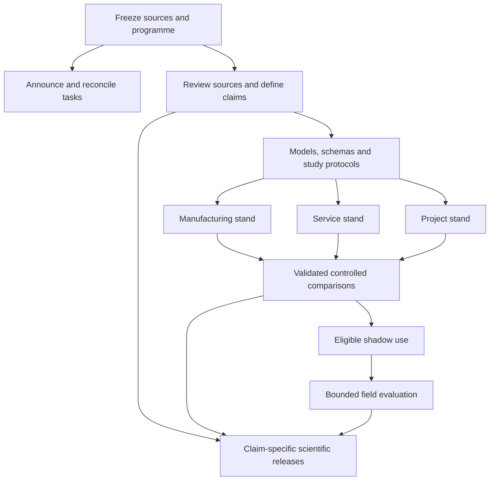

# Coordinated Work: Execution Programme and Research Delivery

Prepared 18 November 2026. Status: **source proposal for reconciliation and review**. Muneral remains the authority for actual task identities, assignments, dependencies and execution states.

This programme has **23 epics, 104 work packages and 247 output-consuming blocking edges**. It preserves all **72 original steps**, adds **32 explicit missing work packages**, and maps **16 potential papers and 12 hypotheses**. The [machine-readable graph](execution-graph.json) and [complete task contracts](TASK_CONTRACTS.md) are the source for registration. The [Russian programme](PROGRAMME.ru.md) and [Simplified Chinese programme](PROGRAMME.zh-Hans.md) present the same scope tables and bind their source to this English text.

The 104 entries are work packages. Broad review batches, benchmark families and publication templates must be split into bounded children before dispatch. A proposed owner is not an actual assignment. The 128 programme/epic/package objects prepared for reconciliation are not 128 created Muneral objects.

## Starting evidence and intended contribution

The [initial research package](https://github.com/Arcanada-one/knowledge-contract/tree/ea698baa3d4997b56c725d806c600173aa6064b9/roadmap/coordinated-work) retains 1,176 bibliographic records: 157 checked primary records and 1,019 citation candidates. Unique-work identity remains unresolved (26 title/year groups and four near-title pairs); completed full-text critical appraisals are zero. The retained revision-2 probe has 10 scenarios, 100 case-period observations and 190 elementary checks. These support a bounded numerical implementation claim, not agent effectiveness or validity for a real organization.

The proposed contribution is an organizational domain profile connecting needs, work networks, distinct resource semantics, competencies and decision evidence to Agent Situation and Context Assembly. Novelty must survive comparison with existing research; no new native KC artifact kind or execution authority follows from introducing a profile.

## First epic: make the programme visible and actionable

CW-EP00 covers source freezing, the programme charter, this graph, EN/RU/zh-Hans Journal announcements, roadmap and repository navigation, native task reconciliation, verified public delivery and a bounded collective handoff. An accepted announcement may ship while native registration is pending; N08 requires both publication and registration receipts before the complete launch handoff closes.

| Package | Observable output | Proposed accountable / executor | Blocking inputs |
| --- | --- | --- | --- |
| [CW-N01](TASK_CONTRACTS.md#freeze-programme-inputs-and-evidence-boundary-cw-n01) — Freeze programme inputs and evidence boundary | Source and evidence freeze manifest | KC-Brain / KC-SWE | Source inputs only |
| [CW-N02](TASK_CONTRACTS.md#define-programme-charter-and-output-families-cw-n02) — Define programme charter and output families | Programme charter and output inventory | KC-Brain / KC-SWE | CW-N01 |
| [CW-N03](TASK_CONTRACTS.md#build-and-validate-execution-graph-cw-n03) — Build and validate execution graph | Versioned execution programme and coverage validator | KC-Brain / KC-SWE | CW-N02 |
| [CW-N04](TASK_CONTRACTS.md#prepare-enruzh-hans-announcement-bundle-cw-n04) — Prepare EN/RU/zh-Hans announcement bundle | Three-language announcement and research cards | KC-Brain / KC-SWE | CW-N02, CW-N03 |
| [CW-N05](TASK_CONTRACTS.md#publish-repository-and-roadmap-programme-entries-cw-n05) — Publish repository and roadmap programme entries | Repository and roadmap announcement integration | KC-Brain / KC-SWE | CW-N03, CW-N04 |
| [CW-N06](TASK_CONTRACTS.md#register-and-read-back-muneral-graph-cw-n06) — Register and read back Muneral graph | Muneral registration and exact readback ledger | KC-Brain / KC-SWE | CW-N03 |
| [CW-N07](TASK_CONTRACTS.md#deliver-announcement-and-programme-landing-cw-n07) — Deliver announcement and programme landing | Published three-language launch receipt | KC-Brain / KC-SWE | CW-N04, CW-N05 |
| [CW-N08](TASK_CONTRACTS.md#complete-collective-handoff-and-first-work-batch-cw-n08) — Complete collective handoff and first work batch | Collective ownership and bounded first-batch handoff | KC-Brain / KC-SWE | CW-N06, CW-N07 |

Launch acceptance includes exact source and translation bindings, rights/attribution, independent review at the stated scope, hosted validation, an explicit rollback revision, publication workflow and anonymous served-page readback. Browser inspection must verify that the actual article is visible on desktop/mobile and that language switching preserves the issue; metadata or a lexical HTML check cannot establish those properties.

## Parallel delivery sequence

The following diagram is an overview, not the authoritative 247-edge graph. Every real blocking edge in the JSON names the predecessor output it consumes.



1. **Launch and reconciliation.** Freeze source/evidence, publish the truthful programme description, reconcile existing Muneral work and prepare the first bounded batch.
2. **Parallel foundations.** Review primary sources, define needs/resources/work graphs, build the provenance schema, define rights and data contracts, and register study-specific questions.
3. **Parallel domain stands.** Build manufacturing, service and project families after their own required inputs. Run independent oracles and model-validity checks before confirmatory comparison.
4. **Controlled evidence.** Compare the current method, strong OR, no-retrieval agent, strong ordinary RAG and full KC profile under declared matched budgets; retain ablations, failures and uncertainty.
5. **Eligible real use.** Bind an actual Arcanada task and implementation, collect shadow evidence, then evaluate a separately authorized bounded intervention and held-out transfer.
6. **Release by claim.** A reviewed source map, a conditional proof and an organizational causal claim have different evidence obligations. A literature or formal result does not wait for a global field trial; a causal-effect claim still requires one or another justified identification design.

The [dependency decisions](DEPENDENCY-DECISIONS.md) retain the source edge history and justify each revision. The original dependency chain reaches 64 tasks; the proposed graph reaches 17. These are topological node counts, not days, effort estimates or demonstrated speedup. Capacity, review availability and duration estimates must be bound during native reconciliation. The existing six-role collective is reused; task rows do not create additional agents.

## Epic register

| Epic | Scope | Work packages | Proposed accountable / executor |
| --- | --- | ---: | --- |
| CW-EP00 | Announcement and registration | 8 | KC-Brain / KC-SWE |
| CW-EP01 | Corpus and research map | 9 | KC-Brain / Research-Arcana |
| CW-EP02 | Needs and capability ontology | 8 | KC-Brain / Research-Arcana |
| CW-EP03 | Organizational state and permitted sources | 8 | KC-Brain / KC-SWE |
| CW-EP04 | Flows, capacity and constraints | 8 | KC-Brain / Research-Arcana |
| CW-EP05 | Teams and capability planning | 8 | KC-Brain / Research-Arcana |
| CW-EP06 | Forecasting, uncertainty and drift | 7 | KC-Brain / Research-Arcana |
| CW-EP07 | Decision contracts and agent verification | 8 | Agent-Brain / Agent-SWE |
| CW-EP08 | Experimental design and comparisons | 5 | KC-Brain / Research-Arcana |
| CW-EP09 | Scientific publication in three languages | 11 | KC-Brain / KC-SWE |
| CW-EP10 | Formal admissibility and resource types | 3 | KC-Brain / Research-Arcana |
| CW-EP11 | Data rights, privacy and reference packages | 2 | KC-Brain / KC-SWE |
| CW-EP12 | Independent oracles and model validity | 2 | KC-Brain / KC-SWE |
| CW-EP13 | Manufacturing stand | 1 | KC-Brain / KC-SWE |
| CW-EP14 | Service stand | 1 | KC-Brain / KC-SWE |
| CW-EP15 | Project and knowledge-work stand | 1 | KC-Brain / KC-SWE |
| CW-EP16 | Causality, observability and interference | 3 | KC-Brain / Research-Arcana |
| CW-EP17 | Execution, concurrency and full cost | 3 | Agent-Brain / Agent-SWE |
| CW-EP18 | Consumers and ecosystem integration | 2 | Agent-Brain / Agent-SWE |
| CW-EP19 | Operator understanding and information value | 1 | KC-Brain / Research-Arcana |
| CW-EP20 | Shadow, field and external reproduction | 3 | KC-Brain / Research-Arcana |
| CW-EP21 | Dynamics and recursive feasibility | 1 | KC-Brain / Research-Arcana |
| CW-EP22 | KC compatibility and evidence lineage | 1 | KC-Brain / KC-SWE |

## Complete work-package inventory

Every linked contract records numbered acceptance criteria, exact proposed output, evidence, negative control, source coverage, reviewer and consumed predecessor outputs.

| Package | Work | Epic | Blocking prerequisites |
| --- | --- | --- | --- |
| [CW-N01](TASK_CONTRACTS.md#freeze-programme-inputs-and-evidence-boundary-cw-n01) | Freeze programme inputs and evidence boundary | CW-EP00 | None in this proposal |
| [CW-N02](TASK_CONTRACTS.md#define-programme-charter-and-output-families-cw-n02) | Define programme charter and output families | CW-EP00 | CW-N01 |
| [CW-N03](TASK_CONTRACTS.md#build-and-validate-execution-graph-cw-n03) | Build and validate execution graph | CW-EP00 | CW-N02 |
| [CW-N04](TASK_CONTRACTS.md#prepare-enruzh-hans-announcement-bundle-cw-n04) | Prepare EN/RU/zh-Hans announcement bundle | CW-EP00 | CW-N02, CW-N03 |
| [CW-N05](TASK_CONTRACTS.md#publish-repository-and-roadmap-programme-entries-cw-n05) | Publish repository and roadmap programme entries | CW-EP00 | CW-N03, CW-N04 |
| [CW-N06](TASK_CONTRACTS.md#register-and-read-back-muneral-graph-cw-n06) | Register and read back Muneral graph | CW-EP00 | CW-N03 |
| [CW-N07](TASK_CONTRACTS.md#deliver-announcement-and-programme-landing-cw-n07) | Deliver announcement and programme landing | CW-EP00 | CW-N04, CW-N05 |
| [CW-N08](TASK_CONTRACTS.md#complete-collective-handoff-and-first-work-batch-cw-n08) | Complete collective handoff and first work batch | CW-EP00 | CW-N06, CW-N07 |
| [CW-A01](TASK_CONTRACTS.md#define-review-scope-cw-a01) | Define review scope | CW-EP01 | CW-N01 |
| [CW-A02](TASK_CONTRACTS.md#verify-the-seed-bibliography-cw-a02) | Verify the seed bibliography | CW-EP01 | CW-A01 |
| [CW-A03](TASK_CONTRACTS.md#extract-citation-candidates-cw-a03) | Extract citation candidates | CW-EP01 | CW-A01 |
| [CW-A04](TASK_CONTRACTS.md#resolve-publication-identities-cw-a04) | Resolve publication identities | CW-EP01 | CW-A02, CW-A03 |
| [CW-A05](TASK_CONTRACTS.md#expand-field-coverage-cw-a05) | Expand field coverage | CW-EP01 | CW-A01 |
| [CW-A06](TASK_CONTRACTS.md#screen-full-texts-cw-a06) | Screen full texts | CW-EP01 | CW-A02, CW-A04, CW-A05 |
| [CW-A07](TASK_CONTRACTS.md#extract-scoped-claims-cw-a07) | Extract scoped claims | CW-EP01 | CW-A06 |
| [CW-A08](TASK_CONTRACTS.md#review-the-scoping-map-cw-a08) | Review the scoping map | CW-EP01 | CW-A07 |
| [CW-N09](TASK_CONTRACTS.md#frontload-novelty-discriminants-cw-n09) | Frontload novelty discriminants | CW-EP01 | CW-A07 |
| [CW-B01](TASK_CONTRACTS.md#define-organizational-units-cw-b01) | Define organizational units | CW-EP02 | CW-A01 |
| [CW-B02](TASK_CONTRACTS.md#classify-needs-and-situations-cw-b02) | Classify needs and situations | CW-EP02 | CW-B01 |
| [CW-B03](TASK_CONTRACTS.md#map-sectors-and-processes-cw-b03) | Map sectors and processes | CW-EP02 | CW-B01 |
| [CW-B04](TASK_CONTRACTS.md#map-occupations-and-competencies-cw-b04) | Map occupations and competencies | CW-EP02 | CW-B01 |
| [CW-B05](TASK_CONTRACTS.md#define-resource-semantics-cw-b05) | Define resource semantics | CW-EP02 | CW-B01 |
| [CW-B06](TASK_CONTRACTS.md#define-performance-measures-cw-b06) | Define performance measures | CW-EP02 | CW-B01 |
| [CW-B07](TASK_CONTRACTS.md#assess-annotation-agreement-cw-b07) | Assess annotation agreement | CW-EP02 | CW-B02, CW-B03, CW-B04, CW-B05, CW-B06 |
| [CW-B08](TASK_CONTRACTS.md#evaluate-held-out-sectors-cw-b08) | Evaluate held-out sectors | CW-EP02 | CW-B07 |
| [CW-C01](TASK_CONTRACTS.md#build-the-typed-work-graph-cw-c01) | Build the typed work graph | CW-EP03 | CW-B01, CW-B02, CW-B05 |
| [CW-C02](TASK_CONTRACTS.md#define-event-semantics-cw-c02) | Define event semantics | CW-EP03 | CW-C01 |
| [CW-C03](TASK_CONTRACTS.md#separate-demand-observations-cw-c03) | Separate demand observations | CW-EP03 | CW-C01, CW-B06 |
| [CW-C04](TASK_CONTRACTS.md#represent-availability-calendars-cw-c04) | Represent availability calendars | CW-EP03 | CW-C01, CW-B04, CW-B05 |
| [CW-C05](TASK_CONTRACTS.md#preserve-provenance-and-conflicts-cw-c05) | Preserve provenance and conflicts | CW-EP03 | CW-C02, CW-A02, CW-N10 |
| [CW-C06](TASK_CONTRACTS.md#specify-freshness-and-invalidation-cw-c06) | Specify freshness and invalidation | CW-EP03 | CW-C05 |
| [CW-C07](TASK_CONTRACTS.md#prototype-authorized-adapters-cw-c07) | Prototype authorized adapters | CW-EP03 | CW-C02, CW-C03, CW-C04, CW-C05, CW-C06, CW-N15 |
| [CW-C08](TASK_CONTRACTS.md#review-the-organization-profile-cw-c08) | Review the organization profile | CW-EP03 | CW-C07, CW-B08, CW-A08 |
| [CW-D01](TASK_CONTRACTS.md#define-flow-conservation-cw-d01) | Define flow conservation | CW-EP04 | CW-B05, CW-N14 |
| [CW-D02](TASK_CONTRACTS.md#derive-conditional-throughput-bounds-cw-d02) | Derive conditional throughput bounds | CW-EP04 | CW-D01 |
| [CW-D03](TASK_CONTRACTS.md#model-buffers-and-delays-cw-d03) | Model buffers and delays | CW-EP04 | CW-D01, CW-D02 |
| [CW-D04](TASK_CONTRACTS.md#model-setup-and-rework-cw-d04) | Model setup and rework | CW-EP04 | CW-D01, CW-C03 |
| [CW-D05](TASK_CONTRACTS.md#compare-release-policies-cw-d05) | Compare release policies | CW-EP04 | CW-D06, CW-N17 |
| [CW-D06](TASK_CONTRACTS.md#add-product-mix-and-shared-resources-cw-d06) | Add product mix and shared resources | CW-EP04 | CW-D03, CW-D04, CW-C04 |
| [CW-D07](TASK_CONTRACTS.md#construct-local-metric-counterexamples-cw-d07) | Construct local-metric counterexamples | CW-EP04 | CW-D05, CW-B06 |
| [CW-D08](TASK_CONTRACTS.md#review-the-flow-model-cw-d08) | Review the flow model | CW-EP04 | CW-D07, CW-A08, CW-C08 |
| [CW-E01](TASK_CONTRACTS.md#estimate-task-workload-cw-e01) | Estimate task workload | CW-EP05 | CW-B04, CW-C03, CW-C04, CW-B06 |
| [CW-E02](TASK_CONTRACTS.md#bind-competency-evidence-cw-e02) | Bind competency evidence | CW-EP05 | CW-B04 |
| [CW-E03](TASK_CONTRACTS.md#optimize-multiskill-assignments-cw-e03) | Optimize multiskill assignments | CW-EP05 | CW-E01, CW-E02, CW-D06 |
| [CW-E04](TASK_CONTRACTS.md#model-hiring-lead-times-cw-e04) | Model hiring lead times | CW-EP05 | CW-E01, CW-C04 |
| [CW-E05](TASK_CONTRACTS.md#compare-capacity-alternatives-cw-e05) | Compare capacity alternatives | CW-EP05 | CW-E03, CW-E04, CW-F04, CW-N21 |
| [CW-E07](TASK_CONTRACTS.md#constrain-sustainable-workload-cw-e07) | Constrain sustainable workload | CW-EP05 | CW-C04, CW-E03 |
| [CW-E08](TASK_CONTRACTS.md#produce-auditable-role-requirements-cw-e08) | Produce auditable role requirements | CW-EP05 | CW-E05, CW-E06, CW-E07, CW-A08, CW-C08 |
| [CW-N21](TASK_CONTRACTS.md#model-team-complementarity-and-capability-change-cw-n21) | Model team complementarity and capability change | CW-EP05 | CW-E01, CW-E02, CW-C04 |
| [CW-F01](TASK_CONTRACTS.md#reconcile-hierarchical-forecasts-cw-f01) | Reconcile hierarchical forecasts | CW-EP06 | CW-C03 |
| [CW-F02](TASK_CONTRACTS.md#calibrate-predictive-uncertainty-cw-f02) | Calibrate predictive uncertainty | CW-EP06 | CW-F01 |
| [CW-F03](TASK_CONTRACTS.md#define-external-shock-scenarios-cw-f03) | Define external shock scenarios | CW-EP06 | CW-A02, CW-C01 |
| [CW-F04](TASK_CONTRACTS.md#model-decision-delays-cw-f04) | Model decision delays | CW-EP06 | CW-C02, CW-C04 |
| [CW-F05](TASK_CONTRACTS.md#optimize-under-uncertainty-cw-f05) | Optimize under uncertainty | CW-EP06 | CW-F02, CW-F03, CW-F04 |
| [CW-F07](TASK_CONTRACTS.md#detect-distribution-shift-cw-f07) | Detect distribution shift | CW-EP06 | CW-C06, CW-F02, CW-F06 |
| [CW-F08](TASK_CONTRACTS.md#backtest-frozen-forecast-decisions-cw-f08) | Backtest frozen forecast decisions | CW-EP06 | CW-F05, CW-F06, CW-F07 |
| [CW-G01](TASK_CONTRACTS.md#define-decision-prerequisites-cw-g01) | Define decision prerequisites | CW-EP07 | CW-C01, CW-B02, CW-B04, CW-B05, CW-B06, CW-N11 |
| [CW-G02](TASK_CONTRACTS.md#assemble-bounded-context-cw-g02) | Assemble bounded context | CW-EP07 | CW-G01, CW-C05, CW-C06 |
| [CW-G03](TASK_CONTRACTS.md#define-startup-readiness-cw-g03) | Define startup readiness | CW-EP07 | CW-G01 |
| [CW-G04](TASK_CONTRACTS.md#separate-proposal-and-verification-cw-g04) | Separate proposal and verification | CW-EP07 | CW-G01, CW-N12 |
| [CW-G05](TASK_CONTRACTS.md#calibrate-abstention-cw-g05) | Calibrate abstention | CW-EP07 | CW-G02, CW-F02 |
| [CW-G06](TASK_CONTRACTS.md#record-decision-evidence-cw-g06) | Record decision evidence | CW-EP07 | CW-G02, CW-G03, CW-G04 |
| [CW-G07](TASK_CONTRACTS.md#handle-concurrent-decisions-cw-g07) | Handle concurrent decisions | CW-EP07 | CW-G06, CW-C04 |
| [CW-G08](TASK_CONTRACTS.md#review-learning-updates-cw-g08) | Review learning updates | CW-EP07 | CW-G06, CW-C06 |
| [CW-H01](TASK_CONTRACTS.md#freeze-hypotheses-and-metrics-cw-h01) | Freeze hypotheses and metrics | CW-EP08 | CW-N19 |
| [CW-H05](TASK_CONTRACTS.md#evaluate-strong-baselines-cw-h05) | Evaluate strong baselines | CW-EP08 | CW-H02, CW-H03, CW-H04, CW-G04, CW-F08, CW-E08, CW-D08, CW-C08, CW-N18, CW-N20 |
| [CW-H06](TASK_CONTRACTS.md#run-ablations-and-uncertainty-analysis-cw-h06) | Run ablations and uncertainty analysis | CW-EP08 | CW-H05, CW-G08 |
| [CW-N19](TASK_CONTRACTS.md#register-study-protocols-and-matched-baselines-cw-n19) | Register study protocols and matched baselines | CW-EP08 | CW-A07, CW-B06, CW-N09, CW-N11 |
| [CW-N20](TASK_CONTRACTS.md#plan-statistical-units-power-and-multiplicity-cw-n20) | Plan statistical units, power and multiplicity | CW-EP08 | CW-N19, CW-N16 |
| [CW-I01](TASK_CONTRACTS.md#reassess-novelty-cw-i01) | Reassess novelty | CW-EP09 | CW-A08, CW-B08, CW-N09 |
| [CW-I02](TASK_CONTRACTS.md#bind-claims-to-evidence-cw-i02) | Bind claims to evidence | CW-EP09 | CW-A07, CW-N10 |
| [CW-I03](TASK_CONTRACTS.md#prepare-canonical-manuscripts-cw-i03) | Prepare canonical manuscripts | CW-EP09 | CW-I01, CW-I02, CW-N30 |
| [CW-I04](TASK_CONTRACTS.md#freeze-reproducibility-packages-cw-i04) | Freeze reproducibility packages | CW-EP09 | CW-I03 |
| [CW-I05](TASK_CONTRACTS.md#obtain-substantive-review-cw-i05) | Obtain substantive review | CW-EP09 | CW-I04, CW-N31 |
| [CW-I06](TASK_CONTRACTS.md#integrate-through-repository-gates-cw-i06) | Integrate through repository gates | CW-EP09 | CW-I05 |
| [CW-I07](TASK_CONTRACTS.md#publish-and-verify-served-content-cw-i07) | Publish and verify served content | CW-EP09 | CW-I06 |
| [CW-I08](TASK_CONTRACTS.md#admit-indexing-and-maintain-revisions-cw-i08) | Admit indexing and maintain revisions | CW-EP09 | CW-I07 |
| [CW-N30](TASK_CONTRACTS.md#define-claim-specific-publication-release-matrix-cw-n30) | Define claim-specific publication release matrix | CW-EP09 | CW-N02, CW-N09 |
| [CW-N31](TASK_CONTRACTS.md#maintain-trilingual-terminology-and-fidelity-cw-n31) | Maintain trilingual terminology and fidelity | CW-EP09 | CW-B04, CW-N02 |
| [CW-N32](TASK_CONTRACTS.md#maintain-revisions-negative-findings-and-withdrawal-cw-n32) | Maintain revisions, negative findings and withdrawal | CW-EP09 | CW-G08, CW-N10 |
| [CW-N11](TASK_CONTRACTS.md#specify-objectives-tradeoffs-and-infeasibility-cw-n11) | Specify objectives, tradeoffs and infeasibility | CW-EP10 | CW-B02, CW-B06 |
| [CW-N12](TASK_CONTRACTS.md#discharge-conditional-admissibility-obligations-cw-n12) | Discharge conditional admissibility obligations | CW-EP10 | CW-B05, CW-C01, CW-N11 |
| [CW-N14](TASK_CONTRACTS.md#implement-dimensional-and-availability-checks-cw-n14) | Implement dimensional and availability checks | CW-EP10 | CW-B05 |
| [CW-N15](TASK_CONTRACTS.md#bind-data-access-rights-and-measurement-purposes-cw-n15) | Bind data access, rights and measurement purposes | CW-EP11 | CW-N02, CW-N10 |
| [CW-N16](TASK_CONTRACTS.md#build-reference-datasets-and-data-dictionaries-cw-n16) | Build reference datasets and data dictionaries | CW-EP11 | CW-C02, CW-C03, CW-C04, CW-N15 |
| [CW-N17](TASK_CONTRACTS.md#create-independent-oracles-and-mutation-controls-cw-n17) | Create independent oracles and mutation controls | CW-EP12 | CW-N12, CW-D01 |
| [CW-N18](TASK_CONTRACTS.md#validate-conceptual-and-operational-simulation-models-cw-n18) | Validate conceptual and operational simulation models | CW-EP12 | CW-N16, CW-N17, CW-D03, CW-E03, CW-C01, CW-H02, CW-H03, CW-H04 |
| [CW-H02](TASK_CONTRACTS.md#build-the-manufacturing-benchmark-cw-h02) | Build the manufacturing benchmark | CW-EP13 | CW-D03, CW-D04, CW-D06, CW-H01, CW-N17 |
| [CW-H03](TASK_CONTRACTS.md#build-the-service-benchmark-cw-h03) | Build the service benchmark | CW-EP14 | CW-E03, CW-C03, CW-H01 |
| [CW-H04](TASK_CONTRACTS.md#build-the-project-benchmark-cw-h04) | Build the project benchmark | CW-EP15 | CW-C01, CW-C04, CW-H01 |
| [CW-E06](TASK_CONTRACTS.md#separate-performance-from-causation-cw-e06) | Separate performance from causation | CW-EP16 | CW-B06, CW-C05 |
| [CW-F06](TASK_CONTRACTS.md#check-endogenous-observations-cw-f06) | Check endogenous observations | CW-EP16 | CW-C03, CW-C05 |
| [CW-N29](TASK_CONTRACTS.md#design-bounded-field-intervention-cw-n29) | Design bounded field intervention | CW-EP16 | CW-E06, CW-H01, CW-N15, CW-H07 |
| [CW-N22](TASK_CONTRACTS.md#specify-organization-decision-adapter-contracts-cw-n22) | Specify organization decision adapter contracts | CW-EP17 | CW-G03, CW-G04, CW-G06, CW-C07 |
| [CW-N23](TASK_CONTRACTS.md#exercise-concurrent-decision-and-recovery-semantics-cw-n23) | Exercise concurrent decision and recovery semantics | CW-EP17 | CW-G07, CW-N22 |
| [CW-N24](TASK_CONTRACTS.md#measure-scale-latency-and-total-decision-cost-cw-n24) | Measure scale, latency and total decision cost | CW-EP17 | CW-N22, CW-H05 |
| [CW-N26](TASK_CONTRACTS.md#prepare-arcanada-collective-shadow-consumer-cw-n26) | Prepare Arcanada collective shadow consumer | CW-EP18 | CW-G08, CW-N22, CW-N23, CW-H01, CW-N15 |
| [CW-N27](TASK_CONTRACTS.md#prepare-a-second-eligible-organizational-shadow-consumer-cw-n27) | Prepare a second eligible organizational shadow consumer | CW-EP18 | CW-G08, CW-N22, CW-N23, CW-H01, CW-N15 |
| [CW-N25](TASK_CONTRACTS.md#evaluate-decision-explanation-and-human-use-cw-n25) | Evaluate decision explanation and human use | CW-EP19 | CW-G06, CW-N19 |
| [CW-H07](TASK_CONTRACTS.md#run-a-shadow-evaluation-cw-h07) | Run a shadow evaluation | CW-EP20 | CW-H06, CW-N26, CW-N24, CW-N25 |
| [CW-H08](TASK_CONTRACTS.md#evaluate-a-bounded-field-intervention-cw-h08) | Evaluate a bounded field intervention | CW-EP20 | CW-H07, CW-E06, CW-N29 |
| [CW-N28](TASK_CONTRACTS.md#run-held-out-transfer-and-external-reproduction-cw-n28) | Run held-out transfer and external reproduction | CW-EP20 | CW-H06, CW-N16 |
| [CW-N13](TASK_CONTRACTS.md#state-recursive-feasibility-and-stability-conditions-cw-n13) | State recursive feasibility and stability conditions | CW-EP21 | CW-N12, CW-D03, CW-F04 |
| [CW-N10](TASK_CONTRACTS.md#specify-claim-and-evidence-lineage-cw-n10) | Specify claim and evidence lineage | CW-EP22 | CW-A01 |

## Scientific series and engineering companions

These are candidate boundaries, not sixteen completed or accepted papers. Final partition follows the research. Each artifact instantiates I03–I08 with its own source, result, review and release evidence.

| Candidate | Research question | Engineering companion | Primary work packages |
| --- | --- | --- | --- |
| CW-P01 — Research map | What is known, and which gap remains testable? | Search, screening, corpus, and claim map | CW-A01, CW-A02, CW-A03, CW-A04, CW-A05, CW-A06, CW-A07, CW-A08, CW-N09, CW-N10 |
| CW-P02 — Organizational needs | How is a gap defined relative to an objective, conditions, and time? | Faceted need representation | CW-B01, CW-B02, CW-B06, CW-C03, CW-N11 |
| CW-P03 — Networks of work | Which dependencies connect tasks and departments? | Typed process graph | CW-C01, CW-C02, CW-C04, CW-G07, CW-N23 |
| CW-P04 — Resource semantics | How can resource types be combined without losing their distinct behavior? | Units, inventories, capacity, and availability schemas | CW-B05, CW-C04, CW-D01, CW-D04, CW-D06, CW-N12, CW-N14 |
| CW-P05 — Professional capabilities | How do occupation, role, task, capability, and evidence relate? | Classifier mappings and competency profiles | CW-B03, CW-B04, CW-E01, CW-E02, CW-E07, CW-N21 |
| CW-P06 — System performance | What constitutes improvement of the overall system? | Metrics and local-KPI counterexamples | CW-B06, CW-D07, CW-E06, CW-H05, CW-N11, CW-N20 |
| CW-P07 — Flow coordination | When should admission be limited or capacity expanded? | Queue, buffer, and release experiments | CW-D01, CW-D02, CW-D03, CW-D04, CW-D05, CW-D06, CW-D07, CW-D08, CW-H02, CW-N17, CW-N18 |
| CW-P08 — Team composition | Which combination and quantity of qualifications are needed? | Joint staffing and scheduling models | CW-E01, CW-E02, CW-E03, CW-E08, CW-H03, CW-N21 |
| CW-P09 — Capability development | How should hiring, training, and automation be compared? | Ramp-up, mentoring, and investment models | CW-E04, CW-E05, CW-F04, CW-H08, CW-N21, CW-N29 |
| CW-P10 — Environment and forecasts | How do external changes affect requirements? | Probabilistic forecasts and scenarios | CW-F01, CW-F02, CW-F03, CW-F04, CW-F05, CW-F06, CW-F07, CW-F08, CW-N16, CW-N20 |
| CW-P11 — Knowledge sufficiency | Which evidence is necessary for a particular decision? | Organizational Agent Situation profile | CW-C05, CW-C06, CW-C08, CW-G01, CW-G02, CW-G03, CW-G05, CW-N10, CW-N22, CW-N25 |
| CW-P12 — Justified choice | How does knowledge support an admissible action? | Preconditions, verifier, and decision record | CW-F05, CW-G03, CW-G04, CW-G06, CW-G07, CW-N12, CW-N22, CW-N23 |
| CW-P13 — Causal evaluation | How can worker, process, and environmental effects be separated? | Attribution and intervention protocols | CW-E06, CW-F06, CW-H07, CW-H08, CW-N19, CW-N20, CW-N29 |
| CW-P14 — Stable control | Under what conditions are overload and harmful oscillation controlled? | Conditional results and stress tests | CW-D03, CW-D05, CW-F04, CW-F07, CW-H02, CW-H03, CW-H04, CW-N13, CW-N18 |
| CW-P15 — Transfer across organizations | Which conclusions remain applicable in a new setting? | Held-out organizations and industries | CW-B08, CW-H02, CW-H03, CW-H04, CW-H06, CW-H08, CW-N28 |
| CW-P16 — Knowledge revision | How should outcomes and counterexamples change the model? | Versioned hypotheses, rules, and evidence | CW-C06, CW-G08, CW-I02, CW-I08, CW-N10, CW-N32 |

## Per-paper release gates

Coverage mappings are not release permission. Each of the sixteen papers has an explicit claim scope and typed required-evidence edges. The current proposal adds 138 such edges and sixteen release-instance templates containing 96 stage nodes. These are counted separately from the 104 work packages and 247 package dependencies; none is a created native task or accepted result.

Each release instance substitutes its own outputs into I03–I08 and must place every required gate upstream of its manuscript and final release. The validator rejects a P13 release missing H08, an advisory link substituted for an evidence dependency, or another paper's stage output. Registration preparation includes these contracts in the native scope templates and emits separate release DAG templates; it sends no requests.

P09 and P13 organizational-effect scopes and P15 organizational-transfer scope require H08 plus the causal and intervention prerequisites. Review, model and formal scopes do not acquire a universal H08 dependency. An earlier protocol-only or narrower formal contribution needs a separate reviewed scope contract that excludes unobserved effect claims; it cannot silently weaken one of the contracts below.

External reproduction N28 consumes frozen H06 evaluation inputs and N16 data packages. Before independent execution it pins code, environment, model, configuration and seeds. It does not wait for I04 of the paper whose release it must gate; the final I04 package later includes its receipts.

| Paper | Declared claim scope | Required evidence gates |
| --- | --- | --- |
| CW-P01 | Reviewed research map with appraised primary sources and explicit unresolved gaps. | CW-A01, CW-A02, CW-A03, CW-A04, CW-A05, CW-A06, CW-A07, CW-A08, CW-N09, CW-N10 |
| CW-P02 | Representation of organizational needs and obligations; no measured organizational benefit is claimed. | CW-B01, CW-B02, CW-B06, CW-C03, CW-N11 |
| CW-P03 | Typed work dependencies and concurrent resource semantics under stated assumptions. | CW-C01, CW-C02, CW-C04, CW-G07, CW-N23 |
| CW-P04 | Resource types, units and conditional admissibility; no unrestricted universal resource law. | CW-B05, CW-C04, CW-D01, CW-D04, CW-D06, CW-N12, CW-N14 |
| CW-P05 | Task-specific capability, competency evidence and team conditions; occupation titles do not establish individual ability. | CW-B03, CW-B04, CW-E01, CW-E02, CW-E07, CW-N21 |
| CW-P06 | System performance and local-metric counterexamples in declared validated comparisons, not field effects. | CW-B06, CW-D07, CW-E06, CW-H05, CW-N11, CW-N20, CW-H01, CW-N17, CW-N18, CW-H06 |
| CW-P07 | Flow and release-policy comparisons within the validated manufacturing model and declared operating region. | CW-D01, CW-D02, CW-D03, CW-D04, CW-D05, CW-D06, CW-D07, CW-D08, CW-H02, CW-N17, CW-N18, CW-H01, CW-H05, CW-H06, CW-N20 |
| CW-P08 | Qualification-aware staffing and scheduling comparisons in the declared service model. | CW-E01, CW-E02, CW-E03, CW-E08, CW-H03, CW-N21, CW-H01, CW-N17, CW-N18, CW-H05, CW-H06, CW-N20 |
| CW-P09 | Measured organizational effects of hiring, training or automation under the evaluated bounded intervention. | CW-E04, CW-E05, CW-F04, CW-H08, CW-N21, CW-N29, CW-E06, CW-F06 |
| CW-P10 | Time-respecting forecast and uncertainty backtests; prediction quality is separate from intervention effects. | CW-F01, CW-F02, CW-F03, CW-F04, CW-F05, CW-F06, CW-F07, CW-F08, CW-N16, CW-N20 |
| CW-P11 | Organizational knowledge prerequisites and bounded context; effectiveness requires separately scoped comparative evidence. | CW-C05, CW-C06, CW-C08, CW-G01, CW-G02, CW-G03, CW-G05, CW-N10, CW-N22, CW-N25 |
| CW-P12 | Conditional admissibility and verifiable decision records under explicit assumptions, not unconditional future safety. | CW-F05, CW-G03, CW-G04, CW-G06, CW-G07, CW-N12, CW-N22, CW-N23 |
| CW-P13 | Causal effects under an identified bounded field design with observed interventions and stated interference limits. | CW-E06, CW-F06, CW-H07, CW-H08, CW-N19, CW-N20, CW-N29 |
| CW-P14 | Conditional stability results and finite operational criteria within declared models; no universal field guarantee. | CW-D03, CW-D05, CW-F04, CW-F07, CW-H02, CW-H03, CW-H04, CW-N13, CW-N18 |
| CW-P15 | Held-out cross-organization transfer of observed intervention outcomes with independent reproduction and explicit transport limits. | CW-B08, CW-H02, CW-H03, CW-H04, CW-H06, CW-H08, CW-N28, CW-E06, CW-F06, CW-N29 |
| CW-P16 | Versioned knowledge revision, contradiction handling and evidence invalidation; no automatic runtime authority. | CW-C06, CW-G08, CW-I02, CW-I08, CW-N10, CW-N32 |

## Hypotheses and possible refutation

Each hypothesis maps to H01 preregistration and N20 statistical design plus the domain-specific work packages in the JSON. All outcomes remain unknown.

| Hypothesis | Comparison | What would challenge the claim |
| --- | --- | --- |
| CW-HYP01 — 1. The domain profile improves admissibility | Strong ordinary RAG versus the profile, with matched information and budgets | No reliable improvement, or improvement explained by extra context alone |
| CW-HYP02 — 2. Cross-process dependencies reduce local harm | Local-KPI policy versus a policy using connected-process objectives | Overall service, quality, or accepted output worsens under the declared tradeoffs |
| CW-HYP03 — 3. Knowledge invalidation reduces stale decisions | Same profile with and without invalidation | Stale-action frequency does not improve; separately assess update cost and false blocks |
| CW-HYP04 — 4. External verification improves constraint compliance | Prompt-only constraints versus an external verifier | No compliance improvement, or increased false acceptance/rejection defeats the registered objective |
| CW-HYP05 — 5. Qualification-aware staffing improves feasibility | Joint skill coverage and scheduling versus aggregate workload division | Assignments remain infeasible or gains disappear in held-out settings |
| CW-HYP06 — 6. Explicit action lags improve capacity decisions | Instantaneous availability assumption versus hiring, training, and mentoring lags | Predicted capacity or service fails to improve after hidden support costs are included |
| CW-HYP07 — 7. Causal constraints reduce false attribution | Cases with identifiable effects and cases with insufficient identification | Confident unsupported attribution persists or appropriate abstention fails |
| CW-HYP08 — 8. Explicit uncertainty improves decision quality | Probabilistic or robust decision versus a point estimate | No benefit under a predefined quality criterion and accepted conservatism tradeoff |
| CW-HYP09 — 9. Selective clarification improves utility | Clarify selectively versus always act, always ask, and a simple threshold rule | Information cost and errors yield no advantage over the simple rule |
| CW-HYP10 — 10. Model rankings transfer | Predicted intervention rankings versus independently observed held-out outcomes | Effect direction or decision ranking fails within the stated transfer scope |
| CW-HYP11 — 11. Control meets a declared stability criterion | Loads, delays, and disturbances inside a specified operating region | The registered stability or recovery criterion is violated |
| CW-HYP12 — 12. Evidence supports independent reproduction | Repeat using fixed source, data, configuration, and model versions | Material differences lack a recorded stochastic or environmental explanation |

## Execution and evidence gates

Use [Muneral registration](../MUNERAL-REGISTRATION.md) for scope reconciliation, actual parent/owner binding, idempotent-by-reconciliation creation and exact dependency readback. The offline preparation tool emits templates, never HTTP requests. Partial visibility cannot establish that work is absent.

Keep source/data/code versions, attempts, claims, verdicts and execution events separately identified. Preserve contradictory evidence; validate empty possible-world sets, insufficient authority, unavailable resources and failed/partial effects explicitly. A knowledge packet describing a permission does not grant it. Current task admission, applicable data rights and experiment budgets are checked before use.

Measured costs must include source appraisal, annotation, human review, models/tools, failed attempts and maintenance. Current programme cost and delivery dates are NOT_MEASURED; no empirical experiment is activated by this planning artifact.

## Reproduce the proposal checks

```sh
python3 -B tools/check_cw_programme.py
python3 -B -m unittest tools.test_check_cw_programme -v
python3 -O -B -m unittest tools.test_check_cw_programme -v
python3 -B tools/render_cw_programme.py --check
```

The checks validate finite structure, coverage and stated evidence boundaries. They do not certify scientific truth, novelty, review, native registration, deployment or effective use.
