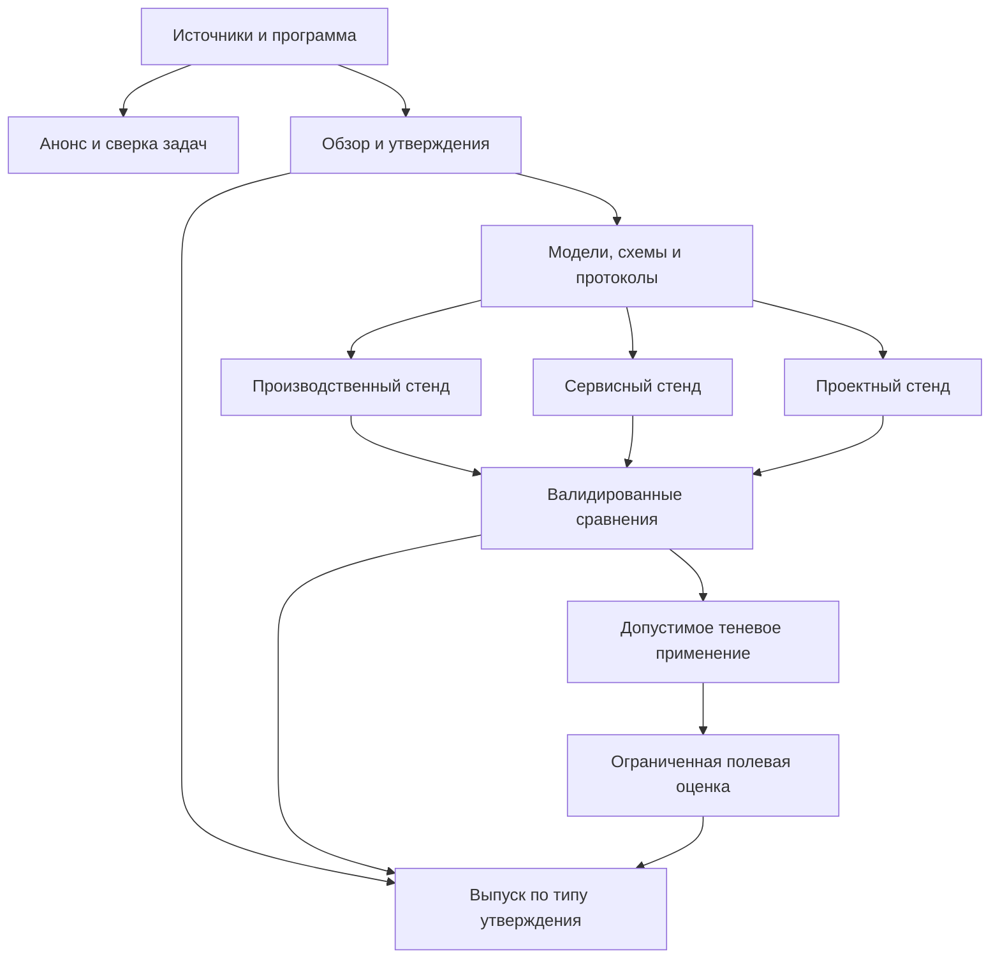

# Согласованная деятельность: программа исполнения и научных результатов

Подготовлено 18 ноября 2026 года. Статус: **исходное предложение для сверки и рецензирования**. Фактические идентификаторы задач, назначения, зависимости и состояния исполнения определяются в Muneral.

Эта русская читательская версия подготовлена авторской стороной и привязана к точным байтам [английской программы](PROGRAMME.md). Она включает все эпики, пакеты, статьи, гипотезы и условия выпуска. Независимая проверка точности перевода, в том числе носителем языка, не заявляется. Ссылки на [полные контракты задач](TASK_CONTRACTS.md) ведут к отдельному исходному документу на английском с сохранёнными русскими исходными критериями; этот документ здесь не объявляется полностью переведённым.

Программа содержит **23 эпика, 104 пакета работ и 247 блокирующих зависимостей с потреблением результатов**. Сохранены все **72 исходных шагов**, добавлены **32 пакета**, сопоставлены **16 возможных статей и 12 гипотез**. [Машиночитаемый граф](execution-graph.json) и полные контракты задают предлагаемую область регистрации.

Это пакеты работ: крупные обзоры, семейства стендов и шаблоны публикации нужно разбить на ограниченные дочерние задачи перед исполнением. Предложенный владелец не является фактическим назначением. Подготовленные 128 объектов программы, эпиков и пакетов не означают 128 созданных задач Muneral.

## Исходные свидетельства и предполагаемый вклад

[Исходный исследовательский пакет](https://github.com/Arcanada-one/knowledge-contract/tree/ea698baa3d4997b56c725d806c600173aa6064b9/roadmap/coordinated-work) сохраняет 1176 библиографических записей: 157 проверенных первичных записей и 1019 цитатных кандидатов. Число уникальных работ не установлено: требуется разобрать 26 групп с совпадающими названием и годом и четыре пары близких названий. Завершённых критических оценок полных текстов — 0. Сохранённый численный пример r2 включает 10 сценариев, 100 наблюдений «сценарий × период» и 190 элементарных проверок; зарегистрировано 0 нарушений. Это ограниченное свидетельство численной реализации, а не эффективности агента, оптимизатора или валидности для реальной организации.

Предполагаемый вклад — организационный профиль, связывающий потребности, сети работы, различающуюся семантику ресурсов, компетенции и свидетельства для решений с Agent Situation и Context Assembly. Новизну ещё нужно проверить относительно существующих исследований. Введение профиля не создаёт новый нативный вид артефакта KC и не предоставляет полномочий исполнения.

## Первый эпик: сделать программу видимой и исполнимой

CW-EP00 включает фиксацию источников, устав программы, граф, анонсы Journal на EN/RU/zh-Hans, навигацию репозитория и дорожной карты, сверку нативных задач, проверенную публичную доставку и ограниченную передачу коллективу. Принятый анонс может быть опубликован, пока регистрация задач ещё выполняется; закрытие полного этапа CW-N08 требует обеих квитанций — публикации и регистрации.

| Пакет | Наблюдаемый результат | Предложенные ответственный / исполнитель | Блокирующие входы |
| --- | --- | --- | --- |
| [CW-N01](TASK_CONTRACTS.md#freeze-programme-inputs-and-evidence-boundary-cw-n01) — Зафиксировать исходники и границу имеющихся свидетельств | Манифест зафиксированных исходников и свидетельств | KC-Brain / KC-SWE | Только исходные материалы |
| [CW-N02](TASK_CONTRACTS.md#define-programme-charter-and-output-families-cw-n02) — Определить программу и семейства результатов | Устав программы и перечень выходных артефактов | KC-Brain / KC-SWE | [CW-N01](TASK_CONTRACTS.md#freeze-programme-inputs-and-evidence-boundary-cw-n01) |
| [CW-N03](TASK_CONTRACTS.md#build-and-validate-execution-graph-cw-n03) — Сформировать граф исполнения и полное покрытие исходного плана | Версионируемая программа исполнения и проверка полноты покрытия | KC-Brain / KC-SWE | [CW-N02](TASK_CONTRACTS.md#define-programme-charter-and-output-families-cw-n02) |
| [CW-N04](TASK_CONTRACTS.md#prepare-enruzh-hans-announcement-bundle-cw-n04) — Подготовить анонс и карточки исследований на трех языках | Анонс и карточки исследований на трёх языках | KC-Brain / KC-SWE | [CW-N02](TASK_CONTRACTS.md#define-programme-charter-and-output-families-cw-n02), [CW-N03](TASK_CONTRACTS.md#build-and-validate-execution-graph-cw-n03) |
| [CW-N05](TASK_CONTRACTS.md#publish-repository-and-roadmap-programme-entries-cw-n05) — Связать программу с репозиториями и дорожной картой | Связанные анонсы в репозитории и дорожной карте | KC-Brain / KC-SWE | [CW-N03](TASK_CONTRACTS.md#build-and-validate-execution-graph-cw-n03), [CW-N04](TASK_CONTRACTS.md#prepare-enruzh-hans-announcement-bundle-cw-n04) |
| [CW-N06](TASK_CONTRACTS.md#register-and-read-back-muneral-graph-cw-n06) — Зарегистрировать граф задач в Muneral и прочитать его обратно | Регистрация в Muneral и реестр точного обратного чтения | KC-Brain / KC-SWE | [CW-N03](TASK_CONTRACTS.md#build-and-validate-execution-graph-cw-n03) |
| [CW-N07](TASK_CONTRACTS.md#deliver-announcement-and-programme-landing-cw-n07) — Опубликовать и проверить анонс на трех языках | Квитанция фактической публикации запуска на трёх языках | KC-Brain / KC-SWE | [CW-N04](TASK_CONTRACTS.md#prepare-enruzh-hans-announcement-bundle-cw-n04), [CW-N05](TASK_CONTRACTS.md#publish-repository-and-roadmap-programme-entries-cw-n05) |
| [CW-N08](TASK_CONTRACTS.md#complete-collective-handoff-and-first-work-batch-cw-n08) — Передать области ответственности и запустить ограниченную первую очередь | Согласование ответственности коллектива и передача ограниченной первой очереди | KC-Brain / KC-SWE | [CW-N06](TASK_CONTRACTS.md#register-and-read-back-muneral-graph-cw-n06), [CW-N07](TASK_CONTRACTS.md#deliver-announcement-and-programme-landing-cw-n07) |

Приёмка запуска требует точных привязок исходников и переводов, прав и атрибуции, независимой рецензии в заявленном объёме, проверок в CI, явной ревизии для отката, штатного процесса публикации и анонимного обратного чтения страниц. Браузерная проверка должна показать, что сама статья видна на компьютере и телефоне, а переключение языка сохраняет выпуск. Метаданные и лексический анализ HTML не устанавливают эти свойства.

## Параллельная последовательность работ

Схема ниже — обзор, а не полный граф из 247 рёбер. Каждая действительная блокирующая зависимость в JSON указывает, какой результат предшественника она потребляет.



1. **Запуск и сверка.** Зафиксировать источники и свидетельства, опубликовать точное описание программы, сверить существующие задачи Muneral и подготовить ограниченную первую очередь.
2. **Параллельные основания.** Критически читать первичные источники, определять потребности, ресурсы и рабочие графы, строить схему происхождения, правила прав и данных, регистрировать вопросы отдельных исследований.
3. **Параллельные предметные стенды.** Производственный, сервисный и проектный стенды начинают работу после получения собственных обязательных входов. До подтверждающих сравнений нужны независимые оракулы и проверки применимости моделей.
4. **Контролируемые свидетельства.** Сравнивать действующий метод, сильные методы исследования операций, агента без поиска, сильный обычный RAG и полный профиль KC при заявленных сопоставимых бюджетах; сохранять абляции, неудачи и неопределённость.
5. **Допустимое реальное применение.** Привязать действительную задачу и реализацию Arcanada, собрать теневые наблюдения, затем провести отдельно разрешённое ограниченное вмешательство и проверку переноса на отложенные случаи.
6. **Выпуск по утверждению.** Рецензированная карта источников, условное доказательство и причинный эффект в организации имеют разные обязательства по свидетельствам. Обзор или формальный результат не ждёт всеобщего полевого испытания; причинное утверждение требует подходящего дизайна идентификации и фактических данных.

[Решения о зависимостях](DEPENDENCY-DECISIONS.md) сохраняют историю исходных рёбер и обоснование изменений. Максимальная исходная цепочка содержит 64 узла, предлагаемая — 17. Это число узлов топологической цепочки, а не дни, трудозатраты или доказанное ускорение. Доступные мощности, время рецензентов и длительности нужно установить при нативной сверке. Используется существующий коллектив из шести ролей; строки задач не создают дополнительных агентов.

## Реестр эпиков

| Эпик | Область | Пакетов | Предложенные ответственный / исполнитель |
| --- | --- | ---: | --- |
| CW-EP00 | Анонс и регистрация направления | 8 | KC-Brain / KC-SWE |
| CW-EP01 | Корпус, обзор и карта prior art | 9 | KC-Brain / Research-Arcana |
| CW-EP02 | Онтология потребностей и компетенций | 8 | KC-Brain / Research-Arcana |
| CW-EP03 | Состояние организации и разрешенные источники | 8 | KC-Brain / KC-SWE |
| CW-EP04 | Потоки, мощности и ограничения | 8 | KC-Brain / Research-Arcana |
| CW-EP05 | Команды, компетенции и планирование мощности | 8 | KC-Brain / Research-Arcana |
| CW-EP06 | Прогнозы, неопределенность и дрейф | 7 | KC-Brain / Research-Arcana |
| CW-EP07 | Контракты решений и проверка агента | 8 | Agent-Brain / Agent-SWE |
| CW-EP08 | План экспериментов и сравнительная оценка | 5 | KC-Brain / Research-Arcana |
| CW-EP09 | Научные публикации и выпуск на трех языках | 11 | KC-Brain / KC-SWE |
| CW-EP10 | Формальная допустимость и типы ресурсов | 3 | KC-Brain / Research-Arcana |
| CW-EP11 | Права, приватность и пакеты данных | 2 | KC-Brain / KC-SWE |
| CW-EP12 | Независимые оракулы и валидность моделей | 2 | KC-Brain / KC-SWE |
| CW-EP13 | Стенд производственных процессов | 1 | KC-Brain / KC-SWE |
| CW-EP14 | Стенд сервисных процессов | 1 | KC-Brain / KC-SWE |
| CW-EP15 | Стенд проектов и интеллектуальной работы | 1 | KC-Brain / KC-SWE |
| CW-EP16 | Причинность, наблюдаемость и интерференция | 3 | KC-Brain / Research-Arcana |
| CW-EP17 | Исполнение, конкурентность и полная стоимость | 3 | Agent-Brain / Agent-SWE |
| CW-EP18 | Потребители и интеграция в экосистему | 2 | Agent-Brain / Agent-SWE |
| CW-EP19 | Понимание оператором и ценность информации | 1 | KC-Brain / Research-Arcana |
| CW-EP20 | Теневое, полевое и внешнее воспроизведение | 3 | KC-Brain / Research-Arcana |
| CW-EP21 | Динамика, устойчивость и рекурсивная допустимость | 1 | KC-Brain / Research-Arcana |
| CW-EP22 | Совместимость KC и происхождение свидетельств | 1 | KC-Brain / KC-SWE |

## Полный перечень пакетов работ

Каждый связанный контракт задаёт нумерованные критерии приёмки, точный предлагаемый результат, необходимые свидетельства, отрицательный контроль, покрытие источника, рецензента и потребляемые результаты предшественников.

| Пакет | Работа | Эпик | Блокирующие предпосылки |
| --- | --- | --- | --- |
| [CW-N01](TASK_CONTRACTS.md#freeze-programme-inputs-and-evidence-boundary-cw-n01) | Зафиксировать исходники и границу имеющихся свидетельств | CW-EP00 | Нет в этом предложении |
| [CW-N02](TASK_CONTRACTS.md#define-programme-charter-and-output-families-cw-n02) | Определить программу и семейства результатов | CW-EP00 | [CW-N01](TASK_CONTRACTS.md#freeze-programme-inputs-and-evidence-boundary-cw-n01) |
| [CW-N03](TASK_CONTRACTS.md#build-and-validate-execution-graph-cw-n03) | Сформировать граф исполнения и полное покрытие исходного плана | CW-EP00 | [CW-N02](TASK_CONTRACTS.md#define-programme-charter-and-output-families-cw-n02) |
| [CW-N04](TASK_CONTRACTS.md#prepare-enruzh-hans-announcement-bundle-cw-n04) | Подготовить анонс и карточки исследований на трех языках | CW-EP00 | [CW-N02](TASK_CONTRACTS.md#define-programme-charter-and-output-families-cw-n02), [CW-N03](TASK_CONTRACTS.md#build-and-validate-execution-graph-cw-n03) |
| [CW-N05](TASK_CONTRACTS.md#publish-repository-and-roadmap-programme-entries-cw-n05) | Связать программу с репозиториями и дорожной картой | CW-EP00 | [CW-N03](TASK_CONTRACTS.md#build-and-validate-execution-graph-cw-n03), [CW-N04](TASK_CONTRACTS.md#prepare-enruzh-hans-announcement-bundle-cw-n04) |
| [CW-N06](TASK_CONTRACTS.md#register-and-read-back-muneral-graph-cw-n06) | Зарегистрировать граф задач в Muneral и прочитать его обратно | CW-EP00 | [CW-N03](TASK_CONTRACTS.md#build-and-validate-execution-graph-cw-n03) |
| [CW-N07](TASK_CONTRACTS.md#deliver-announcement-and-programme-landing-cw-n07) | Опубликовать и проверить анонс на трех языках | CW-EP00 | [CW-N04](TASK_CONTRACTS.md#prepare-enruzh-hans-announcement-bundle-cw-n04), [CW-N05](TASK_CONTRACTS.md#publish-repository-and-roadmap-programme-entries-cw-n05) |
| [CW-N08](TASK_CONTRACTS.md#complete-collective-handoff-and-first-work-batch-cw-n08) | Передать области ответственности и запустить ограниченную первую очередь | CW-EP00 | [CW-N06](TASK_CONTRACTS.md#register-and-read-back-muneral-graph-cw-n06), [CW-N07](TASK_CONTRACTS.md#deliver-announcement-and-programme-landing-cw-n07) |
| [CW-A01](TASK_CONTRACTS.md#define-review-scope-cw-a01) | Границы обзора | CW-EP01 | [CW-N01](TASK_CONTRACTS.md#freeze-programme-inputs-and-evidence-boundary-cw-n01) |
| [CW-A02](TASK_CONTRACTS.md#verify-the-seed-bibliography-cw-a02) | Проверенное библиографическое ядро | CW-EP01 | [CW-A01](TASK_CONTRACTS.md#define-review-scope-cw-a01) |
| [CW-A03](TASK_CONTRACTS.md#extract-citation-candidates-cw-a03) | Извлечение цитатных кандидатов | CW-EP01 | [CW-A01](TASK_CONTRACTS.md#define-review-scope-cw-a01) |
| [CW-A04](TASK_CONTRACTS.md#resolve-publication-identities-cw-a04) | Разрешение идентичности | CW-EP01 | [CW-A02](TASK_CONTRACTS.md#verify-the-seed-bibliography-cw-a02), [CW-A03](TASK_CONTRACTS.md#extract-citation-candidates-cw-a03) |
| [CW-A05](TASK_CONTRACTS.md#expand-field-coverage-cw-a05) | Расширение по научным направлениям | CW-EP01 | [CW-A01](TASK_CONTRACTS.md#define-review-scope-cw-a01) |
| [CW-A06](TASK_CONTRACTS.md#screen-full-texts-cw-a06) | Отбор полных текстов | CW-EP01 | [CW-A02](TASK_CONTRACTS.md#verify-the-seed-bibliography-cw-a02), [CW-A04](TASK_CONTRACTS.md#resolve-publication-identities-cw-a04), [CW-A05](TASK_CONTRACTS.md#expand-field-coverage-cw-a05) |
| [CW-A07](TASK_CONTRACTS.md#extract-scoped-claims-cw-a07) | Карточки утверждений | CW-EP01 | [CW-A06](TASK_CONTRACTS.md#screen-full-texts-cw-a06) |
| [CW-A08](TASK_CONTRACTS.md#review-the-scoping-map-cw-a08) | Публикация карты литературы | CW-EP01 | [CW-A07](TASK_CONTRACTS.md#extract-scoped-claims-cw-a07) |
| [CW-N09](TASK_CONTRACTS.md#frontload-novelty-discriminants-cw-n09) | Сопоставить предполагаемый вклад с ближайшими предшественниками | CW-EP01 | [CW-A07](TASK_CONTRACTS.md#extract-scoped-claims-cw-a07) |
| [CW-B01](TASK_CONTRACTS.md#define-organizational-units-cw-b01) | Единицы организационного анализа | CW-EP02 | [CW-A01](TASK_CONTRACTS.md#define-review-scope-cw-a01) |
| [CW-B02](TASK_CONTRACTS.md#classify-needs-and-situations-cw-b02) | Фасеты ситуаций и потребностей | CW-EP02 | [CW-B01](TASK_CONTRACTS.md#define-organizational-units-cw-b01) |
| [CW-B03](TASK_CONTRACTS.md#map-sectors-and-processes-cw-b03) | Сопоставление отраслей и процессов | CW-EP02 | [CW-B01](TASK_CONTRACTS.md#define-organizational-units-cw-b01) |
| [CW-B04](TASK_CONTRACTS.md#map-occupations-and-competencies-cw-b04) | Сопоставление профессий и компетенций | CW-EP02 | [CW-B01](TASK_CONTRACTS.md#define-organizational-units-cw-b01) |
| [CW-B05](TASK_CONTRACTS.md#define-resource-semantics-cw-b05) | Типы ресурсов | CW-EP02 | [CW-B01](TASK_CONTRACTS.md#define-organizational-units-cw-b01) |
| [CW-B06](TASK_CONTRACTS.md#define-performance-measures-cw-b06) | Вектор производительности | CW-EP02 | [CW-B01](TASK_CONTRACTS.md#define-organizational-units-cw-b01) |
| [CW-B07](TASK_CONTRACTS.md#assess-annotation-agreement-cw-b07) | Проверка согласия классификаторов | CW-EP02 | [CW-B02](TASK_CONTRACTS.md#classify-needs-and-situations-cw-b02), [CW-B03](TASK_CONTRACTS.md#map-sectors-and-processes-cw-b03), [CW-B04](TASK_CONTRACTS.md#map-occupations-and-competencies-cw-b04), [CW-B05](TASK_CONTRACTS.md#define-resource-semantics-cw-b05), [CW-B06](TASK_CONTRACTS.md#define-performance-measures-cw-b06) |
| [CW-B08](TASK_CONTRACTS.md#evaluate-held-out-sectors-cw-b08) | Проверка новых отраслей | CW-EP02 | [CW-B07](TASK_CONTRACTS.md#assess-annotation-agreement-cw-b07) |
| [CW-C01](TASK_CONTRACTS.md#build-the-typed-work-graph-cw-c01) | Граф работы и ответственности | CW-EP03 | [CW-B01](TASK_CONTRACTS.md#define-organizational-units-cw-b01), [CW-B02](TASK_CONTRACTS.md#classify-needs-and-situations-cw-b02), [CW-B05](TASK_CONTRACTS.md#define-resource-semantics-cw-b05) |
| [CW-C02](TASK_CONTRACTS.md#define-event-semantics-cw-c02) | Словарь событий | CW-EP03 | [CW-C01](TASK_CONTRACTS.md#build-the-typed-work-graph-cw-c01) |
| [CW-C03](TASK_CONTRACTS.md#separate-demand-observations-cw-c03) | Наблюдаемый и скрытый спрос | CW-EP03 | [CW-C01](TASK_CONTRACTS.md#build-the-typed-work-graph-cw-c01), [CW-B06](TASK_CONTRACTS.md#define-performance-measures-cw-b06) |
| [CW-C04](TASK_CONTRACTS.md#represent-availability-calendars-cw-c04) | Календарь доступности | CW-EP03 | [CW-C01](TASK_CONTRACTS.md#build-the-typed-work-graph-cw-c01), [CW-B04](TASK_CONTRACTS.md#map-occupations-and-competencies-cw-b04), [CW-B05](TASK_CONTRACTS.md#define-resource-semantics-cw-b05) |
| [CW-C05](TASK_CONTRACTS.md#preserve-provenance-and-conflicts-cw-c05) | Происхождение и конфликты | CW-EP03 | [CW-C02](TASK_CONTRACTS.md#define-event-semantics-cw-c02), [CW-A02](TASK_CONTRACTS.md#verify-the-seed-bibliography-cw-a02), [CW-N10](TASK_CONTRACTS.md#specify-claim-and-evidence-lineage-cw-n10) |
| [CW-C06](TASK_CONTRACTS.md#specify-freshness-and-invalidation-cw-c06) | Обновление и срок пригодности | CW-EP03 | [CW-C05](TASK_CONTRACTS.md#preserve-provenance-and-conflicts-cw-c05) |
| [CW-C07](TASK_CONTRACTS.md#prototype-authorized-adapters-cw-c07) | Адаптеры действующих систем | CW-EP03 | [CW-C02](TASK_CONTRACTS.md#define-event-semantics-cw-c02), [CW-C03](TASK_CONTRACTS.md#separate-demand-observations-cw-c03), [CW-C04](TASK_CONTRACTS.md#represent-availability-calendars-cw-c04), [CW-C05](TASK_CONTRACTS.md#preserve-provenance-and-conflicts-cw-c05), [CW-C06](TASK_CONTRACTS.md#specify-freshness-and-invalidation-cw-c06), [CW-N15](TASK_CONTRACTS.md#bind-data-access-rights-and-measurement-purposes-cw-n15) |
| [CW-C08](TASK_CONTRACTS.md#review-the-organization-profile-cw-c08) | Организационный профиль KC | CW-EP03 | [CW-C07](TASK_CONTRACTS.md#prototype-authorized-adapters-cw-c07), [CW-B08](TASK_CONTRACTS.md#evaluate-held-out-sectors-cw-b08), [CW-A08](TASK_CONTRACTS.md#review-the-scoping-map-cw-a08) |
| [CW-D01](TASK_CONTRACTS.md#define-flow-conservation-cw-d01) | Явная модель баланса | CW-EP04 | [CW-B05](TASK_CONTRACTS.md#define-resource-semantics-cw-b05), [CW-N14](TASK_CONTRACTS.md#implement-dimensional-and-availability-checks-cw-n14) |
| [CW-D02](TASK_CONTRACTS.md#derive-conditional-throughput-bounds-cw-d02) | Узкие места и разрезы | CW-EP04 | [CW-D01](TASK_CONTRACTS.md#define-flow-conservation-cw-d01) |
| [CW-D03](TASK_CONTRACTS.md#model-buffers-and-delays-cw-d03) | Конечные буферы и задержки | CW-EP04 | [CW-D01](TASK_CONTRACTS.md#define-flow-conservation-cw-d01), [CW-D02](TASK_CONTRACTS.md#derive-conditional-throughput-bounds-cw-d02) |
| [CW-D04](TASK_CONTRACTS.md#model-setup-and-rework-cw-d04) | Переналадка и качество | CW-EP04 | [CW-D01](TASK_CONTRACTS.md#define-flow-conservation-cw-d01), [CW-C03](TASK_CONTRACTS.md#separate-demand-observations-cw-c03) |
| [CW-D05](TASK_CONTRACTS.md#compare-release-policies-cw-d05) | Правила допуска работы | CW-EP04 | [CW-D06](TASK_CONTRACTS.md#add-product-mix-and-shared-resources-cw-d06), [CW-N17](TASK_CONTRACTS.md#create-independent-oracles-and-mutation-controls-cw-n17) |
| [CW-D06](TASK_CONTRACTS.md#add-product-mix-and-shared-resources-cw-d06) | Несколько продуктов и общие ресурсы | CW-EP04 | [CW-D03](TASK_CONTRACTS.md#model-buffers-and-delays-cw-d03), [CW-D04](TASK_CONTRACTS.md#model-setup-and-rework-cw-d04), [CW-C04](TASK_CONTRACTS.md#represent-availability-calendars-cw-c04) |
| [CW-D07](TASK_CONTRACTS.md#construct-local-metric-counterexamples-cw-d07) | Контрпримеры локальным KPI | CW-EP04 | [CW-D05](TASK_CONTRACTS.md#compare-release-policies-cw-d05), [CW-B06](TASK_CONTRACTS.md#define-performance-measures-cw-b06) |
| [CW-D08](TASK_CONTRACTS.md#review-the-flow-model-cw-d08) | Рецензия модели потока | CW-EP04 | [CW-D07](TASK_CONTRACTS.md#construct-local-metric-counterexamples-cw-d07), [CW-A08](TASK_CONTRACTS.md#review-the-scoping-map-cw-a08), [CW-C08](TASK_CONTRACTS.md#review-the-organization-profile-cw-c08) |
| [CW-E01](TASK_CONTRACTS.md#estimate-task-workload-cw-e01) | Трудоемкость по задачам | CW-EP05 | [CW-B04](TASK_CONTRACTS.md#map-occupations-and-competencies-cw-b04), [CW-C03](TASK_CONTRACTS.md#separate-demand-observations-cw-c03), [CW-C04](TASK_CONTRACTS.md#represent-availability-calendars-cw-c04), [CW-B06](TASK_CONTRACTS.md#define-performance-measures-cw-b06) |
| [CW-E02](TASK_CONTRACTS.md#bind-competency-evidence-cw-e02) | Проверка компетенций | CW-EP05 | [CW-B04](TASK_CONTRACTS.md#map-occupations-and-competencies-cw-b04) |
| [CW-E03](TASK_CONTRACTS.md#optimize-multiskill-assignments-cw-e03) | Многоквалификационное расписание | CW-EP05 | [CW-E01](TASK_CONTRACTS.md#estimate-task-workload-cw-e01), [CW-E02](TASK_CONTRACTS.md#bind-competency-evidence-cw-e02), [CW-D06](TASK_CONTRACTS.md#add-product-mix-and-shared-resources-cw-d06) |
| [CW-E04](TASK_CONTRACTS.md#model-hiring-lead-times-cw-e04) | Найм и выход на мощность | CW-EP05 | [CW-E01](TASK_CONTRACTS.md#estimate-task-workload-cw-e01), [CW-C04](TASK_CONTRACTS.md#represent-availability-calendars-cw-c04) |
| [CW-E05](TASK_CONTRACTS.md#compare-capacity-alternatives-cw-e05) | Альтернативы найму | CW-EP05 | [CW-E03](TASK_CONTRACTS.md#optimize-multiskill-assignments-cw-e03), [CW-E04](TASK_CONTRACTS.md#model-hiring-lead-times-cw-e04), [CW-F04](TASK_CONTRACTS.md#model-decision-delays-cw-f04), [CW-N21](TASK_CONTRACTS.md#model-team-complementarity-and-capability-change-cw-n21) |
| [CW-E07](TASK_CONTRACTS.md#constrain-sustainable-workload-cw-e07) | Условия устойчивой нагрузки | CW-EP05 | [CW-C04](TASK_CONTRACTS.md#represent-availability-calendars-cw-c04), [CW-E03](TASK_CONTRACTS.md#optimize-multiskill-assignments-cw-e03) |
| [CW-E08](TASK_CONTRACTS.md#produce-auditable-role-requirements-cw-e08) | Профиль потребности в роли | CW-EP05 | [CW-E05](TASK_CONTRACTS.md#compare-capacity-alternatives-cw-e05), [CW-E06](TASK_CONTRACTS.md#separate-performance-from-causation-cw-e06), [CW-E07](TASK_CONTRACTS.md#constrain-sustainable-workload-cw-e07), [CW-A08](TASK_CONTRACTS.md#review-the-scoping-map-cw-a08), [CW-C08](TASK_CONTRACTS.md#review-the-organization-profile-cw-c08) |
| [CW-N21](TASK_CONTRACTS.md#model-team-complementarity-and-capability-change-cw-n21) | Моделировать взаимодополнение команды, наставничество и обучение | CW-EP05 | [CW-E01](TASK_CONTRACTS.md#estimate-task-workload-cw-e01), [CW-E02](TASK_CONTRACTS.md#bind-competency-evidence-cw-e02), [CW-C04](TASK_CONTRACTS.md#represent-availability-calendars-cw-c04) |
| [CW-F01](TASK_CONTRACTS.md#reconcile-hierarchical-forecasts-cw-f01) | Согласование иерархических прогнозов | CW-EP06 | [CW-C03](TASK_CONTRACTS.md#separate-demand-observations-cw-c03) |
| [CW-F02](TASK_CONTRACTS.md#calibrate-predictive-uncertainty-cw-f02) | Вероятностные интервалы | CW-EP06 | [CW-F01](TASK_CONTRACTS.md#reconcile-hierarchical-forecasts-cw-f01) |
| [CW-F03](TASK_CONTRACTS.md#define-external-shock-scenarios-cw-f03) | Рыночные и политические сценарии | CW-EP06 | [CW-A02](TASK_CONTRACTS.md#verify-the-seed-bibliography-cw-a02), [CW-C01](TASK_CONTRACTS.md#build-the-typed-work-graph-cw-c01) |
| [CW-F04](TASK_CONTRACTS.md#model-decision-delays-cw-f04) | Задержки наблюдения и действий | CW-EP06 | [CW-C02](TASK_CONTRACTS.md#define-event-semantics-cw-c02), [CW-C04](TASK_CONTRACTS.md#represent-availability-calendars-cw-c04) |
| [CW-F05](TASK_CONTRACTS.md#optimize-under-uncertainty-cw-f05) | Выбор при неполном знании | CW-EP06 | [CW-F02](TASK_CONTRACTS.md#calibrate-predictive-uncertainty-cw-f02), [CW-F03](TASK_CONTRACTS.md#define-external-shock-scenarios-cw-f03), [CW-F04](TASK_CONTRACTS.md#model-decision-delays-cw-f04) |
| [CW-F07](TASK_CONTRACTS.md#detect-distribution-shift-cw-f07) | Дрейф и смена режима | CW-EP06 | [CW-C06](TASK_CONTRACTS.md#specify-freshness-and-invalidation-cw-c06), [CW-F02](TASK_CONTRACTS.md#calibrate-predictive-uncertainty-cw-f02), [CW-F06](TASK_CONTRACTS.md#check-endogenous-observations-cw-f06) |
| [CW-F08](TASK_CONTRACTS.md#backtest-frozen-forecast-decisions-cw-f08) | Проверка на отложенных периодах | CW-EP06 | [CW-F05](TASK_CONTRACTS.md#optimize-under-uncertainty-cw-f05), [CW-F06](TASK_CONTRACTS.md#check-endogenous-observations-cw-f06), [CW-F07](TASK_CONTRACTS.md#detect-distribution-shift-cw-f07) |
| [CW-G01](TASK_CONTRACTS.md#define-decision-prerequisites-cw-g01) | Набор знаний для решения | CW-EP07 | [CW-C01](TASK_CONTRACTS.md#build-the-typed-work-graph-cw-c01), [CW-B02](TASK_CONTRACTS.md#classify-needs-and-situations-cw-b02), [CW-B04](TASK_CONTRACTS.md#map-occupations-and-competencies-cw-b04), [CW-B05](TASK_CONTRACTS.md#define-resource-semantics-cw-b05), [CW-B06](TASK_CONTRACTS.md#define-performance-measures-cw-b06), [CW-N11](TASK_CONTRACTS.md#specify-objectives-tradeoffs-and-infeasibility-cw-n11) |
| [CW-G02](TASK_CONTRACTS.md#assemble-bounded-context-cw-g02) | Сборка контекста | CW-EP07 | [CW-G01](TASK_CONTRACTS.md#define-decision-prerequisites-cw-g01), [CW-C05](TASK_CONTRACTS.md#preserve-provenance-and-conflicts-cw-c05), [CW-C06](TASK_CONTRACTS.md#specify-freshness-and-invalidation-cw-c06) |
| [CW-G03](TASK_CONTRACTS.md#define-startup-readiness-cw-g03) | Режимы запуска | CW-EP07 | [CW-G01](TASK_CONTRACTS.md#define-decision-prerequisites-cw-g01) |
| [CW-G04](TASK_CONTRACTS.md#separate-proposal-and-verification-cw-g04) | Предложения и внешняя проверка | CW-EP07 | [CW-G01](TASK_CONTRACTS.md#define-decision-prerequisites-cw-g01), [CW-N12](TASK_CONTRACTS.md#discharge-conditional-admissibility-obligations-cw-n12) |
| [CW-G05](TASK_CONTRACTS.md#calibrate-abstention-cw-g05) | Уточнение и отказ от вывода | CW-EP07 | [CW-G02](TASK_CONTRACTS.md#assemble-bounded-context-cw-g02), [CW-F02](TASK_CONTRACTS.md#calibrate-predictive-uncertainty-cw-f02) |
| [CW-G06](TASK_CONTRACTS.md#record-decision-evidence-cw-g06) | Квитанция решения | CW-EP07 | [CW-G02](TASK_CONTRACTS.md#assemble-bounded-context-cw-g02), [CW-G03](TASK_CONTRACTS.md#define-startup-readiness-cw-g03), [CW-G04](TASK_CONTRACTS.md#separate-proposal-and-verification-cw-g04) |
| [CW-G07](TASK_CONTRACTS.md#handle-concurrent-decisions-cw-g07) | Конфликт и повторное выполнение | CW-EP07 | [CW-G06](TASK_CONTRACTS.md#record-decision-evidence-cw-g06), [CW-C04](TASK_CONTRACTS.md#represent-availability-calendars-cw-c04) |
| [CW-G08](TASK_CONTRACTS.md#review-learning-updates-cw-g08) | Возврат знаний в базу | CW-EP07 | [CW-G06](TASK_CONTRACTS.md#record-decision-evidence-cw-g06), [CW-C06](TASK_CONTRACTS.md#specify-freshness-and-invalidation-cw-c06) |
| [CW-H01](TASK_CONTRACTS.md#freeze-hypotheses-and-metrics-cw-h01) | Регистрация гипотез и метрик | CW-EP08 | [CW-N19](TASK_CONTRACTS.md#register-study-protocols-and-matched-baselines-cw-n19) |
| [CW-H05](TASK_CONTRACTS.md#evaluate-strong-baselines-cw-h05) | Сильные сравнительные методы | CW-EP08 | [CW-H02](TASK_CONTRACTS.md#build-the-manufacturing-benchmark-cw-h02), [CW-H03](TASK_CONTRACTS.md#build-the-service-benchmark-cw-h03), [CW-H04](TASK_CONTRACTS.md#build-the-project-benchmark-cw-h04), [CW-G04](TASK_CONTRACTS.md#separate-proposal-and-verification-cw-g04), [CW-F08](TASK_CONTRACTS.md#backtest-frozen-forecast-decisions-cw-f08), [CW-E08](TASK_CONTRACTS.md#produce-auditable-role-requirements-cw-e08), [CW-D08](TASK_CONTRACTS.md#review-the-flow-model-cw-d08), [CW-C08](TASK_CONTRACTS.md#review-the-organization-profile-cw-c08), [CW-N18](TASK_CONTRACTS.md#validate-conceptual-and-operational-simulation-models-cw-n18), [CW-N20](TASK_CONTRACTS.md#plan-statistical-units-power-and-multiplicity-cw-n20) |
| [CW-H06](TASK_CONTRACTS.md#run-ablations-and-uncertainty-analysis-cw-h06) | Абляции и статистический анализ | CW-EP08 | [CW-H05](TASK_CONTRACTS.md#evaluate-strong-baselines-cw-h05), [CW-G08](TASK_CONTRACTS.md#review-learning-updates-cw-g08) |
| [CW-N19](TASK_CONTRACTS.md#register-study-protocols-and-matched-baselines-cw-n19) | Подготовить протокол регистрации каждого сравнения | CW-EP08 | [CW-A07](TASK_CONTRACTS.md#extract-scoped-claims-cw-a07), [CW-B06](TASK_CONTRACTS.md#define-performance-measures-cw-b06), [CW-N09](TASK_CONTRACTS.md#frontload-novelty-discriminants-cw-n09), [CW-N11](TASK_CONTRACTS.md#specify-objectives-tradeoffs-and-infeasibility-cw-n11) |
| [CW-N20](TASK_CONTRACTS.md#plan-statistical-units-power-and-multiplicity-cw-n20) | Установить единицы анализа, неопределенность и статистический план | CW-EP08 | [CW-N19](TASK_CONTRACTS.md#register-study-protocols-and-matched-baselines-cw-n19), [CW-N16](TASK_CONTRACTS.md#build-reference-datasets-and-data-dictionaries-cw-n16) |
| [CW-I01](TASK_CONTRACTS.md#reassess-novelty-cw-i01) | Аудит научной новизны | CW-EP09 | [CW-A08](TASK_CONTRACTS.md#review-the-scoping-map-cw-a08), [CW-B08](TASK_CONTRACTS.md#evaluate-held-out-sectors-cw-b08), [CW-N09](TASK_CONTRACTS.md#frontload-novelty-discriminants-cw-n09) |
| [CW-I02](TASK_CONTRACTS.md#bind-claims-to-evidence-cw-i02) | Матрица утверждений и свидетельств | CW-EP09 | [CW-A07](TASK_CONTRACTS.md#extract-scoped-claims-cw-a07), [CW-N10](TASK_CONTRACTS.md#specify-claim-and-evidence-lineage-cw-n10) |
| [CW-I03](TASK_CONTRACTS.md#prepare-canonical-manuscripts-cw-i03) | Рукописи и спецификации | CW-EP09 | [CW-I01](TASK_CONTRACTS.md#reassess-novelty-cw-i01), [CW-I02](TASK_CONTRACTS.md#bind-claims-to-evidence-cw-i02), [CW-N30](TASK_CONTRACTS.md#define-claim-specific-publication-release-matrix-cw-n30) |
| [CW-I04](TASK_CONTRACTS.md#freeze-reproducibility-packages-cw-i04) | Воспроизводимые пакеты | CW-EP09 | [CW-I03](TASK_CONTRACTS.md#prepare-canonical-manuscripts-cw-i03) |
| [CW-I05](TASK_CONTRACTS.md#obtain-substantive-review-cw-i05) | Отдельная содержательная рецензия | CW-EP09 | [CW-I04](TASK_CONTRACTS.md#freeze-reproducibility-packages-cw-i04), [CW-N31](TASK_CONTRACTS.md#maintain-trilingual-terminology-and-fidelity-cw-n31) |
| [CW-I06](TASK_CONTRACTS.md#integrate-through-repository-gates-cw-i06) | Интеграция в репозиторий | CW-EP09 | [CW-I05](TASK_CONTRACTS.md#obtain-substantive-review-cw-i05) |
| [CW-I07](TASK_CONTRACTS.md#publish-and-verify-served-content-cw-i07) | Публикация и чтение с сайта | CW-EP09 | [CW-I06](TASK_CONTRACTS.md#integrate-through-repository-gates-cw-i06) |
| [CW-I08](TASK_CONTRACTS.md#admit-indexing-and-maintain-revisions-cw-i08) | Индексирование и пересмотр | CW-EP09 | [CW-I07](TASK_CONTRACTS.md#publish-and-verify-served-content-cw-i07) |
| [CW-N30](TASK_CONTRACTS.md#define-claim-specific-publication-release-matrix-cw-n30) | Установить отдельные условия выпуска каждого научного артефакта | CW-EP09 | [CW-N02](TASK_CONTRACTS.md#define-programme-charter-and-output-families-cw-n02), [CW-N09](TASK_CONTRACTS.md#frontload-novelty-discriminants-cw-n09) |
| [CW-N31](TASK_CONTRACTS.md#maintain-trilingual-terminology-and-fidelity-cw-n31) | Согласовать научную терминологию и переводы EN/RU/zh-Hans | CW-EP09 | [CW-B04](TASK_CONTRACTS.md#map-occupations-and-competencies-cw-b04), [CW-N02](TASK_CONTRACTS.md#define-programme-charter-and-output-families-cw-n02) |
| [CW-N32](TASK_CONTRACTS.md#maintain-revisions-negative-findings-and-withdrawal-cw-n32) | Установить пересмотр, исправление и отзыв зависимых утверждений | CW-EP09 | [CW-G08](TASK_CONTRACTS.md#review-learning-updates-cw-g08), [CW-N10](TASK_CONTRACTS.md#specify-claim-and-evidence-lineage-cw-n10) |
| [CW-N11](TASK_CONTRACTS.md#specify-objectives-tradeoffs-and-infeasibility-cw-n11) | Определить цели, обязательства и компромиссы организации | CW-EP10 | [CW-B02](TASK_CONTRACTS.md#classify-needs-and-situations-cw-b02), [CW-B06](TASK_CONTRACTS.md#define-performance-measures-cw-b06) |
| [CW-N12](TASK_CONTRACTS.md#discharge-conditional-admissibility-obligations-cw-n12) | Уточнить условную допустимость решений и обязательства доказательства | CW-EP10 | [CW-B05](TASK_CONTRACTS.md#define-resource-semantics-cw-b05), [CW-C01](TASK_CONTRACTS.md#build-the-typed-work-graph-cw-c01), [CW-N11](TASK_CONTRACTS.md#specify-objectives-tradeoffs-and-infeasibility-cw-n11) |
| [CW-N14](TASK_CONTRACTS.md#implement-dimensional-and-availability-checks-cw-n14) | Проверять размерности, календари и типы ресурсов | CW-EP10 | [CW-B05](TASK_CONTRACTS.md#define-resource-semantics-cw-b05) |
| [CW-N15](TASK_CONTRACTS.md#bind-data-access-rights-and-measurement-purposes-cw-n15) | Установить права, приватность и допустимые способы работы с данными | CW-EP11 | [CW-N02](TASK_CONTRACTS.md#define-programme-charter-and-output-families-cw-n02), [CW-N10](TASK_CONTRACTS.md#specify-claim-and-evidence-lineage-cw-n10) |
| [CW-N16](TASK_CONTRACTS.md#build-reference-datasets-and-data-dictionaries-cw-n16) | Подготовить версионируемые наборы данных и границы наблюдаемости | CW-EP11 | [CW-C02](TASK_CONTRACTS.md#define-event-semantics-cw-c02), [CW-C03](TASK_CONTRACTS.md#separate-demand-observations-cw-c03), [CW-C04](TASK_CONTRACTS.md#represent-availability-calendars-cw-c04), [CW-N15](TASK_CONTRACTS.md#bind-data-access-rights-and-measurement-purposes-cw-n15) |
| [CW-N17](TASK_CONTRACTS.md#create-independent-oracles-and-mutation-controls-cw-n17) | Создать независимые оракулы и отрицательные контроли | CW-EP12 | [CW-N12](TASK_CONTRACTS.md#discharge-conditional-admissibility-obligations-cw-n12), [CW-D01](TASK_CONTRACTS.md#define-flow-conservation-cw-d01) |
| [CW-N18](TASK_CONTRACTS.md#validate-conceptual-and-operational-simulation-models-cw-n18) | Проверить применимость трех семейств моделей | CW-EP12 | [CW-N16](TASK_CONTRACTS.md#build-reference-datasets-and-data-dictionaries-cw-n16), [CW-N17](TASK_CONTRACTS.md#create-independent-oracles-and-mutation-controls-cw-n17), [CW-D03](TASK_CONTRACTS.md#model-buffers-and-delays-cw-d03), [CW-E03](TASK_CONTRACTS.md#optimize-multiskill-assignments-cw-e03), [CW-C01](TASK_CONTRACTS.md#build-the-typed-work-graph-cw-c01), [CW-H02](TASK_CONTRACTS.md#build-the-manufacturing-benchmark-cw-h02), [CW-H03](TASK_CONTRACTS.md#build-the-service-benchmark-cw-h03), [CW-H04](TASK_CONTRACTS.md#build-the-project-benchmark-cw-h04) |
| [CW-H02](TASK_CONTRACTS.md#build-the-manufacturing-benchmark-cw-h02) | Производственный стенд | CW-EP13 | [CW-D03](TASK_CONTRACTS.md#model-buffers-and-delays-cw-d03), [CW-D04](TASK_CONTRACTS.md#model-setup-and-rework-cw-d04), [CW-D06](TASK_CONTRACTS.md#add-product-mix-and-shared-resources-cw-d06), [CW-H01](TASK_CONTRACTS.md#freeze-hypotheses-and-metrics-cw-h01), [CW-N17](TASK_CONTRACTS.md#create-independent-oracles-and-mutation-controls-cw-n17) |
| [CW-H03](TASK_CONTRACTS.md#build-the-service-benchmark-cw-h03) | Сервисный стенд | CW-EP14 | [CW-E03](TASK_CONTRACTS.md#optimize-multiskill-assignments-cw-e03), [CW-C03](TASK_CONTRACTS.md#separate-demand-observations-cw-c03), [CW-H01](TASK_CONTRACTS.md#freeze-hypotheses-and-metrics-cw-h01) |
| [CW-H04](TASK_CONTRACTS.md#build-the-project-benchmark-cw-h04) | Проектный стенд | CW-EP15 | [CW-C01](TASK_CONTRACTS.md#build-the-typed-work-graph-cw-c01), [CW-C04](TASK_CONTRACTS.md#represent-availability-calendars-cw-c04), [CW-H01](TASK_CONTRACTS.md#freeze-hypotheses-and-metrics-cw-h01) |
| [CW-E06](TASK_CONTRACTS.md#separate-performance-from-causation-cw-e06) | Производительность и причинность | CW-EP16 | [CW-B06](TASK_CONTRACTS.md#define-performance-measures-cw-b06), [CW-C05](TASK_CONTRACTS.md#preserve-provenance-and-conflicts-cw-c05) |
| [CW-F06](TASK_CONTRACTS.md#check-endogenous-observations-cw-f06) | Цензурирование и обратное влияние | CW-EP16 | [CW-C03](TASK_CONTRACTS.md#separate-demand-observations-cw-c03), [CW-C05](TASK_CONTRACTS.md#preserve-provenance-and-conflicts-cw-c05) |
| [CW-N29](TASK_CONTRACTS.md#design-bounded-field-intervention-cw-n29) | Зарегистрировать полевое вмешательство, интерференцию и остановку | CW-EP16 | [CW-E06](TASK_CONTRACTS.md#separate-performance-from-causation-cw-e06), [CW-H01](TASK_CONTRACTS.md#freeze-hypotheses-and-metrics-cw-h01), [CW-N15](TASK_CONTRACTS.md#bind-data-access-rights-and-measurement-purposes-cw-n15), [CW-H07](TASK_CONTRACTS.md#run-a-shadow-evaluation-cw-h07) |
| [CW-N22](TASK_CONTRACTS.md#specify-organization-decision-adapter-contracts-cw-n22) | Связать адаптеры действий с режимами и действующими полномочиями | CW-EP17 | [CW-G03](TASK_CONTRACTS.md#define-startup-readiness-cw-g03), [CW-G04](TASK_CONTRACTS.md#separate-proposal-and-verification-cw-g04), [CW-G06](TASK_CONTRACTS.md#record-decision-evidence-cw-g06), [CW-C07](TASK_CONTRACTS.md#prototype-authorized-adapters-cw-c07) |
| [CW-N23](TASK_CONTRACTS.md#exercise-concurrent-decision-and-recovery-semantics-cw-n23) | Проверить конкурентность, отмену, повтор и откат | CW-EP17 | [CW-G07](TASK_CONTRACTS.md#handle-concurrent-decisions-cw-g07), [CW-N22](TASK_CONTRACTS.md#specify-organization-decision-adapter-contracts-cw-n22) |
| [CW-N24](TASK_CONTRACTS.md#measure-scale-latency-and-total-decision-cost-cw-n24) | Измерить масштабирование и полную стоимость работы | CW-EP17 | [CW-N22](TASK_CONTRACTS.md#specify-organization-decision-adapter-contracts-cw-n22), [CW-H05](TASK_CONTRACTS.md#evaluate-strong-baselines-cw-h05) |
| [CW-N26](TASK_CONTRACTS.md#prepare-arcanada-collective-shadow-consumer-cw-n26) | Подготовить теневой потребитель для существующей работы Arcanada | CW-EP18 | [CW-G08](TASK_CONTRACTS.md#review-learning-updates-cw-g08), [CW-N22](TASK_CONTRACTS.md#specify-organization-decision-adapter-contracts-cw-n22), [CW-N23](TASK_CONTRACTS.md#exercise-concurrent-decision-and-recovery-semantics-cw-n23), [CW-H01](TASK_CONTRACTS.md#freeze-hypotheses-and-metrics-cw-h01), [CW-N15](TASK_CONTRACTS.md#bind-data-access-rights-and-measurement-purposes-cw-n15) |
| [CW-N27](TASK_CONTRACTS.md#prepare-a-second-eligible-organizational-shadow-consumer-cw-n27) | Выбрать и проверить второй доступный организационный потребитель | CW-EP18 | [CW-G08](TASK_CONTRACTS.md#review-learning-updates-cw-g08), [CW-N22](TASK_CONTRACTS.md#specify-organization-decision-adapter-contracts-cw-n22), [CW-N23](TASK_CONTRACTS.md#exercise-concurrent-decision-and-recovery-semantics-cw-n23), [CW-H01](TASK_CONTRACTS.md#freeze-hypotheses-and-metrics-cw-h01), [CW-N15](TASK_CONTRACTS.md#bind-data-access-rights-and-measurement-purposes-cw-n15) |
| [CW-N25](TASK_CONTRACTS.md#evaluate-decision-explanation-and-human-use-cw-n25) | Проверить понимание оператором и ценность дополнительной информации | CW-EP19 | [CW-G06](TASK_CONTRACTS.md#record-decision-evidence-cw-g06), [CW-N19](TASK_CONTRACTS.md#register-study-protocols-and-matched-baselines-cw-n19) |
| [CW-H07](TASK_CONTRACTS.md#run-a-shadow-evaluation-cw-h07) | Теневой режим | CW-EP20 | [CW-H06](TASK_CONTRACTS.md#run-ablations-and-uncertainty-analysis-cw-h06), [CW-N26](TASK_CONTRACTS.md#prepare-arcanada-collective-shadow-consumer-cw-n26), [CW-N24](TASK_CONTRACTS.md#measure-scale-latency-and-total-decision-cost-cw-n24), [CW-N25](TASK_CONTRACTS.md#evaluate-decision-explanation-and-human-use-cw-n25) |
| [CW-H08](TASK_CONTRACTS.md#evaluate-a-bounded-field-intervention-cw-h08) | Ограниченный причинный пилот | CW-EP20 | [CW-H07](TASK_CONTRACTS.md#run-a-shadow-evaluation-cw-h07), [CW-E06](TASK_CONTRACTS.md#separate-performance-from-causation-cw-e06), [CW-N29](TASK_CONTRACTS.md#design-bounded-field-intervention-cw-n29) |
| [CW-N28](TASK_CONTRACTS.md#run-held-out-transfer-and-external-reproduction-cw-n28) | Проверить перенос и внешнее воспроизведение | CW-EP20 | [CW-H06](TASK_CONTRACTS.md#run-ablations-and-uncertainty-analysis-cw-h06), [CW-N16](TASK_CONTRACTS.md#build-reference-datasets-and-data-dictionaries-cw-n16) |
| [CW-N13](TASK_CONTRACTS.md#state-recursive-feasibility-and-stability-conditions-cw-n13) | Исследовать устойчивость и рекурсивную допустимость | CW-EP21 | [CW-N12](TASK_CONTRACTS.md#discharge-conditional-admissibility-obligations-cw-n12), [CW-D03](TASK_CONTRACTS.md#model-buffers-and-delays-cw-d03), [CW-F04](TASK_CONTRACTS.md#model-decision-delays-cw-f04) |
| [CW-N10](TASK_CONTRACTS.md#specify-claim-and-evidence-lineage-cw-n10) | Связать происхождение и идентичность свидетельств с существующим KC | CW-EP22 | [CW-A01](TASK_CONTRACTS.md#define-review-scope-cw-a01) |

## Научная серия и инженерные работы

Это предлагаемые границы работ, а не завершённые или принятые статьи. Окончательное разделение зависит от результатов исследования. Для каждого артефакта создаются собственные экземпляры CW-I03–CW-I08 с его источниками, результатами, рецензиями и свидетельствами выпуска.

| Возможная статья | Исследовательский вопрос | Инженерная работа | Основные пакеты |
| --- | --- | --- | --- |
| CW-P01 — Карта исследований | Что уже известно и какой пробел остаётся проверяемым? | Поиск, отбор, корпус и карта утверждений | [CW-A01](TASK_CONTRACTS.md#define-review-scope-cw-a01), [CW-A02](TASK_CONTRACTS.md#verify-the-seed-bibliography-cw-a02), [CW-A03](TASK_CONTRACTS.md#extract-citation-candidates-cw-a03), [CW-A04](TASK_CONTRACTS.md#resolve-publication-identities-cw-a04), [CW-A05](TASK_CONTRACTS.md#expand-field-coverage-cw-a05), [CW-A06](TASK_CONTRACTS.md#screen-full-texts-cw-a06), [CW-A07](TASK_CONTRACTS.md#extract-scoped-claims-cw-a07), [CW-A08](TASK_CONTRACTS.md#review-the-scoping-map-cw-a08), [CW-N09](TASK_CONTRACTS.md#frontload-novelty-discriminants-cw-n09), [CW-N10](TASK_CONTRACTS.md#specify-claim-and-evidence-lineage-cw-n10) |
| CW-P02 — Потребности организации | Как определить разрыв относительно цели, условий и времени? | Фасетное представление потребности | [CW-B01](TASK_CONTRACTS.md#define-organizational-units-cw-b01), [CW-B02](TASK_CONTRACTS.md#classify-needs-and-situations-cw-b02), [CW-B06](TASK_CONTRACTS.md#define-performance-measures-cw-b06), [CW-C03](TASK_CONTRACTS.md#separate-demand-observations-cw-c03), [CW-N11](TASK_CONTRACTS.md#specify-objectives-tradeoffs-and-infeasibility-cw-n11) |
| CW-P03 — Сети работы | Какие зависимости соединяют задачи и подразделения? | Типизированный граф процессов | [CW-C01](TASK_CONTRACTS.md#build-the-typed-work-graph-cw-c01), [CW-C02](TASK_CONTRACTS.md#define-event-semantics-cw-c02), [CW-C04](TASK_CONTRACTS.md#represent-availability-calendars-cw-c04), [CW-G07](TASK_CONTRACTS.md#handle-concurrent-decisions-cw-g07), [CW-N23](TASK_CONTRACTS.md#exercise-concurrent-decision-and-recovery-semantics-cw-n23) |
| CW-P04 — Семантика ресурсов | Как объединять типы ресурсов, сохраняя различия в их поведении? | Схемы единиц измерения, запасов, мощностей и доступности | [CW-B05](TASK_CONTRACTS.md#define-resource-semantics-cw-b05), [CW-C04](TASK_CONTRACTS.md#represent-availability-calendars-cw-c04), [CW-D01](TASK_CONTRACTS.md#define-flow-conservation-cw-d01), [CW-D04](TASK_CONTRACTS.md#model-setup-and-rework-cw-d04), [CW-D06](TASK_CONTRACTS.md#add-product-mix-and-shared-resources-cw-d06), [CW-N12](TASK_CONTRACTS.md#discharge-conditional-admissibility-obligations-cw-n12), [CW-N14](TASK_CONTRACTS.md#implement-dimensional-and-availability-checks-cw-n14) |
| CW-P05 — Профессиональные способности | Как связаны профессия, роль, задача, способность и свидетельство? | Сопоставления классификаторов и профили компетенций | [CW-B03](TASK_CONTRACTS.md#map-sectors-and-processes-cw-b03), [CW-B04](TASK_CONTRACTS.md#map-occupations-and-competencies-cw-b04), [CW-E01](TASK_CONTRACTS.md#estimate-task-workload-cw-e01), [CW-E02](TASK_CONTRACTS.md#bind-competency-evidence-cw-e02), [CW-E07](TASK_CONTRACTS.md#constrain-sustainable-workload-cw-e07), [CW-N21](TASK_CONTRACTS.md#model-team-complementarity-and-capability-change-cw-n21) |
| CW-P06 — Производительность системы | Что считать улучшением всей системы? | Метрики и контрпримеры локальным KPI | [CW-B06](TASK_CONTRACTS.md#define-performance-measures-cw-b06), [CW-D07](TASK_CONTRACTS.md#construct-local-metric-counterexamples-cw-d07), [CW-E06](TASK_CONTRACTS.md#separate-performance-from-causation-cw-e06), [CW-H05](TASK_CONTRACTS.md#evaluate-strong-baselines-cw-h05), [CW-N11](TASK_CONTRACTS.md#specify-objectives-tradeoffs-and-infeasibility-cw-n11), [CW-N20](TASK_CONTRACTS.md#plan-statistical-units-power-and-multiplicity-cw-n20) |
| CW-P07 — Согласование потоков | Когда следует ограничивать допуск работ или расширять мощность? | Эксперименты с очередями, буферами и допуском работ | [CW-D01](TASK_CONTRACTS.md#define-flow-conservation-cw-d01), [CW-D02](TASK_CONTRACTS.md#derive-conditional-throughput-bounds-cw-d02), [CW-D03](TASK_CONTRACTS.md#model-buffers-and-delays-cw-d03), [CW-D04](TASK_CONTRACTS.md#model-setup-and-rework-cw-d04), [CW-D05](TASK_CONTRACTS.md#compare-release-policies-cw-d05), [CW-D06](TASK_CONTRACTS.md#add-product-mix-and-shared-resources-cw-d06), [CW-D07](TASK_CONTRACTS.md#construct-local-metric-counterexamples-cw-d07), [CW-D08](TASK_CONTRACTS.md#review-the-flow-model-cw-d08), [CW-H02](TASK_CONTRACTS.md#build-the-manufacturing-benchmark-cw-h02), [CW-N17](TASK_CONTRACTS.md#create-independent-oracles-and-mutation-controls-cw-n17), [CW-N18](TASK_CONTRACTS.md#validate-conceptual-and-operational-simulation-models-cw-n18) |
| CW-P08 — Состав команды | Какое сочетание и количество квалификаций требуется? | Совместные модели кадрового состава и расписания | [CW-E01](TASK_CONTRACTS.md#estimate-task-workload-cw-e01), [CW-E02](TASK_CONTRACTS.md#bind-competency-evidence-cw-e02), [CW-E03](TASK_CONTRACTS.md#optimize-multiskill-assignments-cw-e03), [CW-E08](TASK_CONTRACTS.md#produce-auditable-role-requirements-cw-e08), [CW-H03](TASK_CONTRACTS.md#build-the-service-benchmark-cw-h03), [CW-N21](TASK_CONTRACTS.md#model-team-complementarity-and-capability-change-cw-n21) |
| CW-P09 — Развитие способностей | Как сравнивать найм, обучение и автоматизацию? | Модели выхода на мощность, наставничества и инвестиций | [CW-E04](TASK_CONTRACTS.md#model-hiring-lead-times-cw-e04), [CW-E05](TASK_CONTRACTS.md#compare-capacity-alternatives-cw-e05), [CW-F04](TASK_CONTRACTS.md#model-decision-delays-cw-f04), [CW-H08](TASK_CONTRACTS.md#evaluate-a-bounded-field-intervention-cw-h08), [CW-N21](TASK_CONTRACTS.md#model-team-complementarity-and-capability-change-cw-n21), [CW-N29](TASK_CONTRACTS.md#design-bounded-field-intervention-cw-n29) |
| CW-P10 — Среда и прогнозы | Как внешние изменения влияют на потребности? | Вероятностные прогнозы и сценарии | [CW-F01](TASK_CONTRACTS.md#reconcile-hierarchical-forecasts-cw-f01), [CW-F02](TASK_CONTRACTS.md#calibrate-predictive-uncertainty-cw-f02), [CW-F03](TASK_CONTRACTS.md#define-external-shock-scenarios-cw-f03), [CW-F04](TASK_CONTRACTS.md#model-decision-delays-cw-f04), [CW-F05](TASK_CONTRACTS.md#optimize-under-uncertainty-cw-f05), [CW-F06](TASK_CONTRACTS.md#check-endogenous-observations-cw-f06), [CW-F07](TASK_CONTRACTS.md#detect-distribution-shift-cw-f07), [CW-F08](TASK_CONTRACTS.md#backtest-frozen-forecast-decisions-cw-f08), [CW-N16](TASK_CONTRACTS.md#build-reference-datasets-and-data-dictionaries-cw-n16), [CW-N20](TASK_CONTRACTS.md#plan-statistical-units-power-and-multiplicity-cw-n20) |
| CW-P11 — Достаточность знаний | Какие свидетельства необходимы для конкретного решения? | Организационный профиль Agent Situation | [CW-C05](TASK_CONTRACTS.md#preserve-provenance-and-conflicts-cw-c05), [CW-C06](TASK_CONTRACTS.md#specify-freshness-and-invalidation-cw-c06), [CW-C08](TASK_CONTRACTS.md#review-the-organization-profile-cw-c08), [CW-G01](TASK_CONTRACTS.md#define-decision-prerequisites-cw-g01), [CW-G02](TASK_CONTRACTS.md#assemble-bounded-context-cw-g02), [CW-G03](TASK_CONTRACTS.md#define-startup-readiness-cw-g03), [CW-G05](TASK_CONTRACTS.md#calibrate-abstention-cw-g05), [CW-N10](TASK_CONTRACTS.md#specify-claim-and-evidence-lineage-cw-n10), [CW-N22](TASK_CONTRACTS.md#specify-organization-decision-adapter-contracts-cw-n22), [CW-N25](TASK_CONTRACTS.md#evaluate-decision-explanation-and-human-use-cw-n25) |
| CW-P12 — Обоснованный выбор | Как знание поддерживает допустимое действие? | Предусловия, верификатор и запись решения | [CW-F05](TASK_CONTRACTS.md#optimize-under-uncertainty-cw-f05), [CW-G03](TASK_CONTRACTS.md#define-startup-readiness-cw-g03), [CW-G04](TASK_CONTRACTS.md#separate-proposal-and-verification-cw-g04), [CW-G06](TASK_CONTRACTS.md#record-decision-evidence-cw-g06), [CW-G07](TASK_CONTRACTS.md#handle-concurrent-decisions-cw-g07), [CW-N12](TASK_CONTRACTS.md#discharge-conditional-admissibility-obligations-cw-n12), [CW-N22](TASK_CONTRACTS.md#specify-organization-decision-adapter-contracts-cw-n22), [CW-N23](TASK_CONTRACTS.md#exercise-concurrent-decision-and-recovery-semantics-cw-n23) |
| CW-P13 — Причинная оценка | Как разделить эффекты работника, процесса и среды? | Протоколы атрибуции и вмешательств | [CW-E06](TASK_CONTRACTS.md#separate-performance-from-causation-cw-e06), [CW-F06](TASK_CONTRACTS.md#check-endogenous-observations-cw-f06), [CW-H07](TASK_CONTRACTS.md#run-a-shadow-evaluation-cw-h07), [CW-H08](TASK_CONTRACTS.md#evaluate-a-bounded-field-intervention-cw-h08), [CW-N19](TASK_CONTRACTS.md#register-study-protocols-and-matched-baselines-cw-n19), [CW-N20](TASK_CONTRACTS.md#plan-statistical-units-power-and-multiplicity-cw-n20), [CW-N29](TASK_CONTRACTS.md#design-bounded-field-intervention-cw-n29) |
| CW-P14 — Устойчивое управление | При каких условиях контролируются перегрузка и вредные колебания? | Условные результаты и стрессовые проверки | [CW-D03](TASK_CONTRACTS.md#model-buffers-and-delays-cw-d03), [CW-D05](TASK_CONTRACTS.md#compare-release-policies-cw-d05), [CW-F04](TASK_CONTRACTS.md#model-decision-delays-cw-f04), [CW-F07](TASK_CONTRACTS.md#detect-distribution-shift-cw-f07), [CW-H02](TASK_CONTRACTS.md#build-the-manufacturing-benchmark-cw-h02), [CW-H03](TASK_CONTRACTS.md#build-the-service-benchmark-cw-h03), [CW-H04](TASK_CONTRACTS.md#build-the-project-benchmark-cw-h04), [CW-N13](TASK_CONTRACTS.md#state-recursive-feasibility-and-stability-conditions-cw-n13), [CW-N18](TASK_CONTRACTS.md#validate-conceptual-and-operational-simulation-models-cw-n18) |
| CW-P15 — Перенос между организациями | Какие выводы сохраняют применимость в новой среде? | Отложенные организации и отрасли | [CW-B08](TASK_CONTRACTS.md#evaluate-held-out-sectors-cw-b08), [CW-H02](TASK_CONTRACTS.md#build-the-manufacturing-benchmark-cw-h02), [CW-H03](TASK_CONTRACTS.md#build-the-service-benchmark-cw-h03), [CW-H04](TASK_CONTRACTS.md#build-the-project-benchmark-cw-h04), [CW-H06](TASK_CONTRACTS.md#run-ablations-and-uncertainty-analysis-cw-h06), [CW-H08](TASK_CONTRACTS.md#evaluate-a-bounded-field-intervention-cw-h08), [CW-N28](TASK_CONTRACTS.md#run-held-out-transfer-and-external-reproduction-cw-n28) |
| CW-P16 — Пересмотр знаний | Как результаты и контрпримеры должны менять модель? | Версионируемые гипотезы, правила и свидетельства | [CW-C06](TASK_CONTRACTS.md#specify-freshness-and-invalidation-cw-c06), [CW-G08](TASK_CONTRACTS.md#review-learning-updates-cw-g08), [CW-I02](TASK_CONTRACTS.md#bind-claims-to-evidence-cw-i02), [CW-I08](TASK_CONTRACTS.md#admit-indexing-and-maintain-revisions-cw-i08), [CW-N10](TASK_CONTRACTS.md#specify-claim-and-evidence-lineage-cw-n10), [CW-N32](TASK_CONTRACTS.md#maintain-revisions-negative-findings-and-withdrawal-cw-n32) |

## Условия выпуска каждой статьи

В графе явно заданы 16 контрактов выпуска с 138 связями необходимых свидетельств. Они образуют 16 шаблонов экземпляров публикации и 96 узлов стадий выпуска; эти числа учитываются отдельно от 104 пакетов и 247 рёбер основного графа. Созданных нативных экземпляров выпуска в этом предложении — 0. Одна ссылка на пакет или общее описание шаблона не удовлетворяет условию выпуска: нужны точный потребляемый результат и принятое свидетельство в соответствующем экземпляре.

| Статья | Область допустимого утверждения | Обязательные свидетельства |
| --- | --- | --- |
| CW-P01 | Рецензированная карта исследований с критически оценёнными первичными источниками и явно указанными нерешёнными вопросами. | [CW-A01](TASK_CONTRACTS.md#define-review-scope-cw-a01), [CW-A02](TASK_CONTRACTS.md#verify-the-seed-bibliography-cw-a02), [CW-A03](TASK_CONTRACTS.md#extract-citation-candidates-cw-a03), [CW-A04](TASK_CONTRACTS.md#resolve-publication-identities-cw-a04), [CW-A05](TASK_CONTRACTS.md#expand-field-coverage-cw-a05), [CW-A06](TASK_CONTRACTS.md#screen-full-texts-cw-a06), [CW-A07](TASK_CONTRACTS.md#extract-scoped-claims-cw-a07), [CW-A08](TASK_CONTRACTS.md#review-the-scoping-map-cw-a08), [CW-N09](TASK_CONTRACTS.md#frontload-novelty-discriminants-cw-n09), [CW-N10](TASK_CONTRACTS.md#specify-claim-and-evidence-lineage-cw-n10) |
| CW-P02 | Представление потребностей и обязательств организации; измеренная польза для организации не заявляется. | [CW-B01](TASK_CONTRACTS.md#define-organizational-units-cw-b01), [CW-B02](TASK_CONTRACTS.md#classify-needs-and-situations-cw-b02), [CW-B06](TASK_CONTRACTS.md#define-performance-measures-cw-b06), [CW-C03](TASK_CONTRACTS.md#separate-demand-observations-cw-c03), [CW-N11](TASK_CONTRACTS.md#specify-objectives-tradeoffs-and-infeasibility-cw-n11) |
| CW-P03 | Типизированные рабочие зависимости и семантика совместного использования ресурсов при явных предпосылках. | [CW-C01](TASK_CONTRACTS.md#build-the-typed-work-graph-cw-c01), [CW-C02](TASK_CONTRACTS.md#define-event-semantics-cw-c02), [CW-C04](TASK_CONTRACTS.md#represent-availability-calendars-cw-c04), [CW-G07](TASK_CONTRACTS.md#handle-concurrent-decisions-cw-g07), [CW-N23](TASK_CONTRACTS.md#exercise-concurrent-decision-and-recovery-semantics-cw-n23) |
| CW-P04 | Типы ресурсов, единицы измерения и условная допустимость; универсальный неограниченный закон ресурсов не заявляется. | [CW-B05](TASK_CONTRACTS.md#define-resource-semantics-cw-b05), [CW-C04](TASK_CONTRACTS.md#represent-availability-calendars-cw-c04), [CW-D01](TASK_CONTRACTS.md#define-flow-conservation-cw-d01), [CW-D04](TASK_CONTRACTS.md#model-setup-and-rework-cw-d04), [CW-D06](TASK_CONTRACTS.md#add-product-mix-and-shared-resources-cw-d06), [CW-N12](TASK_CONTRACTS.md#discharge-conditional-admissibility-obligations-cw-n12), [CW-N14](TASK_CONTRACTS.md#implement-dimensional-and-availability-checks-cw-n14) |
| CW-P05 | Способность применительно к задаче, свидетельства компетенций и условия работы команды; название профессии не устанавливает способность конкретного человека. | [CW-B03](TASK_CONTRACTS.md#map-sectors-and-processes-cw-b03), [CW-B04](TASK_CONTRACTS.md#map-occupations-and-competencies-cw-b04), [CW-E01](TASK_CONTRACTS.md#estimate-task-workload-cw-e01), [CW-E02](TASK_CONTRACTS.md#bind-competency-evidence-cw-e02), [CW-E07](TASK_CONTRACTS.md#constrain-sustainable-workload-cw-e07), [CW-N21](TASK_CONTRACTS.md#model-team-complementarity-and-capability-change-cw-n21) |
| CW-P06 | Производительность системы и контрпримеры локальным метрикам в заявленных валидированных сравнениях; это не полевые эффекты. | [CW-B06](TASK_CONTRACTS.md#define-performance-measures-cw-b06), [CW-D07](TASK_CONTRACTS.md#construct-local-metric-counterexamples-cw-d07), [CW-E06](TASK_CONTRACTS.md#separate-performance-from-causation-cw-e06), [CW-H05](TASK_CONTRACTS.md#evaluate-strong-baselines-cw-h05), [CW-N11](TASK_CONTRACTS.md#specify-objectives-tradeoffs-and-infeasibility-cw-n11), [CW-N20](TASK_CONTRACTS.md#plan-statistical-units-power-and-multiplicity-cw-n20), [CW-H01](TASK_CONTRACTS.md#freeze-hypotheses-and-metrics-cw-h01), [CW-N17](TASK_CONTRACTS.md#create-independent-oracles-and-mutation-controls-cw-n17), [CW-N18](TASK_CONTRACTS.md#validate-conceptual-and-operational-simulation-models-cw-n18), [CW-H06](TASK_CONTRACTS.md#run-ablations-and-uncertainty-analysis-cw-h06) |
| CW-P07 | Сравнения потоков и правил допуска работ в пределах валидированной производственной модели и заявленной области работы. | [CW-D01](TASK_CONTRACTS.md#define-flow-conservation-cw-d01), [CW-D02](TASK_CONTRACTS.md#derive-conditional-throughput-bounds-cw-d02), [CW-D03](TASK_CONTRACTS.md#model-buffers-and-delays-cw-d03), [CW-D04](TASK_CONTRACTS.md#model-setup-and-rework-cw-d04), [CW-D05](TASK_CONTRACTS.md#compare-release-policies-cw-d05), [CW-D06](TASK_CONTRACTS.md#add-product-mix-and-shared-resources-cw-d06), [CW-D07](TASK_CONTRACTS.md#construct-local-metric-counterexamples-cw-d07), [CW-D08](TASK_CONTRACTS.md#review-the-flow-model-cw-d08), [CW-H02](TASK_CONTRACTS.md#build-the-manufacturing-benchmark-cw-h02), [CW-N17](TASK_CONTRACTS.md#create-independent-oracles-and-mutation-controls-cw-n17), [CW-N18](TASK_CONTRACTS.md#validate-conceptual-and-operational-simulation-models-cw-n18), [CW-H01](TASK_CONTRACTS.md#freeze-hypotheses-and-metrics-cw-h01), [CW-H05](TASK_CONTRACTS.md#evaluate-strong-baselines-cw-h05), [CW-H06](TASK_CONTRACTS.md#run-ablations-and-uncertainty-analysis-cw-h06), [CW-N20](TASK_CONTRACTS.md#plan-statistical-units-power-and-multiplicity-cw-n20) |
| CW-P08 | Сравнения кадрового состава и расписаний с учётом квалификации в заявленной сервисной модели. | [CW-E01](TASK_CONTRACTS.md#estimate-task-workload-cw-e01), [CW-E02](TASK_CONTRACTS.md#bind-competency-evidence-cw-e02), [CW-E03](TASK_CONTRACTS.md#optimize-multiskill-assignments-cw-e03), [CW-E08](TASK_CONTRACTS.md#produce-auditable-role-requirements-cw-e08), [CW-H03](TASK_CONTRACTS.md#build-the-service-benchmark-cw-h03), [CW-N21](TASK_CONTRACTS.md#model-team-complementarity-and-capability-change-cw-n21), [CW-H01](TASK_CONTRACTS.md#freeze-hypotheses-and-metrics-cw-h01), [CW-N17](TASK_CONTRACTS.md#create-independent-oracles-and-mutation-controls-cw-n17), [CW-N18](TASK_CONTRACTS.md#validate-conceptual-and-operational-simulation-models-cw-n18), [CW-H05](TASK_CONTRACTS.md#evaluate-strong-baselines-cw-h05), [CW-H06](TASK_CONTRACTS.md#run-ablations-and-uncertainty-analysis-cw-h06), [CW-N20](TASK_CONTRACTS.md#plan-statistical-units-power-and-multiplicity-cw-n20) |
| CW-P09 | Измеренные организационные эффекты найма, обучения или автоматизации в пределах оценённого ограниченного вмешательства. | [CW-E04](TASK_CONTRACTS.md#model-hiring-lead-times-cw-e04), [CW-E05](TASK_CONTRACTS.md#compare-capacity-alternatives-cw-e05), [CW-F04](TASK_CONTRACTS.md#model-decision-delays-cw-f04), [CW-H08](TASK_CONTRACTS.md#evaluate-a-bounded-field-intervention-cw-h08), [CW-N21](TASK_CONTRACTS.md#model-team-complementarity-and-capability-change-cw-n21), [CW-N29](TASK_CONTRACTS.md#design-bounded-field-intervention-cw-n29), [CW-E06](TASK_CONTRACTS.md#separate-performance-from-causation-cw-e06), [CW-F06](TASK_CONTRACTS.md#check-endogenous-observations-cw-f06) |
| CW-P10 | Обратные проверки прогнозов и неопределённости с соблюдением временного порядка; качество предсказания отделено от эффектов вмешательств. | [CW-F01](TASK_CONTRACTS.md#reconcile-hierarchical-forecasts-cw-f01), [CW-F02](TASK_CONTRACTS.md#calibrate-predictive-uncertainty-cw-f02), [CW-F03](TASK_CONTRACTS.md#define-external-shock-scenarios-cw-f03), [CW-F04](TASK_CONTRACTS.md#model-decision-delays-cw-f04), [CW-F05](TASK_CONTRACTS.md#optimize-under-uncertainty-cw-f05), [CW-F06](TASK_CONTRACTS.md#check-endogenous-observations-cw-f06), [CW-F07](TASK_CONTRACTS.md#detect-distribution-shift-cw-f07), [CW-F08](TASK_CONTRACTS.md#backtest-frozen-forecast-decisions-cw-f08), [CW-N16](TASK_CONTRACTS.md#build-reference-datasets-and-data-dictionaries-cw-n16), [CW-N20](TASK_CONTRACTS.md#plan-statistical-units-power-and-multiplicity-cw-n20) |
| CW-P11 | Организационные предпосылки знания и ограниченный контекст; эффективность требует отдельно определённых сравнительных свидетельств. | [CW-C05](TASK_CONTRACTS.md#preserve-provenance-and-conflicts-cw-c05), [CW-C06](TASK_CONTRACTS.md#specify-freshness-and-invalidation-cw-c06), [CW-C08](TASK_CONTRACTS.md#review-the-organization-profile-cw-c08), [CW-G01](TASK_CONTRACTS.md#define-decision-prerequisites-cw-g01), [CW-G02](TASK_CONTRACTS.md#assemble-bounded-context-cw-g02), [CW-G03](TASK_CONTRACTS.md#define-startup-readiness-cw-g03), [CW-G05](TASK_CONTRACTS.md#calibrate-abstention-cw-g05), [CW-N10](TASK_CONTRACTS.md#specify-claim-and-evidence-lineage-cw-n10), [CW-N22](TASK_CONTRACTS.md#specify-organization-decision-adapter-contracts-cw-n22), [CW-N25](TASK_CONTRACTS.md#evaluate-decision-explanation-and-human-use-cw-n25) |
| CW-P12 | Условная допустимость и проверяемые записи решений при явных предпосылках; безусловная безопасность в будущем не заявляется. | [CW-F05](TASK_CONTRACTS.md#optimize-under-uncertainty-cw-f05), [CW-G03](TASK_CONTRACTS.md#define-startup-readiness-cw-g03), [CW-G04](TASK_CONTRACTS.md#separate-proposal-and-verification-cw-g04), [CW-G06](TASK_CONTRACTS.md#record-decision-evidence-cw-g06), [CW-G07](TASK_CONTRACTS.md#handle-concurrent-decisions-cw-g07), [CW-N12](TASK_CONTRACTS.md#discharge-conditional-admissibility-obligations-cw-n12), [CW-N22](TASK_CONTRACTS.md#specify-organization-decision-adapter-contracts-cw-n22), [CW-N23](TASK_CONTRACTS.md#exercise-concurrent-decision-and-recovery-semantics-cw-n23) |
| CW-P13 | Причинные эффекты в пределах идентифицированного ограниченного полевого дизайна с наблюдаемыми вмешательствами и явными границами интерференции. | [CW-E06](TASK_CONTRACTS.md#separate-performance-from-causation-cw-e06), [CW-F06](TASK_CONTRACTS.md#check-endogenous-observations-cw-f06), [CW-H07](TASK_CONTRACTS.md#run-a-shadow-evaluation-cw-h07), [CW-H08](TASK_CONTRACTS.md#evaluate-a-bounded-field-intervention-cw-h08), [CW-N19](TASK_CONTRACTS.md#register-study-protocols-and-matched-baselines-cw-n19), [CW-N20](TASK_CONTRACTS.md#plan-statistical-units-power-and-multiplicity-cw-n20), [CW-N29](TASK_CONTRACTS.md#design-bounded-field-intervention-cw-n29) |
| CW-P14 | Условные результаты об устойчивости и конечные операционные критерии в заявленных моделях; универсальная полевая гарантия не заявляется. | [CW-D03](TASK_CONTRACTS.md#model-buffers-and-delays-cw-d03), [CW-D05](TASK_CONTRACTS.md#compare-release-policies-cw-d05), [CW-F04](TASK_CONTRACTS.md#model-decision-delays-cw-f04), [CW-F07](TASK_CONTRACTS.md#detect-distribution-shift-cw-f07), [CW-H02](TASK_CONTRACTS.md#build-the-manufacturing-benchmark-cw-h02), [CW-H03](TASK_CONTRACTS.md#build-the-service-benchmark-cw-h03), [CW-H04](TASK_CONTRACTS.md#build-the-project-benchmark-cw-h04), [CW-N13](TASK_CONTRACTS.md#state-recursive-feasibility-and-stability-conditions-cw-n13), [CW-N18](TASK_CONTRACTS.md#validate-conceptual-and-operational-simulation-models-cw-n18) |
| CW-P15 | Перенос наблюдаемых результатов вмешательства на отложенные организации с независимым воспроизведением и явными границами переноса. | [CW-B08](TASK_CONTRACTS.md#evaluate-held-out-sectors-cw-b08), [CW-H02](TASK_CONTRACTS.md#build-the-manufacturing-benchmark-cw-h02), [CW-H03](TASK_CONTRACTS.md#build-the-service-benchmark-cw-h03), [CW-H04](TASK_CONTRACTS.md#build-the-project-benchmark-cw-h04), [CW-H06](TASK_CONTRACTS.md#run-ablations-and-uncertainty-analysis-cw-h06), [CW-H08](TASK_CONTRACTS.md#evaluate-a-bounded-field-intervention-cw-h08), [CW-N28](TASK_CONTRACTS.md#run-held-out-transfer-and-external-reproduction-cw-n28), [CW-E06](TASK_CONTRACTS.md#separate-performance-from-causation-cw-e06), [CW-F06](TASK_CONTRACTS.md#check-endogenous-observations-cw-f06), [CW-N29](TASK_CONTRACTS.md#design-bounded-field-intervention-cw-n29) |
| CW-P16 | Версионируемый пересмотр знания, обработка противоречий и инвалидация свидетельств; автоматические полномочия среды исполнения не предоставляются. | [CW-C06](TASK_CONTRACTS.md#specify-freshness-and-invalidation-cw-c06), [CW-G08](TASK_CONTRACTS.md#review-learning-updates-cw-g08), [CW-I02](TASK_CONTRACTS.md#bind-claims-to-evidence-cw-i02), [CW-I08](TASK_CONTRACTS.md#admit-indexing-and-maintain-revisions-cw-i08), [CW-N10](TASK_CONTRACTS.md#specify-claim-and-evidence-lineage-cw-n10), [CW-N32](TASK_CONTRACTS.md#maintain-revisions-negative-findings-and-withdrawal-cw-n32) |

Для заявленных организационных эффектов CW-P09 и CW-P13, а также переноса наблюдаемых вмешательств CW-P15, обязателен результат CW-H08. Удаление этой зависимости должно отклонять выпуск, в том числе выпуск CW-P13. CW-N28 использует версионированные входы CW-H06 и CW-N16 до собственного результата, а не результаты будущей публикации. Обзорные и формальные работы не получают универсального требования H08. Для более узкого результата нужен отдельный рецензированный контракт без утверждения об организационном эффекте; молча удалять полевой барьер нельзя. У всех шестнадцати работ остаётся собственная цепочка CW-I03–CW-I08.

## Гипотезы и возможное опровержение

Каждая гипотеза связана с предварительной регистрацией CW-H01, статистическим дизайном CW-N20 и своими предметными пакетами. Все исходы остаются неизвестными. Отсутствие данных не считается подтверждением.

| Гипотеза | Сравнение | Что опровергнет или ограничит утверждение | Связанные пакеты |
| --- | --- | --- | --- |
| CW-HYP01 — Доменный профиль повышает допустимость решений | Сильный обычный RAG против профиля при одинаковой информации и бюджетах | Нет надёжного улучшения либо оно объясняется только дополнительным контекстом | [CW-G01](TASK_CONTRACTS.md#define-decision-prerequisites-cw-g01), [CW-G02](TASK_CONTRACTS.md#assemble-bounded-context-cw-g02), [CW-G03](TASK_CONTRACTS.md#define-startup-readiness-cw-g03), [CW-G04](TASK_CONTRACTS.md#separate-proposal-and-verification-cw-g04), [CW-G05](TASK_CONTRACTS.md#calibrate-abstention-cw-g05), [CW-G06](TASK_CONTRACTS.md#record-decision-evidence-cw-g06), [CW-H05](TASK_CONTRACTS.md#evaluate-strong-baselines-cw-h05), [CW-H06](TASK_CONTRACTS.md#run-ablations-and-uncertainty-analysis-cw-h06), [CW-N19](TASK_CONTRACTS.md#register-study-protocols-and-matched-baselines-cw-n19), [CW-N20](TASK_CONTRACTS.md#plan-statistical-units-power-and-multiplicity-cw-n20) |
| CW-HYP02 — Межпроцессные зависимости уменьшают локальный вред | Политика локальных KPI против политики, учитывающей цели связанных процессов | При заявленных компромиссах ухудшаются общее обслуживание, качество или принятый результат | [CW-C01](TASK_CONTRACTS.md#build-the-typed-work-graph-cw-c01), [CW-D06](TASK_CONTRACTS.md#add-product-mix-and-shared-resources-cw-d06), [CW-D07](TASK_CONTRACTS.md#construct-local-metric-counterexamples-cw-d07), [CW-H02](TASK_CONTRACTS.md#build-the-manufacturing-benchmark-cw-h02), [CW-H03](TASK_CONTRACTS.md#build-the-service-benchmark-cw-h03), [CW-H04](TASK_CONTRACTS.md#build-the-project-benchmark-cw-h04), [CW-H06](TASK_CONTRACTS.md#run-ablations-and-uncertainty-analysis-cw-h06), [CW-N11](TASK_CONTRACTS.md#specify-objectives-tradeoffs-and-infeasibility-cw-n11), [CW-N18](TASK_CONTRACTS.md#validate-conceptual-and-operational-simulation-models-cw-n18) |
| CW-HYP03 — Инвалидация знаний уменьшает число устаревших решений | Один профиль с инвалидацией и без неё | Частота устаревших действий не улучшается; стоимость обновления и ложные блокировки оцениваются отдельно | [CW-C05](TASK_CONTRACTS.md#preserve-provenance-and-conflicts-cw-c05), [CW-C06](TASK_CONTRACTS.md#specify-freshness-and-invalidation-cw-c06), [CW-F07](TASK_CONTRACTS.md#detect-distribution-shift-cw-f07), [CW-G08](TASK_CONTRACTS.md#review-learning-updates-cw-g08), [CW-H06](TASK_CONTRACTS.md#run-ablations-and-uncertainty-analysis-cw-h06), [CW-N10](TASK_CONTRACTS.md#specify-claim-and-evidence-lineage-cw-n10), [CW-N22](TASK_CONTRACTS.md#specify-organization-decision-adapter-contracts-cw-n22) |
| CW-HYP04 — Внешняя проверка улучшает соблюдение ограничений | Ограничения только в промпте против внешнего верификатора | Соблюдение не улучшается либо рост ложных допусков или отказов нарушает зарегистрированную цель | [CW-G04](TASK_CONTRACTS.md#separate-proposal-and-verification-cw-g04), [CW-H05](TASK_CONTRACTS.md#evaluate-strong-baselines-cw-h05), [CW-H06](TASK_CONTRACTS.md#run-ablations-and-uncertainty-analysis-cw-h06), [CW-N17](TASK_CONTRACTS.md#create-independent-oracles-and-mutation-controls-cw-n17), [CW-N19](TASK_CONTRACTS.md#register-study-protocols-and-matched-baselines-cw-n19) |
| CW-HYP05 — Учёт квалификации при планировании персонала улучшает выполнимость | Совместное покрытие навыков и расписание против деления совокупной трудоёмкости | Назначения остаются невыполнимыми либо выигрыш исчезает на отложенных данных | [CW-B04](TASK_CONTRACTS.md#map-occupations-and-competencies-cw-b04), [CW-E01](TASK_CONTRACTS.md#estimate-task-workload-cw-e01), [CW-E02](TASK_CONTRACTS.md#bind-competency-evidence-cw-e02), [CW-E03](TASK_CONTRACTS.md#optimize-multiskill-assignments-cw-e03), [CW-E08](TASK_CONTRACTS.md#produce-auditable-role-requirements-cw-e08), [CW-H03](TASK_CONTRACTS.md#build-the-service-benchmark-cw-h03), [CW-H06](TASK_CONTRACTS.md#run-ablations-and-uncertainty-analysis-cw-h06), [CW-N21](TASK_CONTRACTS.md#model-team-complementarity-and-capability-change-cw-n21) |
| CW-HYP06 — Явные задержки действий улучшают решения о мощности | Предположение мгновенной доступности против задержек найма, обучения и наставничества | После учёта скрытых затрат поддержки прогнозируемая мощность или обслуживание не улучшаются | [CW-C04](TASK_CONTRACTS.md#represent-availability-calendars-cw-c04), [CW-E04](TASK_CONTRACTS.md#model-hiring-lead-times-cw-e04), [CW-E05](TASK_CONTRACTS.md#compare-capacity-alternatives-cw-e05), [CW-F04](TASK_CONTRACTS.md#model-decision-delays-cw-f04), [CW-H02](TASK_CONTRACTS.md#build-the-manufacturing-benchmark-cw-h02), [CW-H03](TASK_CONTRACTS.md#build-the-service-benchmark-cw-h03), [CW-H04](TASK_CONTRACTS.md#build-the-project-benchmark-cw-h04), [CW-H06](TASK_CONTRACTS.md#run-ablations-and-uncertainty-analysis-cw-h06), [CW-N21](TASK_CONTRACTS.md#model-team-complementarity-and-capability-change-cw-n21) |
| CW-HYP07 — Причинные ограничения уменьшают ложную атрибуцию | Случаи идентифицируемых эффектов и случаи недостаточной идентификации | Сохраняется уверенная необоснованная атрибуция либо не происходит уместного отказа от вывода | [CW-E06](TASK_CONTRACTS.md#separate-performance-from-causation-cw-e06), [CW-F06](TASK_CONTRACTS.md#check-endogenous-observations-cw-f06), [CW-H07](TASK_CONTRACTS.md#run-a-shadow-evaluation-cw-h07), [CW-H08](TASK_CONTRACTS.md#evaluate-a-bounded-field-intervention-cw-h08), [CW-N20](TASK_CONTRACTS.md#plan-statistical-units-power-and-multiplicity-cw-n20), [CW-N29](TASK_CONTRACTS.md#design-bounded-field-intervention-cw-n29) |
| CW-HYP08 — Явная неопределённость повышает качество решений | Вероятностное или робастное решение против точечной оценки | Нет пользы по заранее заданному критерию качества и принятому компромиссу консерватизма | [CW-F02](TASK_CONTRACTS.md#calibrate-predictive-uncertainty-cw-f02), [CW-F03](TASK_CONTRACTS.md#define-external-shock-scenarios-cw-f03), [CW-F05](TASK_CONTRACTS.md#optimize-under-uncertainty-cw-f05), [CW-F08](TASK_CONTRACTS.md#backtest-frozen-forecast-decisions-cw-f08), [CW-H05](TASK_CONTRACTS.md#evaluate-strong-baselines-cw-h05), [CW-H06](TASK_CONTRACTS.md#run-ablations-and-uncertainty-analysis-cw-h06), [CW-N12](TASK_CONTRACTS.md#discharge-conditional-admissibility-obligations-cw-n12), [CW-N20](TASK_CONTRACTS.md#plan-statistical-units-power-and-multiplicity-cw-n20) |
| CW-HYP09 — Избирательное уточнение повышает полезность | Выборочное уточнение против постоянного действия, постоянного вопроса и простого порогового правила | Затраты на информацию и ошибки не дают преимущества перед простым правилом | [CW-G05](TASK_CONTRACTS.md#calibrate-abstention-cw-g05), [CW-H05](TASK_CONTRACTS.md#evaluate-strong-baselines-cw-h05), [CW-H06](TASK_CONTRACTS.md#run-ablations-and-uncertainty-analysis-cw-h06), [CW-N25](TASK_CONTRACTS.md#evaluate-decision-explanation-and-human-use-cw-n25) |
| CW-HYP10 — Ранжирование моделей переносится | Предсказанные ранги вмешательств против независимо наблюдаемых результатов на отложенных данных | Направление эффекта или порядок решений не сохраняется в заявленной области переноса | [CW-B08](TASK_CONTRACTS.md#evaluate-held-out-sectors-cw-b08), [CW-H02](TASK_CONTRACTS.md#build-the-manufacturing-benchmark-cw-h02), [CW-H03](TASK_CONTRACTS.md#build-the-service-benchmark-cw-h03), [CW-H04](TASK_CONTRACTS.md#build-the-project-benchmark-cw-h04), [CW-H06](TASK_CONTRACTS.md#run-ablations-and-uncertainty-analysis-cw-h06), [CW-H08](TASK_CONTRACTS.md#evaluate-a-bounded-field-intervention-cw-h08), [CW-N28](TASK_CONTRACTS.md#run-held-out-transfer-and-external-reproduction-cw-n28) |
| CW-HYP11 — Управление соответствует заявленному критерию устойчивости | Нагрузки, задержки и возмущения в заданной области работы | Зарегистрированный критерий устойчивости или восстановления нарушается | [CW-D03](TASK_CONTRACTS.md#model-buffers-and-delays-cw-d03), [CW-D05](TASK_CONTRACTS.md#compare-release-policies-cw-d05), [CW-D06](TASK_CONTRACTS.md#add-product-mix-and-shared-resources-cw-d06), [CW-F04](TASK_CONTRACTS.md#model-decision-delays-cw-f04), [CW-F07](TASK_CONTRACTS.md#detect-distribution-shift-cw-f07), [CW-H02](TASK_CONTRACTS.md#build-the-manufacturing-benchmark-cw-h02), [CW-H03](TASK_CONTRACTS.md#build-the-service-benchmark-cw-h03), [CW-H04](TASK_CONTRACTS.md#build-the-project-benchmark-cw-h04), [CW-H06](TASK_CONTRACTS.md#run-ablations-and-uncertainty-analysis-cw-h06), [CW-N13](TASK_CONTRACTS.md#state-recursive-feasibility-and-stability-conditions-cw-n13), [CW-N18](TASK_CONTRACTS.md#validate-conceptual-and-operational-simulation-models-cw-n18) |
| CW-HYP12 — Свидетельства обеспечивают независимое воспроизведение | Повтор с зафиксированными версиями источников, данных, конфигурации и моделей | Существенные различия не имеют документированного стохастического или средового объяснения | [CW-A02](TASK_CONTRACTS.md#verify-the-seed-bibliography-cw-a02), [CW-A03](TASK_CONTRACTS.md#extract-citation-candidates-cw-a03), [CW-C02](TASK_CONTRACTS.md#define-event-semantics-cw-c02), [CW-G06](TASK_CONTRACTS.md#record-decision-evidence-cw-g06), [CW-I04](TASK_CONTRACTS.md#freeze-reproducibility-packages-cw-i04), [CW-I05](TASK_CONTRACTS.md#obtain-substantive-review-cw-i05), [CW-N17](TASK_CONTRACTS.md#create-independent-oracles-and-mutation-controls-cw-n17), [CW-N28](TASK_CONTRACTS.md#run-held-out-transfer-and-external-reproduction-cw-n28), [CW-N32](TASK_CONTRACTS.md#maintain-revisions-negative-findings-and-withdrawal-cw-n32) |

## Условия исполнения и требования к свидетельствам

[Порядок регистрации Muneral](../MUNERAL-REGISTRATION.md) задаёт сверку областей работ, реального родителя и владельцев, создание без дубликатов через проверку уже существующих записей и точное обратное чтение зависимостей. Подготовительный инструмент создаёт шаблоны и не отправляет HTTP-запросов. Неполная видимость не доказывает отсутствие задач.

- Литературные и обзорные утверждения требуют фактического критического чтения полных текстов и проверки покрытия источников; импортированный библиографический корпус этого ещё не даёт.
- Формальные утверждения требуют явных предпосылок и доказательств; конечные примеры не доказывают неограниченную теорему.
- Модельные сравнения требуют CW-H01, соответствующих CW-H02/CW-H03/CW-H04, CW-N17/CW-N18, CW-H05/CW-H06 и CW-N20.
- Организационные причинные эффекты дополнительно требуют CW-E06/CW-F06, CW-N29 и CW-H08; изменение графа не отменяет эти обязательства.
- Утверждения о теневом применении требуют точной связи потребителя, входов, реализации и наблюдаемого исхода по CW-N26/CW-N27 и CW-H07; создание задачи или синтетический пример не заменяет её.
- Программа не предоставляет новый вид нативного артефакта, допуск среды исполнения, научное принятие, право найма или право выполнения действий.
- При запуске анонсируются предполагаемые статьи и исследования. Карточки не регистрируются в каталоге как завершённые публикации.

Версии источников, данных и кода, попытки, утверждения, вердикты и события исполнения имеют отдельные идентификаторы. Сохраняются противоречивые свидетельства; явно проверяются пустые множества возможных миров, недостаточные полномочия, недоступные ресурсы и неудачные либо частичные последствия. Пакет знаний, описывающий разрешение, не выдаёт его. До использования проверяются текущий допуск задачи, применимые права на данные и бюджет эксперимента.

Полная стоимость включает оценку источников, разметку, человеческую рецензию, модели и инструменты, неудачные попытки и сопровождение. Стоимость программы и сроки доставки пока NOT_MEASURED. План не активирует эмпирические эксперименты. Проверка коллегой-ассистентом не является внешним независимым научным принятием; новый эксперимент, статья, внешняя задача, выкладка или операционное действие здесь не объявляются завершёнными.

## Воспроизведение проверок предложения

```sh
python3 -B tools/check_cw_programme.py
python3 -B tools/render_cw_programme.py --check
python3 -B -m unittest tools.test_check_cw_programme tools.test_prepare_cw_registration -v
python3 -O -B -m unittest tools.test_check_cw_programme tools.test_prepare_cw_registration -v
```

Эти команды проверяют согласованность исходного предложения, воспроизводимость его представления и заявленные отрицательные случаи. Они не устанавливают научную истинность, точность перевода, нативную регистрацию, публикацию или эффект в организации.
