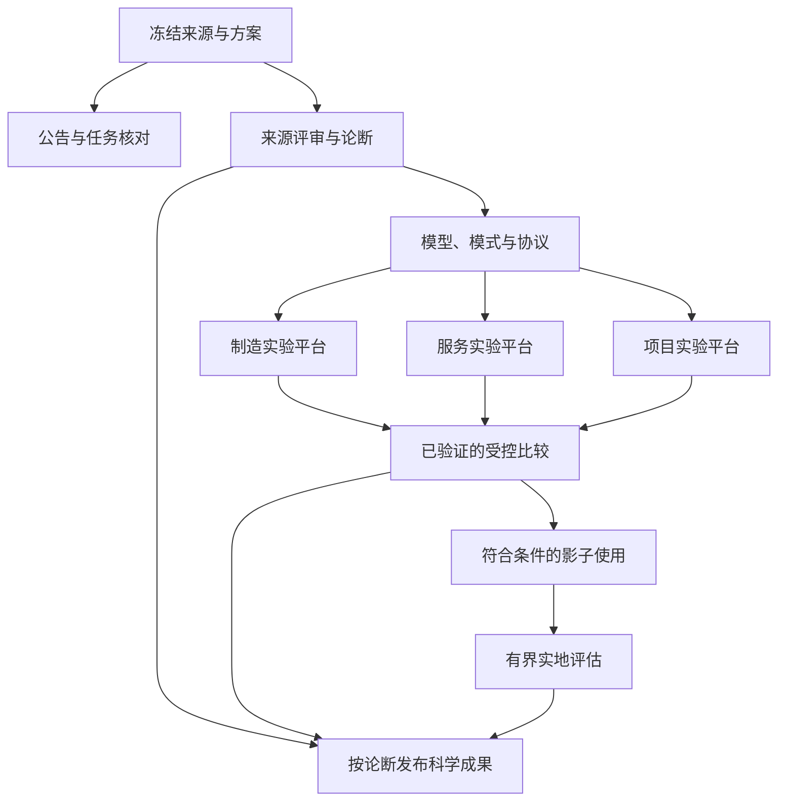

# 协调工作：执行方案与研究成果交付

编制日期：2026 年 11 月 18 日。状态：**供核对与评审的来源提案**。实际任务身份、分派、依赖与执行状态以 Muneral 为准。

本简体中文阅读版本由作者一方准备，并绑定到[英语方案](PROGRAMME.md)的精确字节。它覆盖全部史诗级任务、工作包、论文、假设与发布条件。不宣称已通过独立翻译忠实性评审或母语使用者评审。[完整任务契约](TASK_CONTRACTS.md)的链接指向另一个英语来源文档，其中保留了原始俄语验收条款；本页不宣称该契约文档已经完整翻译。

方案包含 **23 个史诗级任务、104 个工作包，以及 247 条消费前置成果的阻塞依赖**。保留全部 **72 个原始步骤**，补充 **32 个工作包**，并关联 **16 篇潜在论文与 12 个假设**。[机器可读图](execution-graph.json)与完整任务契约界定拟登记的范围。

这些条目是工作包。大型综述批次、实验平台族与出版模板必须在分派前拆成有界子任务。拟议负责人不等于已获实际分派。为核对准备的 128 个方案、史诗级任务与工作包对象，不等于已创建 128 个 Muneral 对象。

## 现有证据与拟议贡献

[初始研究资料包](https://github.com/Arcanada-one/knowledge-contract/tree/ea698baa3d4997b56c725d806c600173aa6064b9/roadmap/coordinated-work)保留 1176 条参考文献记录：157 条已核验原始记录与 1019 条引文候选记录。独立文献数量仍未确定：26 组同标题同年份记录以及四对近似标题仍待身份核查。已完成的全文批判性评价为 0 项。保留的 r2 数值示例包含 10 个情景、100 个“情景×时段”观测和 190 项基础检查，记录到 0 次违反。这些结果仅支持有界数值实现结论，不能证明智能体或优化器有效，也不能证明模型适用于真实组织。

拟议贡献是一种组织领域配置：把需求、工作网络、不同资源语义、胜任能力与决策证据关联到 Agent Situation 和 Context Assembly。创新性仍须与既有研究比较。引入领域配置不会创建新的 KC 原生制品类型，也不会授予执行权限。

## 首个史诗级任务：使方案可见并可落实

CW-EP00 包括来源冻结、方案章程、任务图、EN/RU/zh-Hans Journal 公告、路线图与仓库导航、原生任务核对、经核验的公开交付，以及向集体移交有界工作。公告在获准后可以先行发布，即使原生任务登记仍未完成；完整启动交接 CW-N08 只有在同时取得发布与登记回执后才能关闭。

| 工作包 | 可观察成果 | 拟议负责人 / 执行方 | 阻塞输入 |
| --- | --- | --- | --- |
| [CW-N01](TASK_CONTRACTS.md#freeze-programme-inputs-and-evidence-boundary-cw-n01) — 冻结方案输入与已有证据的边界 | 冻结来源与证据的清单 | KC-Brain / KC-SWE | 仅来源输入 |
| [CW-N02](TASK_CONTRACTS.md#define-programme-charter-and-output-families-cw-n02) — 定义方案章程与成果类别 | 方案章程与成果目录 | KC-Brain / KC-SWE | [CW-N01](TASK_CONTRACTS.md#freeze-programme-inputs-and-evidence-boundary-cw-n01) |
| [CW-N03](TASK_CONTRACTS.md#build-and-validate-execution-graph-cw-n03) — 构建并验证执行图 | 版本化执行方案与覆盖验证器 | KC-Brain / KC-SWE | [CW-N02](TASK_CONTRACTS.md#define-programme-charter-and-output-families-cw-n02) |
| [CW-N04](TASK_CONTRACTS.md#prepare-enruzh-hans-announcement-bundle-cw-n04) — 准备英语、俄语与简体中文公告资料包 | 三语公告与研究卡片 | KC-Brain / KC-SWE | [CW-N02](TASK_CONTRACTS.md#define-programme-charter-and-output-families-cw-n02), [CW-N03](TASK_CONTRACTS.md#build-and-validate-execution-graph-cw-n03) |
| [CW-N05](TASK_CONTRACTS.md#publish-repository-and-roadmap-programme-entries-cw-n05) — 发布仓库与路线图中的方案条目 | 仓库与路线图公告整合 | KC-Brain / KC-SWE | [CW-N03](TASK_CONTRACTS.md#build-and-validate-execution-graph-cw-n03), [CW-N04](TASK_CONTRACTS.md#prepare-enruzh-hans-announcement-bundle-cw-n04) |
| [CW-N06](TASK_CONTRACTS.md#register-and-read-back-muneral-graph-cw-n06) — 在 Muneral 登记任务图并读回核验 | Muneral 登记与精确读回记录 | KC-Brain / KC-SWE | [CW-N03](TASK_CONTRACTS.md#build-and-validate-execution-graph-cw-n03) |
| [CW-N07](TASK_CONTRACTS.md#deliver-announcement-and-programme-landing-cw-n07) — 交付三语公告与方案页面 | 三语发布完成回执 | KC-Brain / KC-SWE | [CW-N04](TASK_CONTRACTS.md#prepare-enruzh-hans-announcement-bundle-cw-n04), [CW-N05](TASK_CONTRACTS.md#publish-repository-and-roadmap-programme-entries-cw-n05) |
| [CW-N08](TASK_CONTRACTS.md#complete-collective-handoff-and-first-work-batch-cw-n08) — 完成集体交接与首批有界工作 | 集体责任约定与首批有界工作交接 | KC-Brain / KC-SWE | [CW-N06](TASK_CONTRACTS.md#register-and-read-back-muneral-graph-cw-n06), [CW-N07](TASK_CONTRACTS.md#deliver-announcement-and-programme-landing-cw-n07) |

启动验收需要精确的来源与翻译绑定、权利与署名检查、在声明范围内的独立评审、托管 CI 核验、明确的回滚版本、正式发布流程，以及匿名读回实际页面。浏览器检查必须确认桌面与手机上能够看到文章正文，并确认切换语言后仍是同一期内容。元数据或 HTML 词法检查不能证明这些属性。

## 并行交付顺序

下图仅是概览，并非包含 247 条边的完整权威图。JSON 中的每条实际阻塞依赖都说明其消费哪项前置成果。



1. **启动与核对。** 冻结来源和证据，发布准确的方案说明，核对既有 Muneral 工作，并准备首批有界任务。
2. **并行基础工作。** 评审原始来源，定义需求、资源与工作图，建立来源模式，规定权利与数据契约，并登记各项研究的问题。
3. **并行领域平台。** 制造、服务和项目平台在获得各自必要输入后开展。确认性比较之前必须完成独立判定基准与模型有效性检查。
4. **受控证据。** 在声明的匹配预算下，比较当前方法、强运筹学方法、不检索的智能体、强普通 RAG 与完整 KC 配置；保留消融、失败与不确定性。
5. **符合条件的真实使用。** 绑定真实的 Arcanada 任务与实现，收集影子证据，再开展另行获准的有界干预和留出迁移评估。
6. **按论断发布。** 经评审的来源图谱、条件证明与组织因果效应具有不同证据义务。文献或形式化结果不必等待全局实地试验；因果效应论断仍须具有适当的识别设计与实际数据。

[依赖关系决策](DEPENDENCY-DECISIONS.md)保留原始边的历史并解释修订。原始最长依赖链为 64 个任务节点，提议图为 17 个节点。这是拓扑节点数量，不是天数、工作量估计或已证明的提速。原生核对时还须明确产能、评审人员可用时间与持续时间。复用现有六角色集体；任务行不会创建额外智能体。

## 史诗级任务登记表

| 史诗级任务 | 范围 | 工作包数 | 拟议负责人 / 执行方 |
| --- | --- | ---: | --- |
| CW-EP00 | 方向公告与任务登记 | 8 | KC-Brain / KC-SWE |
| CW-EP01 | 文献库与研究图谱 | 9 | KC-Brain / Research-Arcana |
| CW-EP02 | 需求与能力本体 | 8 | KC-Brain / Research-Arcana |
| CW-EP03 | 组织状态与允许使用的来源 | 8 | KC-Brain / KC-SWE |
| CW-EP04 | 流量、产能与约束 | 8 | KC-Brain / Research-Arcana |
| CW-EP05 | 团队与能力规划 | 8 | KC-Brain / Research-Arcana |
| CW-EP06 | 预测、不确定性与漂移 | 7 | KC-Brain / Research-Arcana |
| CW-EP07 | 决策契约与智能体核验 | 8 | Agent-Brain / Agent-SWE |
| CW-EP08 | 实验设计与比较评估 | 5 | KC-Brain / Research-Arcana |
| CW-EP09 | 三语科学出版 | 11 | KC-Brain / KC-SWE |
| CW-EP10 | 形式化可容许性与资源类型 | 3 | KC-Brain / Research-Arcana |
| CW-EP11 | 数据权利、隐私与参考资料包 | 2 | KC-Brain / KC-SWE |
| CW-EP12 | 独立判定基准与模型有效性 | 2 | KC-Brain / KC-SWE |
| CW-EP13 | 制造流程实验平台 | 1 | KC-Brain / KC-SWE |
| CW-EP14 | 服务流程实验平台 | 1 | KC-Brain / KC-SWE |
| CW-EP15 | 项目与知识工作实验平台 | 1 | KC-Brain / KC-SWE |
| CW-EP16 | 因果性、可观测性与干扰 | 3 | KC-Brain / Research-Arcana |
| CW-EP17 | 执行、并发与总成本 | 3 | Agent-Brain / Agent-SWE |
| CW-EP18 | 使用方与生态系统整合 | 2 | Agent-Brain / Agent-SWE |
| CW-EP19 | 操作人员理解与信息价值 | 1 | KC-Brain / Research-Arcana |
| CW-EP20 | 影子评估、实地研究与外部复现 | 3 | KC-Brain / Research-Arcana |
| CW-EP21 | 动力学、稳定性与递归可行性 | 1 | KC-Brain / Research-Arcana |
| CW-EP22 | KC 兼容性与证据来源链 | 1 | KC-Brain / KC-SWE |

## 完整工作包清单

每个链接指向的契约都记录编号验收标准、明确的拟议成果、所需证据、负向对照、来源覆盖、评审方，以及消费的前置成果。

| 工作包 | 工作 | 所属史诗级任务 | 阻塞前提 |
| --- | --- | --- | --- |
| [CW-N01](TASK_CONTRACTS.md#freeze-programme-inputs-and-evidence-boundary-cw-n01) | 冻结方案输入与已有证据的边界 | CW-EP00 | 本提案中没有前置任务 |
| [CW-N02](TASK_CONTRACTS.md#define-programme-charter-and-output-families-cw-n02) | 定义方案章程与成果类别 | CW-EP00 | [CW-N01](TASK_CONTRACTS.md#freeze-programme-inputs-and-evidence-boundary-cw-n01) |
| [CW-N03](TASK_CONTRACTS.md#build-and-validate-execution-graph-cw-n03) | 构建并验证执行图 | CW-EP00 | [CW-N02](TASK_CONTRACTS.md#define-programme-charter-and-output-families-cw-n02) |
| [CW-N04](TASK_CONTRACTS.md#prepare-enruzh-hans-announcement-bundle-cw-n04) | 准备英语、俄语与简体中文公告资料包 | CW-EP00 | [CW-N02](TASK_CONTRACTS.md#define-programme-charter-and-output-families-cw-n02), [CW-N03](TASK_CONTRACTS.md#build-and-validate-execution-graph-cw-n03) |
| [CW-N05](TASK_CONTRACTS.md#publish-repository-and-roadmap-programme-entries-cw-n05) | 发布仓库与路线图中的方案条目 | CW-EP00 | [CW-N03](TASK_CONTRACTS.md#build-and-validate-execution-graph-cw-n03), [CW-N04](TASK_CONTRACTS.md#prepare-enruzh-hans-announcement-bundle-cw-n04) |
| [CW-N06](TASK_CONTRACTS.md#register-and-read-back-muneral-graph-cw-n06) | 在 Muneral 登记任务图并读回核验 | CW-EP00 | [CW-N03](TASK_CONTRACTS.md#build-and-validate-execution-graph-cw-n03) |
| [CW-N07](TASK_CONTRACTS.md#deliver-announcement-and-programme-landing-cw-n07) | 交付三语公告与方案页面 | CW-EP00 | [CW-N04](TASK_CONTRACTS.md#prepare-enruzh-hans-announcement-bundle-cw-n04), [CW-N05](TASK_CONTRACTS.md#publish-repository-and-roadmap-programme-entries-cw-n05) |
| [CW-N08](TASK_CONTRACTS.md#complete-collective-handoff-and-first-work-batch-cw-n08) | 完成集体交接与首批有界工作 | CW-EP00 | [CW-N06](TASK_CONTRACTS.md#register-and-read-back-muneral-graph-cw-n06), [CW-N07](TASK_CONTRACTS.md#deliver-announcement-and-programme-landing-cw-n07) |
| [CW-A01](TASK_CONTRACTS.md#define-review-scope-cw-a01) | 界定文献综述的范围 | CW-EP01 | [CW-N01](TASK_CONTRACTS.md#freeze-programme-inputs-and-evidence-boundary-cw-n01) |
| [CW-A02](TASK_CONTRACTS.md#verify-the-seed-bibliography-cw-a02) | 核验初始参考文献 | CW-EP01 | [CW-A01](TASK_CONTRACTS.md#define-review-scope-cw-a01) |
| [CW-A03](TASK_CONTRACTS.md#extract-citation-candidates-cw-a03) | 提取引文候选记录 | CW-EP01 | [CW-A01](TASK_CONTRACTS.md#define-review-scope-cw-a01) |
| [CW-A04](TASK_CONTRACTS.md#resolve-publication-identities-cw-a04) | 确认文献身份并消解重复 | CW-EP01 | [CW-A02](TASK_CONTRACTS.md#verify-the-seed-bibliography-cw-a02), [CW-A03](TASK_CONTRACTS.md#extract-citation-candidates-cw-a03) |
| [CW-A05](TASK_CONTRACTS.md#expand-field-coverage-cw-a05) | 扩大研究领域覆盖 | CW-EP01 | [CW-A01](TASK_CONTRACTS.md#define-review-scope-cw-a01) |
| [CW-A06](TASK_CONTRACTS.md#screen-full-texts-cw-a06) | 筛选并评价全文 | CW-EP01 | [CW-A02](TASK_CONTRACTS.md#verify-the-seed-bibliography-cw-a02), [CW-A04](TASK_CONTRACTS.md#resolve-publication-identities-cw-a04), [CW-A05](TASK_CONTRACTS.md#expand-field-coverage-cw-a05) |
| [CW-A07](TASK_CONTRACTS.md#extract-scoped-claims-cw-a07) | 提取具有明确适用范围的论断 | CW-EP01 | [CW-A06](TASK_CONTRACTS.md#screen-full-texts-cw-a06) |
| [CW-A08](TASK_CONTRACTS.md#review-the-scoping-map-cw-a08) | 评审范围综述图谱 | CW-EP01 | [CW-A07](TASK_CONTRACTS.md#extract-scoped-claims-cw-a07) |
| [CW-N09](TASK_CONTRACTS.md#frontload-novelty-discriminants-cw-n09) | 提前比较创新性与最接近的既有研究 | CW-EP01 | [CW-A07](TASK_CONTRACTS.md#extract-scoped-claims-cw-a07) |
| [CW-B01](TASK_CONTRACTS.md#define-organizational-units-cw-b01) | 定义组织分析单元 | CW-EP02 | [CW-A01](TASK_CONTRACTS.md#define-review-scope-cw-a01) |
| [CW-B02](TASK_CONTRACTS.md#classify-needs-and-situations-cw-b02) | 对需求与情境进行分类 | CW-EP02 | [CW-B01](TASK_CONTRACTS.md#define-organizational-units-cw-b01) |
| [CW-B03](TASK_CONTRACTS.md#map-sectors-and-processes-cw-b03) | 映射行业与流程 | CW-EP02 | [CW-B01](TASK_CONTRACTS.md#define-organizational-units-cw-b01) |
| [CW-B04](TASK_CONTRACTS.md#map-occupations-and-competencies-cw-b04) | 映射职业与胜任能力 | CW-EP02 | [CW-B01](TASK_CONTRACTS.md#define-organizational-units-cw-b01) |
| [CW-B05](TASK_CONTRACTS.md#define-resource-semantics-cw-b05) | 定义资源语义 | CW-EP02 | [CW-B01](TASK_CONTRACTS.md#define-organizational-units-cw-b01) |
| [CW-B06](TASK_CONTRACTS.md#define-performance-measures-cw-b06) | 定义绩效度量 | CW-EP02 | [CW-B01](TASK_CONTRACTS.md#define-organizational-units-cw-b01) |
| [CW-B07](TASK_CONTRACTS.md#assess-annotation-agreement-cw-b07) | 评估标注一致性 | CW-EP02 | [CW-B02](TASK_CONTRACTS.md#classify-needs-and-situations-cw-b02), [CW-B03](TASK_CONTRACTS.md#map-sectors-and-processes-cw-b03), [CW-B04](TASK_CONTRACTS.md#map-occupations-and-competencies-cw-b04), [CW-B05](TASK_CONTRACTS.md#define-resource-semantics-cw-b05), [CW-B06](TASK_CONTRACTS.md#define-performance-measures-cw-b06) |
| [CW-B08](TASK_CONTRACTS.md#evaluate-held-out-sectors-cw-b08) | 在留出的行业中评估 | CW-EP02 | [CW-B07](TASK_CONTRACTS.md#assess-annotation-agreement-cw-b07) |
| [CW-C01](TASK_CONTRACTS.md#build-the-typed-work-graph-cw-c01) | 构建具有类型的工作图 | CW-EP03 | [CW-B01](TASK_CONTRACTS.md#define-organizational-units-cw-b01), [CW-B02](TASK_CONTRACTS.md#classify-needs-and-situations-cw-b02), [CW-B05](TASK_CONTRACTS.md#define-resource-semantics-cw-b05) |
| [CW-C02](TASK_CONTRACTS.md#define-event-semantics-cw-c02) | 定义事件语义 | CW-EP03 | [CW-C01](TASK_CONTRACTS.md#build-the-typed-work-graph-cw-c01) |
| [CW-C03](TASK_CONTRACTS.md#separate-demand-observations-cw-c03) | 区分需求观测与潜在需求 | CW-EP03 | [CW-C01](TASK_CONTRACTS.md#build-the-typed-work-graph-cw-c01), [CW-B06](TASK_CONTRACTS.md#define-performance-measures-cw-b06) |
| [CW-C04](TASK_CONTRACTS.md#represent-availability-calendars-cw-c04) | 表示资源可用日历 | CW-EP03 | [CW-C01](TASK_CONTRACTS.md#build-the-typed-work-graph-cw-c01), [CW-B04](TASK_CONTRACTS.md#map-occupations-and-competencies-cw-b04), [CW-B05](TASK_CONTRACTS.md#define-resource-semantics-cw-b05) |
| [CW-C05](TASK_CONTRACTS.md#preserve-provenance-and-conflicts-cw-c05) | 保留来源与冲突 | CW-EP03 | [CW-C02](TASK_CONTRACTS.md#define-event-semantics-cw-c02), [CW-A02](TASK_CONTRACTS.md#verify-the-seed-bibliography-cw-a02), [CW-N10](TASK_CONTRACTS.md#specify-claim-and-evidence-lineage-cw-n10) |
| [CW-C06](TASK_CONTRACTS.md#specify-freshness-and-invalidation-cw-c06) | 规定知识时效与失效机制 | CW-EP03 | [CW-C05](TASK_CONTRACTS.md#preserve-provenance-and-conflicts-cw-c05) |
| [CW-C07](TASK_CONTRACTS.md#prototype-authorized-adapters-cw-c07) | 制作具有授权边界的适配器原型 | CW-EP03 | [CW-C02](TASK_CONTRACTS.md#define-event-semantics-cw-c02), [CW-C03](TASK_CONTRACTS.md#separate-demand-observations-cw-c03), [CW-C04](TASK_CONTRACTS.md#represent-availability-calendars-cw-c04), [CW-C05](TASK_CONTRACTS.md#preserve-provenance-and-conflicts-cw-c05), [CW-C06](TASK_CONTRACTS.md#specify-freshness-and-invalidation-cw-c06), [CW-N15](TASK_CONTRACTS.md#bind-data-access-rights-and-measurement-purposes-cw-n15) |
| [CW-C08](TASK_CONTRACTS.md#review-the-organization-profile-cw-c08) | 评审组织领域配置 | CW-EP03 | [CW-C07](TASK_CONTRACTS.md#prototype-authorized-adapters-cw-c07), [CW-B08](TASK_CONTRACTS.md#evaluate-held-out-sectors-cw-b08), [CW-A08](TASK_CONTRACTS.md#review-the-scoping-map-cw-a08) |
| [CW-D01](TASK_CONTRACTS.md#define-flow-conservation-cw-d01) | 定义流量守恒 | CW-EP04 | [CW-B05](TASK_CONTRACTS.md#define-resource-semantics-cw-b05), [CW-N14](TASK_CONTRACTS.md#implement-dimensional-and-availability-checks-cw-n14) |
| [CW-D02](TASK_CONTRACTS.md#derive-conditional-throughput-bounds-cw-d02) | 推导附带条件的吞吐量上界 | CW-EP04 | [CW-D01](TASK_CONTRACTS.md#define-flow-conservation-cw-d01) |
| [CW-D03](TASK_CONTRACTS.md#model-buffers-and-delays-cw-d03) | 建模缓冲区与延迟 | CW-EP04 | [CW-D01](TASK_CONTRACTS.md#define-flow-conservation-cw-d01), [CW-D02](TASK_CONTRACTS.md#derive-conditional-throughput-bounds-cw-d02) |
| [CW-D04](TASK_CONTRACTS.md#model-setup-and-rework-cw-d04) | 建模换型与返工 | CW-EP04 | [CW-D01](TASK_CONTRACTS.md#define-flow-conservation-cw-d01), [CW-C03](TASK_CONTRACTS.md#separate-demand-observations-cw-c03) |
| [CW-D05](TASK_CONTRACTS.md#compare-release-policies-cw-d05) | 比较工作投放策略 | CW-EP04 | [CW-D06](TASK_CONTRACTS.md#add-product-mix-and-shared-resources-cw-d06), [CW-N17](TASK_CONTRACTS.md#create-independent-oracles-and-mutation-controls-cw-n17) |
| [CW-D06](TASK_CONTRACTS.md#add-product-mix-and-shared-resources-cw-d06) | 加入产品组合与共享资源 | CW-EP04 | [CW-D03](TASK_CONTRACTS.md#model-buffers-and-delays-cw-d03), [CW-D04](TASK_CONTRACTS.md#model-setup-and-rework-cw-d04), [CW-C04](TASK_CONTRACTS.md#represent-availability-calendars-cw-c04) |
| [CW-D07](TASK_CONTRACTS.md#construct-local-metric-counterexamples-cw-d07) | 构造局部指标的反例 | CW-EP04 | [CW-D05](TASK_CONTRACTS.md#compare-release-policies-cw-d05), [CW-B06](TASK_CONTRACTS.md#define-performance-measures-cw-b06) |
| [CW-D08](TASK_CONTRACTS.md#review-the-flow-model-cw-d08) | 评审流量模型 | CW-EP04 | [CW-D07](TASK_CONTRACTS.md#construct-local-metric-counterexamples-cw-d07), [CW-A08](TASK_CONTRACTS.md#review-the-scoping-map-cw-a08), [CW-C08](TASK_CONTRACTS.md#review-the-organization-profile-cw-c08) |
| [CW-E01](TASK_CONTRACTS.md#estimate-task-workload-cw-e01) | 估算各任务的劳动工作量 | CW-EP05 | [CW-B04](TASK_CONTRACTS.md#map-occupations-and-competencies-cw-b04), [CW-C03](TASK_CONTRACTS.md#separate-demand-observations-cw-c03), [CW-C04](TASK_CONTRACTS.md#represent-availability-calendars-cw-c04), [CW-B06](TASK_CONTRACTS.md#define-performance-measures-cw-b06) |
| [CW-E02](TASK_CONTRACTS.md#bind-competency-evidence-cw-e02) | 关联胜任能力证据 | CW-EP05 | [CW-B04](TASK_CONTRACTS.md#map-occupations-and-competencies-cw-b04) |
| [CW-E03](TASK_CONTRACTS.md#optimize-multiskill-assignments-cw-e03) | 优化多技能人员分配 | CW-EP05 | [CW-E01](TASK_CONTRACTS.md#estimate-task-workload-cw-e01), [CW-E02](TASK_CONTRACTS.md#bind-competency-evidence-cw-e02), [CW-D06](TASK_CONTRACTS.md#add-product-mix-and-shared-resources-cw-d06) |
| [CW-E04](TASK_CONTRACTS.md#model-hiring-lead-times-cw-e04) | 建模招聘提前期与产能爬坡 | CW-EP05 | [CW-E01](TASK_CONTRACTS.md#estimate-task-workload-cw-e01), [CW-C04](TASK_CONTRACTS.md#represent-availability-calendars-cw-c04) |
| [CW-E05](TASK_CONTRACTS.md#compare-capacity-alternatives-cw-e05) | 比较招聘之外的产能方案 | CW-EP05 | [CW-E03](TASK_CONTRACTS.md#optimize-multiskill-assignments-cw-e03), [CW-E04](TASK_CONTRACTS.md#model-hiring-lead-times-cw-e04), [CW-F04](TASK_CONTRACTS.md#model-decision-delays-cw-f04), [CW-N21](TASK_CONTRACTS.md#model-team-complementarity-and-capability-change-cw-n21) |
| [CW-E07](TASK_CONTRACTS.md#constrain-sustainable-workload-cw-e07) | 约束可持续工作负荷 | CW-EP05 | [CW-C04](TASK_CONTRACTS.md#represent-availability-calendars-cw-c04), [CW-E03](TASK_CONTRACTS.md#optimize-multiskill-assignments-cw-e03) |
| [CW-E08](TASK_CONTRACTS.md#produce-auditable-role-requirements-cw-e08) | 形成可审计的岗位需求 | CW-EP05 | [CW-E05](TASK_CONTRACTS.md#compare-capacity-alternatives-cw-e05), [CW-E06](TASK_CONTRACTS.md#separate-performance-from-causation-cw-e06), [CW-E07](TASK_CONTRACTS.md#constrain-sustainable-workload-cw-e07), [CW-A08](TASK_CONTRACTS.md#review-the-scoping-map-cw-a08), [CW-C08](TASK_CONTRACTS.md#review-the-organization-profile-cw-c08) |
| [CW-N21](TASK_CONTRACTS.md#model-team-complementarity-and-capability-change-cw-n21) | 建模团队互补、指导与能力变化 | CW-EP05 | [CW-E01](TASK_CONTRACTS.md#estimate-task-workload-cw-e01), [CW-E02](TASK_CONTRACTS.md#bind-competency-evidence-cw-e02), [CW-C04](TASK_CONTRACTS.md#represent-availability-calendars-cw-c04) |
| [CW-F01](TASK_CONTRACTS.md#reconcile-hierarchical-forecasts-cw-f01) | 协调层级预测 | CW-EP06 | [CW-C03](TASK_CONTRACTS.md#separate-demand-observations-cw-c03) |
| [CW-F02](TASK_CONTRACTS.md#calibrate-predictive-uncertainty-cw-f02) | 校准预测不确定性 | CW-EP06 | [CW-F01](TASK_CONTRACTS.md#reconcile-hierarchical-forecasts-cw-f01) |
| [CW-F03](TASK_CONTRACTS.md#define-external-shock-scenarios-cw-f03) | 定义外部冲击情景 | CW-EP06 | [CW-A02](TASK_CONTRACTS.md#verify-the-seed-bibliography-cw-a02), [CW-C01](TASK_CONTRACTS.md#build-the-typed-work-graph-cw-c01) |
| [CW-F04](TASK_CONTRACTS.md#model-decision-delays-cw-f04) | 建模决策延迟 | CW-EP06 | [CW-C02](TASK_CONTRACTS.md#define-event-semantics-cw-c02), [CW-C04](TASK_CONTRACTS.md#represent-availability-calendars-cw-c04) |
| [CW-F05](TASK_CONTRACTS.md#optimize-under-uncertainty-cw-f05) | 在不确定条件下优化 | CW-EP06 | [CW-F02](TASK_CONTRACTS.md#calibrate-predictive-uncertainty-cw-f02), [CW-F03](TASK_CONTRACTS.md#define-external-shock-scenarios-cw-f03), [CW-F04](TASK_CONTRACTS.md#model-decision-delays-cw-f04) |
| [CW-F07](TASK_CONTRACTS.md#detect-distribution-shift-cw-f07) | 检测分布漂移 | CW-EP06 | [CW-C06](TASK_CONTRACTS.md#specify-freshness-and-invalidation-cw-c06), [CW-F02](TASK_CONTRACTS.md#calibrate-predictive-uncertainty-cw-f02), [CW-F06](TASK_CONTRACTS.md#check-endogenous-observations-cw-f06) |
| [CW-F08](TASK_CONTRACTS.md#backtest-frozen-forecast-decisions-cw-f08) | 回测冻结的预测与决策 | CW-EP06 | [CW-F05](TASK_CONTRACTS.md#optimize-under-uncertainty-cw-f05), [CW-F06](TASK_CONTRACTS.md#check-endogenous-observations-cw-f06), [CW-F07](TASK_CONTRACTS.md#detect-distribution-shift-cw-f07) |
| [CW-G01](TASK_CONTRACTS.md#define-decision-prerequisites-cw-g01) | 定义决策前提 | CW-EP07 | [CW-C01](TASK_CONTRACTS.md#build-the-typed-work-graph-cw-c01), [CW-B02](TASK_CONTRACTS.md#classify-needs-and-situations-cw-b02), [CW-B04](TASK_CONTRACTS.md#map-occupations-and-competencies-cw-b04), [CW-B05](TASK_CONTRACTS.md#define-resource-semantics-cw-b05), [CW-B06](TASK_CONTRACTS.md#define-performance-measures-cw-b06), [CW-N11](TASK_CONTRACTS.md#specify-objectives-tradeoffs-and-infeasibility-cw-n11) |
| [CW-G02](TASK_CONTRACTS.md#assemble-bounded-context-cw-g02) | 组装有界上下文 | CW-EP07 | [CW-G01](TASK_CONTRACTS.md#define-decision-prerequisites-cw-g01), [CW-C05](TASK_CONTRACTS.md#preserve-provenance-and-conflicts-cw-c05), [CW-C06](TASK_CONTRACTS.md#specify-freshness-and-invalidation-cw-c06) |
| [CW-G03](TASK_CONTRACTS.md#define-startup-readiness-cw-g03) | 定义启动就绪条件 | CW-EP07 | [CW-G01](TASK_CONTRACTS.md#define-decision-prerequisites-cw-g01) |
| [CW-G04](TASK_CONTRACTS.md#separate-proposal-and-verification-cw-g04) | 分离方案提出与核验 | CW-EP07 | [CW-G01](TASK_CONTRACTS.md#define-decision-prerequisites-cw-g01), [CW-N12](TASK_CONTRACTS.md#discharge-conditional-admissibility-obligations-cw-n12) |
| [CW-G05](TASK_CONTRACTS.md#calibrate-abstention-cw-g05) | 校准澄清与拒绝推断 | CW-EP07 | [CW-G02](TASK_CONTRACTS.md#assemble-bounded-context-cw-g02), [CW-F02](TASK_CONTRACTS.md#calibrate-predictive-uncertainty-cw-f02) |
| [CW-G06](TASK_CONTRACTS.md#record-decision-evidence-cw-g06) | 记录决策证据 | CW-EP07 | [CW-G02](TASK_CONTRACTS.md#assemble-bounded-context-cw-g02), [CW-G03](TASK_CONTRACTS.md#define-startup-readiness-cw-g03), [CW-G04](TASK_CONTRACTS.md#separate-proposal-and-verification-cw-g04) |
| [CW-G07](TASK_CONTRACTS.md#handle-concurrent-decisions-cw-g07) | 处理并发决策 | CW-EP07 | [CW-G06](TASK_CONTRACTS.md#record-decision-evidence-cw-g06), [CW-C04](TASK_CONTRACTS.md#represent-availability-calendars-cw-c04) |
| [CW-G08](TASK_CONTRACTS.md#review-learning-updates-cw-g08) | 评审学习产生的更新 | CW-EP07 | [CW-G06](TASK_CONTRACTS.md#record-decision-evidence-cw-g06), [CW-C06](TASK_CONTRACTS.md#specify-freshness-and-invalidation-cw-c06) |
| [CW-H01](TASK_CONTRACTS.md#freeze-hypotheses-and-metrics-cw-h01) | 冻结假设与度量 | CW-EP08 | [CW-N19](TASK_CONTRACTS.md#register-study-protocols-and-matched-baselines-cw-n19) |
| [CW-H05](TASK_CONTRACTS.md#evaluate-strong-baselines-cw-h05) | 评估强基线方法 | CW-EP08 | [CW-H02](TASK_CONTRACTS.md#build-the-manufacturing-benchmark-cw-h02), [CW-H03](TASK_CONTRACTS.md#build-the-service-benchmark-cw-h03), [CW-H04](TASK_CONTRACTS.md#build-the-project-benchmark-cw-h04), [CW-G04](TASK_CONTRACTS.md#separate-proposal-and-verification-cw-g04), [CW-F08](TASK_CONTRACTS.md#backtest-frozen-forecast-decisions-cw-f08), [CW-E08](TASK_CONTRACTS.md#produce-auditable-role-requirements-cw-e08), [CW-D08](TASK_CONTRACTS.md#review-the-flow-model-cw-d08), [CW-C08](TASK_CONTRACTS.md#review-the-organization-profile-cw-c08), [CW-N18](TASK_CONTRACTS.md#validate-conceptual-and-operational-simulation-models-cw-n18), [CW-N20](TASK_CONTRACTS.md#plan-statistical-units-power-and-multiplicity-cw-n20) |
| [CW-H06](TASK_CONTRACTS.md#run-ablations-and-uncertainty-analysis-cw-h06) | 开展消融与不确定性分析 | CW-EP08 | [CW-H05](TASK_CONTRACTS.md#evaluate-strong-baselines-cw-h05), [CW-G08](TASK_CONTRACTS.md#review-learning-updates-cw-g08) |
| [CW-N19](TASK_CONTRACTS.md#register-study-protocols-and-matched-baselines-cw-n19) | 登记研究协议与匹配的基线 | CW-EP08 | [CW-A07](TASK_CONTRACTS.md#extract-scoped-claims-cw-a07), [CW-B06](TASK_CONTRACTS.md#define-performance-measures-cw-b06), [CW-N09](TASK_CONTRACTS.md#frontload-novelty-discriminants-cw-n09), [CW-N11](TASK_CONTRACTS.md#specify-objectives-tradeoffs-and-infeasibility-cw-n11) |
| [CW-N20](TASK_CONTRACTS.md#plan-statistical-units-power-and-multiplicity-cw-n20) | 规划统计单位、检验功效与多重比较 | CW-EP08 | [CW-N19](TASK_CONTRACTS.md#register-study-protocols-and-matched-baselines-cw-n19), [CW-N16](TASK_CONTRACTS.md#build-reference-datasets-and-data-dictionaries-cw-n16) |
| [CW-I01](TASK_CONTRACTS.md#reassess-novelty-cw-i01) | 重新评估创新性 | CW-EP09 | [CW-A08](TASK_CONTRACTS.md#review-the-scoping-map-cw-a08), [CW-B08](TASK_CONTRACTS.md#evaluate-held-out-sectors-cw-b08), [CW-N09](TASK_CONTRACTS.md#frontload-novelty-discriminants-cw-n09) |
| [CW-I02](TASK_CONTRACTS.md#bind-claims-to-evidence-cw-i02) | 将论断与证据关联 | CW-EP09 | [CW-A07](TASK_CONTRACTS.md#extract-scoped-claims-cw-a07), [CW-N10](TASK_CONTRACTS.md#specify-claim-and-evidence-lineage-cw-n10) |
| [CW-I03](TASK_CONTRACTS.md#prepare-canonical-manuscripts-cw-i03) | 编写规范来源稿件 | CW-EP09 | [CW-I01](TASK_CONTRACTS.md#reassess-novelty-cw-i01), [CW-I02](TASK_CONTRACTS.md#bind-claims-to-evidence-cw-i02), [CW-N30](TASK_CONTRACTS.md#define-claim-specific-publication-release-matrix-cw-n30) |
| [CW-I04](TASK_CONTRACTS.md#freeze-reproducibility-packages-cw-i04) | 冻结可复现资料包 | CW-EP09 | [CW-I03](TASK_CONTRACTS.md#prepare-canonical-manuscripts-cw-i03) |
| [CW-I05](TASK_CONTRACTS.md#obtain-substantive-review-cw-i05) | 取得实质性评审 | CW-EP09 | [CW-I04](TASK_CONTRACTS.md#freeze-reproducibility-packages-cw-i04), [CW-N31](TASK_CONTRACTS.md#maintain-trilingual-terminology-and-fidelity-cw-n31) |
| [CW-I06](TASK_CONTRACTS.md#integrate-through-repository-gates-cw-i06) | 通过仓库检查整合 | CW-EP09 | [CW-I05](TASK_CONTRACTS.md#obtain-substantive-review-cw-i05) |
| [CW-I07](TASK_CONTRACTS.md#publish-and-verify-served-content-cw-i07) | 发布并核验实际提供的内容 | CW-EP09 | [CW-I06](TASK_CONTRACTS.md#integrate-through-repository-gates-cw-i06) |
| [CW-I08](TASK_CONTRACTS.md#admit-indexing-and-maintain-revisions-cw-i08) | 批准索引收录并维护修订 | CW-EP09 | [CW-I07](TASK_CONTRACTS.md#publish-and-verify-served-content-cw-i07) |
| [CW-N30](TASK_CONTRACTS.md#define-claim-specific-publication-release-matrix-cw-n30) | 定义按论断区分的发布条件矩阵 | CW-EP09 | [CW-N02](TASK_CONTRACTS.md#define-programme-charter-and-output-families-cw-n02), [CW-N09](TASK_CONTRACTS.md#frontload-novelty-discriminants-cw-n09) |
| [CW-N31](TASK_CONTRACTS.md#maintain-trilingual-terminology-and-fidelity-cw-n31) | 维护三语术语与翻译忠实性 | CW-EP09 | [CW-B04](TASK_CONTRACTS.md#map-occupations-and-competencies-cw-b04), [CW-N02](TASK_CONTRACTS.md#define-programme-charter-and-output-families-cw-n02) |
| [CW-N32](TASK_CONTRACTS.md#maintain-revisions-negative-findings-and-withdrawal-cw-n32) | 维护修订、否定结果与撤回 | CW-EP09 | [CW-G08](TASK_CONTRACTS.md#review-learning-updates-cw-g08), [CW-N10](TASK_CONTRACTS.md#specify-claim-and-evidence-lineage-cw-n10) |
| [CW-N11](TASK_CONTRACTS.md#specify-objectives-tradeoffs-and-infeasibility-cw-n11) | 规定目标、权衡与不可行情形 | CW-EP10 | [CW-B02](TASK_CONTRACTS.md#classify-needs-and-situations-cw-b02), [CW-B06](TASK_CONTRACTS.md#define-performance-measures-cw-b06) |
| [CW-N12](TASK_CONTRACTS.md#discharge-conditional-admissibility-obligations-cw-n12) | 履行附带条件的可容许性证明义务 | CW-EP10 | [CW-B05](TASK_CONTRACTS.md#define-resource-semantics-cw-b05), [CW-C01](TASK_CONTRACTS.md#build-the-typed-work-graph-cw-c01), [CW-N11](TASK_CONTRACTS.md#specify-objectives-tradeoffs-and-infeasibility-cw-n11) |
| [CW-N14](TASK_CONTRACTS.md#implement-dimensional-and-availability-checks-cw-n14) | 实现量纲与可用性检查 | CW-EP10 | [CW-B05](TASK_CONTRACTS.md#define-resource-semantics-cw-b05) |
| [CW-N15](TASK_CONTRACTS.md#bind-data-access-rights-and-measurement-purposes-cw-n15) | 绑定数据访问权、使用权与测量目的 | CW-EP11 | [CW-N02](TASK_CONTRACTS.md#define-programme-charter-and-output-families-cw-n02), [CW-N10](TASK_CONTRACTS.md#specify-claim-and-evidence-lineage-cw-n10) |
| [CW-N16](TASK_CONTRACTS.md#build-reference-datasets-and-data-dictionaries-cw-n16) | 构建参考数据集与数据字典 | CW-EP11 | [CW-C02](TASK_CONTRACTS.md#define-event-semantics-cw-c02), [CW-C03](TASK_CONTRACTS.md#separate-demand-observations-cw-c03), [CW-C04](TASK_CONTRACTS.md#represent-availability-calendars-cw-c04), [CW-N15](TASK_CONTRACTS.md#bind-data-access-rights-and-measurement-purposes-cw-n15) |
| [CW-N17](TASK_CONTRACTS.md#create-independent-oracles-and-mutation-controls-cw-n17) | 建立独立判定基准与变异测试 | CW-EP12 | [CW-N12](TASK_CONTRACTS.md#discharge-conditional-admissibility-obligations-cw-n12), [CW-D01](TASK_CONTRACTS.md#define-flow-conservation-cw-d01) |
| [CW-N18](TASK_CONTRACTS.md#validate-conceptual-and-operational-simulation-models-cw-n18) | 验证仿真模型的概念与操作适用性 | CW-EP12 | [CW-N16](TASK_CONTRACTS.md#build-reference-datasets-and-data-dictionaries-cw-n16), [CW-N17](TASK_CONTRACTS.md#create-independent-oracles-and-mutation-controls-cw-n17), [CW-D03](TASK_CONTRACTS.md#model-buffers-and-delays-cw-d03), [CW-E03](TASK_CONTRACTS.md#optimize-multiskill-assignments-cw-e03), [CW-C01](TASK_CONTRACTS.md#build-the-typed-work-graph-cw-c01), [CW-H02](TASK_CONTRACTS.md#build-the-manufacturing-benchmark-cw-h02), [CW-H03](TASK_CONTRACTS.md#build-the-service-benchmark-cw-h03), [CW-H04](TASK_CONTRACTS.md#build-the-project-benchmark-cw-h04) |
| [CW-H02](TASK_CONTRACTS.md#build-the-manufacturing-benchmark-cw-h02) | 构建制造业基准实验平台 | CW-EP13 | [CW-D03](TASK_CONTRACTS.md#model-buffers-and-delays-cw-d03), [CW-D04](TASK_CONTRACTS.md#model-setup-and-rework-cw-d04), [CW-D06](TASK_CONTRACTS.md#add-product-mix-and-shared-resources-cw-d06), [CW-H01](TASK_CONTRACTS.md#freeze-hypotheses-and-metrics-cw-h01), [CW-N17](TASK_CONTRACTS.md#create-independent-oracles-and-mutation-controls-cw-n17) |
| [CW-H03](TASK_CONTRACTS.md#build-the-service-benchmark-cw-h03) | 构建服务业基准实验平台 | CW-EP14 | [CW-E03](TASK_CONTRACTS.md#optimize-multiskill-assignments-cw-e03), [CW-C03](TASK_CONTRACTS.md#separate-demand-observations-cw-c03), [CW-H01](TASK_CONTRACTS.md#freeze-hypotheses-and-metrics-cw-h01) |
| [CW-H04](TASK_CONTRACTS.md#build-the-project-benchmark-cw-h04) | 构建项目基准实验平台 | CW-EP15 | [CW-C01](TASK_CONTRACTS.md#build-the-typed-work-graph-cw-c01), [CW-C04](TASK_CONTRACTS.md#represent-availability-calendars-cw-c04), [CW-H01](TASK_CONTRACTS.md#freeze-hypotheses-and-metrics-cw-h01) |
| [CW-E06](TASK_CONTRACTS.md#separate-performance-from-causation-cw-e06) | 区分绩效观察与因果作用 | CW-EP16 | [CW-B06](TASK_CONTRACTS.md#define-performance-measures-cw-b06), [CW-C05](TASK_CONTRACTS.md#preserve-provenance-and-conflicts-cw-c05) |
| [CW-F06](TASK_CONTRACTS.md#check-endogenous-observations-cw-f06) | 检查观测的内生性 | CW-EP16 | [CW-C03](TASK_CONTRACTS.md#separate-demand-observations-cw-c03), [CW-C05](TASK_CONTRACTS.md#preserve-provenance-and-conflicts-cw-c05) |
| [CW-N29](TASK_CONTRACTS.md#design-bounded-field-intervention-cw-n29) | 设计有界实地干预 | CW-EP16 | [CW-E06](TASK_CONTRACTS.md#separate-performance-from-causation-cw-e06), [CW-H01](TASK_CONTRACTS.md#freeze-hypotheses-and-metrics-cw-h01), [CW-N15](TASK_CONTRACTS.md#bind-data-access-rights-and-measurement-purposes-cw-n15), [CW-H07](TASK_CONTRACTS.md#run-a-shadow-evaluation-cw-h07) |
| [CW-N22](TASK_CONTRACTS.md#specify-organization-decision-adapter-contracts-cw-n22) | 规定组织决策适配器的契约 | CW-EP17 | [CW-G03](TASK_CONTRACTS.md#define-startup-readiness-cw-g03), [CW-G04](TASK_CONTRACTS.md#separate-proposal-and-verification-cw-g04), [CW-G06](TASK_CONTRACTS.md#record-decision-evidence-cw-g06), [CW-C07](TASK_CONTRACTS.md#prototype-authorized-adapters-cw-c07) |
| [CW-N23](TASK_CONTRACTS.md#exercise-concurrent-decision-and-recovery-semantics-cw-n23) | 检验并发决策与恢复语义 | CW-EP17 | [CW-G07](TASK_CONTRACTS.md#handle-concurrent-decisions-cw-g07), [CW-N22](TASK_CONTRACTS.md#specify-organization-decision-adapter-contracts-cw-n22) |
| [CW-N24](TASK_CONTRACTS.md#measure-scale-latency-and-total-decision-cost-cw-n24) | 测量规模、延迟与决策总成本 | CW-EP17 | [CW-N22](TASK_CONTRACTS.md#specify-organization-decision-adapter-contracts-cw-n22), [CW-H05](TASK_CONTRACTS.md#evaluate-strong-baselines-cw-h05) |
| [CW-N26](TASK_CONTRACTS.md#prepare-arcanada-collective-shadow-consumer-cw-n26) | 准备 Arcanada 现有工作的影子使用方 | CW-EP18 | [CW-G08](TASK_CONTRACTS.md#review-learning-updates-cw-g08), [CW-N22](TASK_CONTRACTS.md#specify-organization-decision-adapter-contracts-cw-n22), [CW-N23](TASK_CONTRACTS.md#exercise-concurrent-decision-and-recovery-semantics-cw-n23), [CW-H01](TASK_CONTRACTS.md#freeze-hypotheses-and-metrics-cw-h01), [CW-N15](TASK_CONTRACTS.md#bind-data-access-rights-and-measurement-purposes-cw-n15) |
| [CW-N27](TASK_CONTRACTS.md#prepare-a-second-eligible-organizational-shadow-consumer-cw-n27) | 准备第二个符合条件的组织影子使用方 | CW-EP18 | [CW-G08](TASK_CONTRACTS.md#review-learning-updates-cw-g08), [CW-N22](TASK_CONTRACTS.md#specify-organization-decision-adapter-contracts-cw-n22), [CW-N23](TASK_CONTRACTS.md#exercise-concurrent-decision-and-recovery-semantics-cw-n23), [CW-H01](TASK_CONTRACTS.md#freeze-hypotheses-and-metrics-cw-h01), [CW-N15](TASK_CONTRACTS.md#bind-data-access-rights-and-measurement-purposes-cw-n15) |
| [CW-N25](TASK_CONTRACTS.md#evaluate-decision-explanation-and-human-use-cw-n25) | 评估决策解释与人的使用 | CW-EP19 | [CW-G06](TASK_CONTRACTS.md#record-decision-evidence-cw-g06), [CW-N19](TASK_CONTRACTS.md#register-study-protocols-and-matched-baselines-cw-n19) |
| [CW-H07](TASK_CONTRACTS.md#run-a-shadow-evaluation-cw-h07) | 开展影子评估 | CW-EP20 | [CW-H06](TASK_CONTRACTS.md#run-ablations-and-uncertainty-analysis-cw-h06), [CW-N26](TASK_CONTRACTS.md#prepare-arcanada-collective-shadow-consumer-cw-n26), [CW-N24](TASK_CONTRACTS.md#measure-scale-latency-and-total-decision-cost-cw-n24), [CW-N25](TASK_CONTRACTS.md#evaluate-decision-explanation-and-human-use-cw-n25) |
| [CW-H08](TASK_CONTRACTS.md#evaluate-a-bounded-field-intervention-cw-h08) | 评估有界实地干预 | CW-EP20 | [CW-H07](TASK_CONTRACTS.md#run-a-shadow-evaluation-cw-h07), [CW-E06](TASK_CONTRACTS.md#separate-performance-from-causation-cw-e06), [CW-N29](TASK_CONTRACTS.md#design-bounded-field-intervention-cw-n29) |
| [CW-N28](TASK_CONTRACTS.md#run-held-out-transfer-and-external-reproduction-cw-n28) | 开展留出迁移评估与外部复现 | CW-EP20 | [CW-H06](TASK_CONTRACTS.md#run-ablations-and-uncertainty-analysis-cw-h06), [CW-N16](TASK_CONTRACTS.md#build-reference-datasets-and-data-dictionaries-cw-n16) |
| [CW-N13](TASK_CONTRACTS.md#state-recursive-feasibility-and-stability-conditions-cw-n13) | 陈述递归可行性与稳定性的条件 | CW-EP21 | [CW-N12](TASK_CONTRACTS.md#discharge-conditional-admissibility-obligations-cw-n12), [CW-D03](TASK_CONTRACTS.md#model-buffers-and-delays-cw-d03), [CW-F04](TASK_CONTRACTS.md#model-decision-delays-cw-f04) |
| [CW-N10](TASK_CONTRACTS.md#specify-claim-and-evidence-lineage-cw-n10) | 规定论断与证据的来源链 | CW-EP22 | [CW-A01](TASK_CONTRACTS.md#define-review-scope-cw-a01) |

## 科学系列与配套工程工作

这些是候选研究边界，并非已完成或已获认可的论文。最终划分取决于研究结果。每项制品均须实例化自己的 CW-I03–CW-I08，并绑定其来源、结果、评审与发布证据。

| 候选论文 | 研究问题 | 配套工程工作 | 主要工作包 |
| --- | --- | --- | --- |
| CW-P01 — 研究图谱 | 哪些结论已经建立，哪些缺口仍可检验？ | 检索、筛选、文献库与论断图谱 | [CW-A01](TASK_CONTRACTS.md#define-review-scope-cw-a01), [CW-A02](TASK_CONTRACTS.md#verify-the-seed-bibliography-cw-a02), [CW-A03](TASK_CONTRACTS.md#extract-citation-candidates-cw-a03), [CW-A04](TASK_CONTRACTS.md#resolve-publication-identities-cw-a04), [CW-A05](TASK_CONTRACTS.md#expand-field-coverage-cw-a05), [CW-A06](TASK_CONTRACTS.md#screen-full-texts-cw-a06), [CW-A07](TASK_CONTRACTS.md#extract-scoped-claims-cw-a07), [CW-A08](TASK_CONTRACTS.md#review-the-scoping-map-cw-a08), [CW-N09](TASK_CONTRACTS.md#frontload-novelty-discriminants-cw-n09), [CW-N10](TASK_CONTRACTS.md#specify-claim-and-evidence-lineage-cw-n10) |
| CW-P02 — 组织需求 | 如何相对于目标、条件与时间定义差距？ | 需求的分面表示 | [CW-B01](TASK_CONTRACTS.md#define-organizational-units-cw-b01), [CW-B02](TASK_CONTRACTS.md#classify-needs-and-situations-cw-b02), [CW-B06](TASK_CONTRACTS.md#define-performance-measures-cw-b06), [CW-C03](TASK_CONTRACTS.md#separate-demand-observations-cw-c03), [CW-N11](TASK_CONTRACTS.md#specify-objectives-tradeoffs-and-infeasibility-cw-n11) |
| CW-P03 — 工作网络 | 哪些依赖关系连接任务与部门？ | 具有类型的流程图 | [CW-C01](TASK_CONTRACTS.md#build-the-typed-work-graph-cw-c01), [CW-C02](TASK_CONTRACTS.md#define-event-semantics-cw-c02), [CW-C04](TASK_CONTRACTS.md#represent-availability-calendars-cw-c04), [CW-G07](TASK_CONTRACTS.md#handle-concurrent-decisions-cw-g07), [CW-N23](TASK_CONTRACTS.md#exercise-concurrent-decision-and-recovery-semantics-cw-n23) |
| CW-P04 — 资源语义 | 如何组合资源类型并保留各自不同的行为？ | 单位、库存、产能与可用性模式 | [CW-B05](TASK_CONTRACTS.md#define-resource-semantics-cw-b05), [CW-C04](TASK_CONTRACTS.md#represent-availability-calendars-cw-c04), [CW-D01](TASK_CONTRACTS.md#define-flow-conservation-cw-d01), [CW-D04](TASK_CONTRACTS.md#model-setup-and-rework-cw-d04), [CW-D06](TASK_CONTRACTS.md#add-product-mix-and-shared-resources-cw-d06), [CW-N12](TASK_CONTRACTS.md#discharge-conditional-admissibility-obligations-cw-n12), [CW-N14](TASK_CONTRACTS.md#implement-dimensional-and-availability-checks-cw-n14) |
| CW-P05 — 职业能力 | 职业、角色、任务、能力与证据如何关联？ | 分类体系映射与胜任能力配置 | [CW-B03](TASK_CONTRACTS.md#map-sectors-and-processes-cw-b03), [CW-B04](TASK_CONTRACTS.md#map-occupations-and-competencies-cw-b04), [CW-E01](TASK_CONTRACTS.md#estimate-task-workload-cw-e01), [CW-E02](TASK_CONTRACTS.md#bind-competency-evidence-cw-e02), [CW-E07](TASK_CONTRACTS.md#constrain-sustainable-workload-cw-e07), [CW-N21](TASK_CONTRACTS.md#model-team-complementarity-and-capability-change-cw-n21) |
| CW-P06 — 系统绩效 | 什么构成整个系统的改善？ | 度量与局部 KPI 反例 | [CW-B06](TASK_CONTRACTS.md#define-performance-measures-cw-b06), [CW-D07](TASK_CONTRACTS.md#construct-local-metric-counterexamples-cw-d07), [CW-E06](TASK_CONTRACTS.md#separate-performance-from-causation-cw-e06), [CW-H05](TASK_CONTRACTS.md#evaluate-strong-baselines-cw-h05), [CW-N11](TASK_CONTRACTS.md#specify-objectives-tradeoffs-and-infeasibility-cw-n11), [CW-N20](TASK_CONTRACTS.md#plan-statistical-units-power-and-multiplicity-cw-n20) |
| CW-P07 — 流量协调 | 何时应限制工作投放，何时应扩大产能？ | 队列、缓冲区与投放实验 | [CW-D01](TASK_CONTRACTS.md#define-flow-conservation-cw-d01), [CW-D02](TASK_CONTRACTS.md#derive-conditional-throughput-bounds-cw-d02), [CW-D03](TASK_CONTRACTS.md#model-buffers-and-delays-cw-d03), [CW-D04](TASK_CONTRACTS.md#model-setup-and-rework-cw-d04), [CW-D05](TASK_CONTRACTS.md#compare-release-policies-cw-d05), [CW-D06](TASK_CONTRACTS.md#add-product-mix-and-shared-resources-cw-d06), [CW-D07](TASK_CONTRACTS.md#construct-local-metric-counterexamples-cw-d07), [CW-D08](TASK_CONTRACTS.md#review-the-flow-model-cw-d08), [CW-H02](TASK_CONTRACTS.md#build-the-manufacturing-benchmark-cw-h02), [CW-N17](TASK_CONTRACTS.md#create-independent-oracles-and-mutation-controls-cw-n17), [CW-N18](TASK_CONTRACTS.md#validate-conceptual-and-operational-simulation-models-cw-n18) |
| CW-P08 — 团队组成 | 需要怎样的资质组合与数量？ | 联合人员配置与排程模型 | [CW-E01](TASK_CONTRACTS.md#estimate-task-workload-cw-e01), [CW-E02](TASK_CONTRACTS.md#bind-competency-evidence-cw-e02), [CW-E03](TASK_CONTRACTS.md#optimize-multiskill-assignments-cw-e03), [CW-E08](TASK_CONTRACTS.md#produce-auditable-role-requirements-cw-e08), [CW-H03](TASK_CONTRACTS.md#build-the-service-benchmark-cw-h03), [CW-N21](TASK_CONTRACTS.md#model-team-complementarity-and-capability-change-cw-n21) |
| CW-P09 — 能力发展 | 应如何比较招聘、培训与自动化？ | 产能爬坡、指导与投资模型 | [CW-E04](TASK_CONTRACTS.md#model-hiring-lead-times-cw-e04), [CW-E05](TASK_CONTRACTS.md#compare-capacity-alternatives-cw-e05), [CW-F04](TASK_CONTRACTS.md#model-decision-delays-cw-f04), [CW-H08](TASK_CONTRACTS.md#evaluate-a-bounded-field-intervention-cw-h08), [CW-N21](TASK_CONTRACTS.md#model-team-complementarity-and-capability-change-cw-n21), [CW-N29](TASK_CONTRACTS.md#design-bounded-field-intervention-cw-n29) |
| CW-P10 — 环境与预测 | 外部变化如何影响需求？ | 概率预测与情景 | [CW-F01](TASK_CONTRACTS.md#reconcile-hierarchical-forecasts-cw-f01), [CW-F02](TASK_CONTRACTS.md#calibrate-predictive-uncertainty-cw-f02), [CW-F03](TASK_CONTRACTS.md#define-external-shock-scenarios-cw-f03), [CW-F04](TASK_CONTRACTS.md#model-decision-delays-cw-f04), [CW-F05](TASK_CONTRACTS.md#optimize-under-uncertainty-cw-f05), [CW-F06](TASK_CONTRACTS.md#check-endogenous-observations-cw-f06), [CW-F07](TASK_CONTRACTS.md#detect-distribution-shift-cw-f07), [CW-F08](TASK_CONTRACTS.md#backtest-frozen-forecast-decisions-cw-f08), [CW-N16](TASK_CONTRACTS.md#build-reference-datasets-and-data-dictionaries-cw-n16), [CW-N20](TASK_CONTRACTS.md#plan-statistical-units-power-and-multiplicity-cw-n20) |
| CW-P11 — 知识充分性 | 某项具体决策需要哪些证据？ | 组织领域的 Agent Situation 配置 | [CW-C05](TASK_CONTRACTS.md#preserve-provenance-and-conflicts-cw-c05), [CW-C06](TASK_CONTRACTS.md#specify-freshness-and-invalidation-cw-c06), [CW-C08](TASK_CONTRACTS.md#review-the-organization-profile-cw-c08), [CW-G01](TASK_CONTRACTS.md#define-decision-prerequisites-cw-g01), [CW-G02](TASK_CONTRACTS.md#assemble-bounded-context-cw-g02), [CW-G03](TASK_CONTRACTS.md#define-startup-readiness-cw-g03), [CW-G05](TASK_CONTRACTS.md#calibrate-abstention-cw-g05), [CW-N10](TASK_CONTRACTS.md#specify-claim-and-evidence-lineage-cw-n10), [CW-N22](TASK_CONTRACTS.md#specify-organization-decision-adapter-contracts-cw-n22), [CW-N25](TASK_CONTRACTS.md#evaluate-decision-explanation-and-human-use-cw-n25) |
| CW-P12 — 有据可依的选择 | 知识如何支持可容许的行动？ | 前提条件、核验器与决策记录 | [CW-F05](TASK_CONTRACTS.md#optimize-under-uncertainty-cw-f05), [CW-G03](TASK_CONTRACTS.md#define-startup-readiness-cw-g03), [CW-G04](TASK_CONTRACTS.md#separate-proposal-and-verification-cw-g04), [CW-G06](TASK_CONTRACTS.md#record-decision-evidence-cw-g06), [CW-G07](TASK_CONTRACTS.md#handle-concurrent-decisions-cw-g07), [CW-N12](TASK_CONTRACTS.md#discharge-conditional-admissibility-obligations-cw-n12), [CW-N22](TASK_CONTRACTS.md#specify-organization-decision-adapter-contracts-cw-n22), [CW-N23](TASK_CONTRACTS.md#exercise-concurrent-decision-and-recovery-semantics-cw-n23) |
| CW-P13 — 因果评估 | 如何区分人员、流程与环境的作用？ | 归因与干预协议 | [CW-E06](TASK_CONTRACTS.md#separate-performance-from-causation-cw-e06), [CW-F06](TASK_CONTRACTS.md#check-endogenous-observations-cw-f06), [CW-H07](TASK_CONTRACTS.md#run-a-shadow-evaluation-cw-h07), [CW-H08](TASK_CONTRACTS.md#evaluate-a-bounded-field-intervention-cw-h08), [CW-N19](TASK_CONTRACTS.md#register-study-protocols-and-matched-baselines-cw-n19), [CW-N20](TASK_CONTRACTS.md#plan-statistical-units-power-and-multiplicity-cw-n20), [CW-N29](TASK_CONTRACTS.md#design-bounded-field-intervention-cw-n29) |
| CW-P14 — 稳定控制 | 在什么条件下可以控制过载与有害振荡？ | 附带条件的结果与压力测试 | [CW-D03](TASK_CONTRACTS.md#model-buffers-and-delays-cw-d03), [CW-D05](TASK_CONTRACTS.md#compare-release-policies-cw-d05), [CW-F04](TASK_CONTRACTS.md#model-decision-delays-cw-f04), [CW-F07](TASK_CONTRACTS.md#detect-distribution-shift-cw-f07), [CW-H02](TASK_CONTRACTS.md#build-the-manufacturing-benchmark-cw-h02), [CW-H03](TASK_CONTRACTS.md#build-the-service-benchmark-cw-h03), [CW-H04](TASK_CONTRACTS.md#build-the-project-benchmark-cw-h04), [CW-N13](TASK_CONTRACTS.md#state-recursive-feasibility-and-stability-conditions-cw-n13), [CW-N18](TASK_CONTRACTS.md#validate-conceptual-and-operational-simulation-models-cw-n18) |
| CW-P15 — 跨组织迁移 | 哪些结论在新环境下仍然适用？ | 留出的组织与行业 | [CW-B08](TASK_CONTRACTS.md#evaluate-held-out-sectors-cw-b08), [CW-H02](TASK_CONTRACTS.md#build-the-manufacturing-benchmark-cw-h02), [CW-H03](TASK_CONTRACTS.md#build-the-service-benchmark-cw-h03), [CW-H04](TASK_CONTRACTS.md#build-the-project-benchmark-cw-h04), [CW-H06](TASK_CONTRACTS.md#run-ablations-and-uncertainty-analysis-cw-h06), [CW-H08](TASK_CONTRACTS.md#evaluate-a-bounded-field-intervention-cw-h08), [CW-N28](TASK_CONTRACTS.md#run-held-out-transfer-and-external-reproduction-cw-n28) |
| CW-P16 — 知识修订 | 结果与反例应如何改变模型？ | 版本化的假设、规则与证据 | [CW-C06](TASK_CONTRACTS.md#specify-freshness-and-invalidation-cw-c06), [CW-G08](TASK_CONTRACTS.md#review-learning-updates-cw-g08), [CW-I02](TASK_CONTRACTS.md#bind-claims-to-evidence-cw-i02), [CW-I08](TASK_CONTRACTS.md#admit-indexing-and-maintain-revisions-cw-i08), [CW-N10](TASK_CONTRACTS.md#specify-claim-and-evidence-lineage-cw-n10), [CW-N32](TASK_CONTRACTS.md#maintain-revisions-negative-findings-and-withdrawal-cw-n32) |

## 逐篇论文的发布条件

图中明确给出 16 份发布契约及 138 条必要证据连接。它们形成 16 个论文发布实例模板和 96 个发布阶段节点；这些数量与基础图中的 104 个工作包、247 条边分别统计。本提案创建的原生发布实例为 0 个。仅有覆盖链接或通用模板不能满足发布条件：相应实例必须消费精确成果及已接受的证据。

| 论文 | 允许提出论断的范围 | 必需证据 |
| --- | --- | --- |
| CW-P01 | 经评审的研究图谱，包含已评价的原始来源以及明确未解决的缺口。 | [CW-A01](TASK_CONTRACTS.md#define-review-scope-cw-a01), [CW-A02](TASK_CONTRACTS.md#verify-the-seed-bibliography-cw-a02), [CW-A03](TASK_CONTRACTS.md#extract-citation-candidates-cw-a03), [CW-A04](TASK_CONTRACTS.md#resolve-publication-identities-cw-a04), [CW-A05](TASK_CONTRACTS.md#expand-field-coverage-cw-a05), [CW-A06](TASK_CONTRACTS.md#screen-full-texts-cw-a06), [CW-A07](TASK_CONTRACTS.md#extract-scoped-claims-cw-a07), [CW-A08](TASK_CONTRACTS.md#review-the-scoping-map-cw-a08), [CW-N09](TASK_CONTRACTS.md#frontload-novelty-discriminants-cw-n09), [CW-N10](TASK_CONTRACTS.md#specify-claim-and-evidence-lineage-cw-n10) |
| CW-P02 | 组织需求与义务的表示；不宣称已测得组织收益。 | [CW-B01](TASK_CONTRACTS.md#define-organizational-units-cw-b01), [CW-B02](TASK_CONTRACTS.md#classify-needs-and-situations-cw-b02), [CW-B06](TASK_CONTRACTS.md#define-performance-measures-cw-b06), [CW-C03](TASK_CONTRACTS.md#separate-demand-observations-cw-c03), [CW-N11](TASK_CONTRACTS.md#specify-objectives-tradeoffs-and-infeasibility-cw-n11) |
| CW-P03 | 在明确假设下，表示具有类型的工作依赖与并发资源语义。 | [CW-C01](TASK_CONTRACTS.md#build-the-typed-work-graph-cw-c01), [CW-C02](TASK_CONTRACTS.md#define-event-semantics-cw-c02), [CW-C04](TASK_CONTRACTS.md#represent-availability-calendars-cw-c04), [CW-G07](TASK_CONTRACTS.md#handle-concurrent-decisions-cw-g07), [CW-N23](TASK_CONTRACTS.md#exercise-concurrent-decision-and-recovery-semantics-cw-n23) |
| CW-P04 | 资源类型、单位与附带条件的可容许性；不宣称不受限制的普遍资源定律。 | [CW-B05](TASK_CONTRACTS.md#define-resource-semantics-cw-b05), [CW-C04](TASK_CONTRACTS.md#represent-availability-calendars-cw-c04), [CW-D01](TASK_CONTRACTS.md#define-flow-conservation-cw-d01), [CW-D04](TASK_CONTRACTS.md#model-setup-and-rework-cw-d04), [CW-D06](TASK_CONTRACTS.md#add-product-mix-and-shared-resources-cw-d06), [CW-N12](TASK_CONTRACTS.md#discharge-conditional-admissibility-obligations-cw-n12), [CW-N14](TASK_CONTRACTS.md#implement-dimensional-and-availability-checks-cw-n14) |
| CW-P05 | 与任务相关的能力、胜任能力证据及团队条件；职业名称不能证明个人能力。 | [CW-B03](TASK_CONTRACTS.md#map-sectors-and-processes-cw-b03), [CW-B04](TASK_CONTRACTS.md#map-occupations-and-competencies-cw-b04), [CW-E01](TASK_CONTRACTS.md#estimate-task-workload-cw-e01), [CW-E02](TASK_CONTRACTS.md#bind-competency-evidence-cw-e02), [CW-E07](TASK_CONTRACTS.md#constrain-sustainable-workload-cw-e07), [CW-N21](TASK_CONTRACTS.md#model-team-complementarity-and-capability-change-cw-n21) |
| CW-P06 | 在声明并已验证的比较中研究系统绩效与局部指标反例；不将其视为实地效应。 | [CW-B06](TASK_CONTRACTS.md#define-performance-measures-cw-b06), [CW-D07](TASK_CONTRACTS.md#construct-local-metric-counterexamples-cw-d07), [CW-E06](TASK_CONTRACTS.md#separate-performance-from-causation-cw-e06), [CW-H05](TASK_CONTRACTS.md#evaluate-strong-baselines-cw-h05), [CW-N11](TASK_CONTRACTS.md#specify-objectives-tradeoffs-and-infeasibility-cw-n11), [CW-N20](TASK_CONTRACTS.md#plan-statistical-units-power-and-multiplicity-cw-n20), [CW-H01](TASK_CONTRACTS.md#freeze-hypotheses-and-metrics-cw-h01), [CW-N17](TASK_CONTRACTS.md#create-independent-oracles-and-mutation-controls-cw-n17), [CW-N18](TASK_CONTRACTS.md#validate-conceptual-and-operational-simulation-models-cw-n18), [CW-H06](TASK_CONTRACTS.md#run-ablations-and-uncertainty-analysis-cw-h06) |
| CW-P07 | 在已验证的制造模型与声明的运行区域内比较流量及工作投放策略。 | [CW-D01](TASK_CONTRACTS.md#define-flow-conservation-cw-d01), [CW-D02](TASK_CONTRACTS.md#derive-conditional-throughput-bounds-cw-d02), [CW-D03](TASK_CONTRACTS.md#model-buffers-and-delays-cw-d03), [CW-D04](TASK_CONTRACTS.md#model-setup-and-rework-cw-d04), [CW-D05](TASK_CONTRACTS.md#compare-release-policies-cw-d05), [CW-D06](TASK_CONTRACTS.md#add-product-mix-and-shared-resources-cw-d06), [CW-D07](TASK_CONTRACTS.md#construct-local-metric-counterexamples-cw-d07), [CW-D08](TASK_CONTRACTS.md#review-the-flow-model-cw-d08), [CW-H02](TASK_CONTRACTS.md#build-the-manufacturing-benchmark-cw-h02), [CW-N17](TASK_CONTRACTS.md#create-independent-oracles-and-mutation-controls-cw-n17), [CW-N18](TASK_CONTRACTS.md#validate-conceptual-and-operational-simulation-models-cw-n18), [CW-H01](TASK_CONTRACTS.md#freeze-hypotheses-and-metrics-cw-h01), [CW-H05](TASK_CONTRACTS.md#evaluate-strong-baselines-cw-h05), [CW-H06](TASK_CONTRACTS.md#run-ablations-and-uncertainty-analysis-cw-h06), [CW-N20](TASK_CONTRACTS.md#plan-statistical-units-power-and-multiplicity-cw-n20) |
| CW-P08 | 在声明的服务模型中比较考虑资质的人员配置与排程。 | [CW-E01](TASK_CONTRACTS.md#estimate-task-workload-cw-e01), [CW-E02](TASK_CONTRACTS.md#bind-competency-evidence-cw-e02), [CW-E03](TASK_CONTRACTS.md#optimize-multiskill-assignments-cw-e03), [CW-E08](TASK_CONTRACTS.md#produce-auditable-role-requirements-cw-e08), [CW-H03](TASK_CONTRACTS.md#build-the-service-benchmark-cw-h03), [CW-N21](TASK_CONTRACTS.md#model-team-complementarity-and-capability-change-cw-n21), [CW-H01](TASK_CONTRACTS.md#freeze-hypotheses-and-metrics-cw-h01), [CW-N17](TASK_CONTRACTS.md#create-independent-oracles-and-mutation-controls-cw-n17), [CW-N18](TASK_CONTRACTS.md#validate-conceptual-and-operational-simulation-models-cw-n18), [CW-H05](TASK_CONTRACTS.md#evaluate-strong-baselines-cw-h05), [CW-H06](TASK_CONTRACTS.md#run-ablations-and-uncertainty-analysis-cw-h06), [CW-N20](TASK_CONTRACTS.md#plan-statistical-units-power-and-multiplicity-cw-n20) |
| CW-P09 | 在已评估的有界干预范围内，测量招聘、培训或自动化的组织效应。 | [CW-E04](TASK_CONTRACTS.md#model-hiring-lead-times-cw-e04), [CW-E05](TASK_CONTRACTS.md#compare-capacity-alternatives-cw-e05), [CW-F04](TASK_CONTRACTS.md#model-decision-delays-cw-f04), [CW-H08](TASK_CONTRACTS.md#evaluate-a-bounded-field-intervention-cw-h08), [CW-N21](TASK_CONTRACTS.md#model-team-complementarity-and-capability-change-cw-n21), [CW-N29](TASK_CONTRACTS.md#design-bounded-field-intervention-cw-n29), [CW-E06](TASK_CONTRACTS.md#separate-performance-from-causation-cw-e06), [CW-F06](TASK_CONTRACTS.md#check-endogenous-observations-cw-f06) |
| CW-P10 | 遵守时间顺序的预测与不确定性回测；预测质量与干预效应分开处理。 | [CW-F01](TASK_CONTRACTS.md#reconcile-hierarchical-forecasts-cw-f01), [CW-F02](TASK_CONTRACTS.md#calibrate-predictive-uncertainty-cw-f02), [CW-F03](TASK_CONTRACTS.md#define-external-shock-scenarios-cw-f03), [CW-F04](TASK_CONTRACTS.md#model-decision-delays-cw-f04), [CW-F05](TASK_CONTRACTS.md#optimize-under-uncertainty-cw-f05), [CW-F06](TASK_CONTRACTS.md#check-endogenous-observations-cw-f06), [CW-F07](TASK_CONTRACTS.md#detect-distribution-shift-cw-f07), [CW-F08](TASK_CONTRACTS.md#backtest-frozen-forecast-decisions-cw-f08), [CW-N16](TASK_CONTRACTS.md#build-reference-datasets-and-data-dictionaries-cw-n16), [CW-N20](TASK_CONTRACTS.md#plan-statistical-units-power-and-multiplicity-cw-n20) |
| CW-P11 | 组织知识前提与有界上下文；有效性需要范围另行明确的比较证据。 | [CW-C05](TASK_CONTRACTS.md#preserve-provenance-and-conflicts-cw-c05), [CW-C06](TASK_CONTRACTS.md#specify-freshness-and-invalidation-cw-c06), [CW-C08](TASK_CONTRACTS.md#review-the-organization-profile-cw-c08), [CW-G01](TASK_CONTRACTS.md#define-decision-prerequisites-cw-g01), [CW-G02](TASK_CONTRACTS.md#assemble-bounded-context-cw-g02), [CW-G03](TASK_CONTRACTS.md#define-startup-readiness-cw-g03), [CW-G05](TASK_CONTRACTS.md#calibrate-abstention-cw-g05), [CW-N10](TASK_CONTRACTS.md#specify-claim-and-evidence-lineage-cw-n10), [CW-N22](TASK_CONTRACTS.md#specify-organization-decision-adapter-contracts-cw-n22), [CW-N25](TASK_CONTRACTS.md#evaluate-decision-explanation-and-human-use-cw-n25) |
| CW-P12 | 在明确假设下的附带条件的可容许性与可核验决策记录；不宣称无条件的未来安全。 | [CW-F05](TASK_CONTRACTS.md#optimize-under-uncertainty-cw-f05), [CW-G03](TASK_CONTRACTS.md#define-startup-readiness-cw-g03), [CW-G04](TASK_CONTRACTS.md#separate-proposal-and-verification-cw-g04), [CW-G06](TASK_CONTRACTS.md#record-decision-evidence-cw-g06), [CW-G07](TASK_CONTRACTS.md#handle-concurrent-decisions-cw-g07), [CW-N12](TASK_CONTRACTS.md#discharge-conditional-admissibility-obligations-cw-n12), [CW-N22](TASK_CONTRACTS.md#specify-organization-decision-adapter-contracts-cw-n22), [CW-N23](TASK_CONTRACTS.md#exercise-concurrent-decision-and-recovery-semantics-cw-n23) |
| CW-P13 | 在可识别的有界实地设计下估计因果效应，并记录干预与干扰限制。 | [CW-E06](TASK_CONTRACTS.md#separate-performance-from-causation-cw-e06), [CW-F06](TASK_CONTRACTS.md#check-endogenous-observations-cw-f06), [CW-H07](TASK_CONTRACTS.md#run-a-shadow-evaluation-cw-h07), [CW-H08](TASK_CONTRACTS.md#evaluate-a-bounded-field-intervention-cw-h08), [CW-N19](TASK_CONTRACTS.md#register-study-protocols-and-matched-baselines-cw-n19), [CW-N20](TASK_CONTRACTS.md#plan-statistical-units-power-and-multiplicity-cw-n20), [CW-N29](TASK_CONTRACTS.md#design-bounded-field-intervention-cw-n29) |
| CW-P14 | 在声明模型内给出附带条件的稳定性结果与有限操作准则；不提供普遍实地保证。 | [CW-D03](TASK_CONTRACTS.md#model-buffers-and-delays-cw-d03), [CW-D05](TASK_CONTRACTS.md#compare-release-policies-cw-d05), [CW-F04](TASK_CONTRACTS.md#model-decision-delays-cw-f04), [CW-F07](TASK_CONTRACTS.md#detect-distribution-shift-cw-f07), [CW-H02](TASK_CONTRACTS.md#build-the-manufacturing-benchmark-cw-h02), [CW-H03](TASK_CONTRACTS.md#build-the-service-benchmark-cw-h03), [CW-H04](TASK_CONTRACTS.md#build-the-project-benchmark-cw-h04), [CW-N13](TASK_CONTRACTS.md#state-recursive-feasibility-and-stability-conditions-cw-n13), [CW-N18](TASK_CONTRACTS.md#validate-conceptual-and-operational-simulation-models-cw-n18) |
| CW-P15 | 将观察到的干预结果迁移到留出组织，并进行独立复现、明确迁移范围限制。 | [CW-B08](TASK_CONTRACTS.md#evaluate-held-out-sectors-cw-b08), [CW-H02](TASK_CONTRACTS.md#build-the-manufacturing-benchmark-cw-h02), [CW-H03](TASK_CONTRACTS.md#build-the-service-benchmark-cw-h03), [CW-H04](TASK_CONTRACTS.md#build-the-project-benchmark-cw-h04), [CW-H06](TASK_CONTRACTS.md#run-ablations-and-uncertainty-analysis-cw-h06), [CW-H08](TASK_CONTRACTS.md#evaluate-a-bounded-field-intervention-cw-h08), [CW-N28](TASK_CONTRACTS.md#run-held-out-transfer-and-external-reproduction-cw-n28), [CW-E06](TASK_CONTRACTS.md#separate-performance-from-causation-cw-e06), [CW-F06](TASK_CONTRACTS.md#check-endogenous-observations-cw-f06), [CW-N29](TASK_CONTRACTS.md#design-bounded-field-intervention-cw-n29) |
| CW-P16 | 版本化的知识修订、矛盾处理与证据失效；不自动授予运行时权限。 | [CW-C06](TASK_CONTRACTS.md#specify-freshness-and-invalidation-cw-c06), [CW-G08](TASK_CONTRACTS.md#review-learning-updates-cw-g08), [CW-I02](TASK_CONTRACTS.md#bind-claims-to-evidence-cw-i02), [CW-I08](TASK_CONTRACTS.md#admit-indexing-and-maintain-revisions-cw-i08), [CW-N10](TASK_CONTRACTS.md#specify-claim-and-evidence-lineage-cw-n10), [CW-N32](TASK_CONTRACTS.md#maintain-revisions-negative-findings-and-withdrawal-cw-n32) |

CW-P09、CW-P13 所声明的组织效应，以及 CW-P15 中观测干预结果的迁移，均必须取得 CW-H08 的结果。移除该依赖必须使发布被拒绝，其中包括缺少 H08 的 CW-P13 发布。CW-N28 在产生自身结果前消费 CW-H06 和 CW-N16 的版本化输入，而不是等待未来出版的结果。综述与形式化工作不一律要求 H08。更窄的结果必须取得另一份经评审且不声称组织效应的契约，不能悄悄删除实地评估条件。十六篇论文各自保留 CW-I03–CW-I08 发布链。

## 假设与可能的反驳

每个假设均关联 CW-H01 预登记、CW-N20 统计设计及其领域工作包。全部结果仍未知；数据缺失不算确认。

| 假设 | 比较 | 能反驳或限制论断的结果 | 关联工作包 |
| --- | --- | --- | --- |
| CW-HYP01 — 领域配置提高决策的可容许性 | 在信息与预算匹配时，比较强普通 RAG 与领域配置 | 未出现可靠改善，或改善仅由额外上下文解释 | [CW-G01](TASK_CONTRACTS.md#define-decision-prerequisites-cw-g01), [CW-G02](TASK_CONTRACTS.md#assemble-bounded-context-cw-g02), [CW-G03](TASK_CONTRACTS.md#define-startup-readiness-cw-g03), [CW-G04](TASK_CONTRACTS.md#separate-proposal-and-verification-cw-g04), [CW-G05](TASK_CONTRACTS.md#calibrate-abstention-cw-g05), [CW-G06](TASK_CONTRACTS.md#record-decision-evidence-cw-g06), [CW-H05](TASK_CONTRACTS.md#evaluate-strong-baselines-cw-h05), [CW-H06](TASK_CONTRACTS.md#run-ablations-and-uncertainty-analysis-cw-h06), [CW-N19](TASK_CONTRACTS.md#register-study-protocols-and-matched-baselines-cw-n19), [CW-N20](TASK_CONTRACTS.md#plan-statistical-units-power-and-multiplicity-cw-n20) |
| CW-HYP02 — 跨流程依赖减少局部优化造成的损害 | 比较局部 KPI 策略与使用相连流程目标的策略 | 在声明的权衡下，整体服务、质量或验收通过的产出变差 | [CW-C01](TASK_CONTRACTS.md#build-the-typed-work-graph-cw-c01), [CW-D06](TASK_CONTRACTS.md#add-product-mix-and-shared-resources-cw-d06), [CW-D07](TASK_CONTRACTS.md#construct-local-metric-counterexamples-cw-d07), [CW-H02](TASK_CONTRACTS.md#build-the-manufacturing-benchmark-cw-h02), [CW-H03](TASK_CONTRACTS.md#build-the-service-benchmark-cw-h03), [CW-H04](TASK_CONTRACTS.md#build-the-project-benchmark-cw-h04), [CW-H06](TASK_CONTRACTS.md#run-ablations-and-uncertainty-analysis-cw-h06), [CW-N11](TASK_CONTRACTS.md#specify-objectives-tradeoffs-and-infeasibility-cw-n11), [CW-N18](TASK_CONTRACTS.md#validate-conceptual-and-operational-simulation-models-cw-n18) |
| CW-HYP03 — 知识失效处理减少过时决策 | 比较同一配置启用与停用失效处理的情况 | 过时行动频率没有改善；更新成本与误阻断须另行评估 | [CW-C05](TASK_CONTRACTS.md#preserve-provenance-and-conflicts-cw-c05), [CW-C06](TASK_CONTRACTS.md#specify-freshness-and-invalidation-cw-c06), [CW-F07](TASK_CONTRACTS.md#detect-distribution-shift-cw-f07), [CW-G08](TASK_CONTRACTS.md#review-learning-updates-cw-g08), [CW-H06](TASK_CONTRACTS.md#run-ablations-and-uncertainty-analysis-cw-h06), [CW-N10](TASK_CONTRACTS.md#specify-claim-and-evidence-lineage-cw-n10), [CW-N22](TASK_CONTRACTS.md#specify-organization-decision-adapter-contracts-cw-n22) |
| CW-HYP04 — 外部核验改善约束遵守 | 比较仅在提示词中列出约束与使用外部核验器 | 约束遵守未改善，或误接受与误拒绝的增加破坏了已登记目标 | [CW-G04](TASK_CONTRACTS.md#separate-proposal-and-verification-cw-g04), [CW-H05](TASK_CONTRACTS.md#evaluate-strong-baselines-cw-h05), [CW-H06](TASK_CONTRACTS.md#run-ablations-and-uncertainty-analysis-cw-h06), [CW-N17](TASK_CONTRACTS.md#create-independent-oracles-and-mutation-controls-cw-n17), [CW-N19](TASK_CONTRACTS.md#register-study-protocols-and-matched-baselines-cw-n19) |
| CW-HYP05 — 考虑资质的人员配置提高可行性 | 比较联合技能覆盖与排程，以及仅按总工作量分配 | 分配仍不可行，或收益在留出情境中消失 | [CW-B04](TASK_CONTRACTS.md#map-occupations-and-competencies-cw-b04), [CW-E01](TASK_CONTRACTS.md#estimate-task-workload-cw-e01), [CW-E02](TASK_CONTRACTS.md#bind-competency-evidence-cw-e02), [CW-E03](TASK_CONTRACTS.md#optimize-multiskill-assignments-cw-e03), [CW-E08](TASK_CONTRACTS.md#produce-auditable-role-requirements-cw-e08), [CW-H03](TASK_CONTRACTS.md#build-the-service-benchmark-cw-h03), [CW-H06](TASK_CONTRACTS.md#run-ablations-and-uncertainty-analysis-cw-h06), [CW-N21](TASK_CONTRACTS.md#model-team-complementarity-and-capability-change-cw-n21) |
| CW-HYP06 — 显式行动时滞改善产能决策 | 比较即时可用假设与招聘、培训、指导的时滞 | 计入隐藏支持成本后，预测产能或服务没有改善 | [CW-C04](TASK_CONTRACTS.md#represent-availability-calendars-cw-c04), [CW-E04](TASK_CONTRACTS.md#model-hiring-lead-times-cw-e04), [CW-E05](TASK_CONTRACTS.md#compare-capacity-alternatives-cw-e05), [CW-F04](TASK_CONTRACTS.md#model-decision-delays-cw-f04), [CW-H02](TASK_CONTRACTS.md#build-the-manufacturing-benchmark-cw-h02), [CW-H03](TASK_CONTRACTS.md#build-the-service-benchmark-cw-h03), [CW-H04](TASK_CONTRACTS.md#build-the-project-benchmark-cw-h04), [CW-H06](TASK_CONTRACTS.md#run-ablations-and-uncertainty-analysis-cw-h06), [CW-N21](TASK_CONTRACTS.md#model-team-complementarity-and-capability-change-cw-n21) |
| CW-HYP07 — 因果约束减少错误归因 | 比较效应可识别的情形与识别不足的情形 | 仍存在高置信度但无依据的归因，或未能适当地拒绝推断 | [CW-E06](TASK_CONTRACTS.md#separate-performance-from-causation-cw-e06), [CW-F06](TASK_CONTRACTS.md#check-endogenous-observations-cw-f06), [CW-H07](TASK_CONTRACTS.md#run-a-shadow-evaluation-cw-h07), [CW-H08](TASK_CONTRACTS.md#evaluate-a-bounded-field-intervention-cw-h08), [CW-N20](TASK_CONTRACTS.md#plan-statistical-units-power-and-multiplicity-cw-n20), [CW-N29](TASK_CONTRACTS.md#design-bounded-field-intervention-cw-n29) |
| CW-HYP08 — 显式不确定性提高决策质量 | 比较概率或鲁棒决策与点估计 | 按预先设定的质量准则及已接受的保守性权衡衡量，没有收益 | [CW-F02](TASK_CONTRACTS.md#calibrate-predictive-uncertainty-cw-f02), [CW-F03](TASK_CONTRACTS.md#define-external-shock-scenarios-cw-f03), [CW-F05](TASK_CONTRACTS.md#optimize-under-uncertainty-cw-f05), [CW-F08](TASK_CONTRACTS.md#backtest-frozen-forecast-decisions-cw-f08), [CW-H05](TASK_CONTRACTS.md#evaluate-strong-baselines-cw-h05), [CW-H06](TASK_CONTRACTS.md#run-ablations-and-uncertainty-analysis-cw-h06), [CW-N12](TASK_CONTRACTS.md#discharge-conditional-admissibility-obligations-cw-n12), [CW-N20](TASK_CONTRACTS.md#plan-statistical-units-power-and-multiplicity-cw-n20) |
| CW-HYP09 — 选择性澄清提高效用 | 比较选择性澄清、总是行动、总是提问与简单阈值规则 | 信息成本与错误合计后，相对于简单规则没有优势 | [CW-G05](TASK_CONTRACTS.md#calibrate-abstention-cw-g05), [CW-H05](TASK_CONTRACTS.md#evaluate-strong-baselines-cw-h05), [CW-H06](TASK_CONTRACTS.md#run-ablations-and-uncertainty-analysis-cw-h06), [CW-N25](TASK_CONTRACTS.md#evaluate-decision-explanation-and-human-use-cw-n25) |
| CW-HYP10 — 模型排序能够迁移 | 比较预测的干预排序与独立观察到的留出结果 | 在声明的迁移范围内，效应方向或决策排序不成立 | [CW-B08](TASK_CONTRACTS.md#evaluate-held-out-sectors-cw-b08), [CW-H02](TASK_CONTRACTS.md#build-the-manufacturing-benchmark-cw-h02), [CW-H03](TASK_CONTRACTS.md#build-the-service-benchmark-cw-h03), [CW-H04](TASK_CONTRACTS.md#build-the-project-benchmark-cw-h04), [CW-H06](TASK_CONTRACTS.md#run-ablations-and-uncertainty-analysis-cw-h06), [CW-H08](TASK_CONTRACTS.md#evaluate-a-bounded-field-intervention-cw-h08), [CW-N28](TASK_CONTRACTS.md#run-held-out-transfer-and-external-reproduction-cw-n28) |
| CW-HYP11 — 控制满足已声明的稳定性准则 | 在规定运行区域内考察负荷、延迟与扰动 | 违反已登记的稳定性或恢复准则 | [CW-D03](TASK_CONTRACTS.md#model-buffers-and-delays-cw-d03), [CW-D05](TASK_CONTRACTS.md#compare-release-policies-cw-d05), [CW-D06](TASK_CONTRACTS.md#add-product-mix-and-shared-resources-cw-d06), [CW-F04](TASK_CONTRACTS.md#model-decision-delays-cw-f04), [CW-F07](TASK_CONTRACTS.md#detect-distribution-shift-cw-f07), [CW-H02](TASK_CONTRACTS.md#build-the-manufacturing-benchmark-cw-h02), [CW-H03](TASK_CONTRACTS.md#build-the-service-benchmark-cw-h03), [CW-H04](TASK_CONTRACTS.md#build-the-project-benchmark-cw-h04), [CW-H06](TASK_CONTRACTS.md#run-ablations-and-uncertainty-analysis-cw-h06), [CW-N13](TASK_CONTRACTS.md#state-recursive-feasibility-and-stability-conditions-cw-n13), [CW-N18](TASK_CONTRACTS.md#validate-conceptual-and-operational-simulation-models-cw-n18) |
| CW-HYP12 — 证据支持独立复现 | 使用固定来源、数据、配置与模型版本重复执行 | 实质性差异没有已记录的随机性或环境解释 | [CW-A02](TASK_CONTRACTS.md#verify-the-seed-bibliography-cw-a02), [CW-A03](TASK_CONTRACTS.md#extract-citation-candidates-cw-a03), [CW-C02](TASK_CONTRACTS.md#define-event-semantics-cw-c02), [CW-G06](TASK_CONTRACTS.md#record-decision-evidence-cw-g06), [CW-I04](TASK_CONTRACTS.md#freeze-reproducibility-packages-cw-i04), [CW-I05](TASK_CONTRACTS.md#obtain-substantive-review-cw-i05), [CW-N17](TASK_CONTRACTS.md#create-independent-oracles-and-mutation-controls-cw-n17), [CW-N28](TASK_CONTRACTS.md#run-held-out-transfer-and-external-reproduction-cw-n28), [CW-N32](TASK_CONTRACTS.md#maintain-revisions-negative-findings-and-withdrawal-cw-n32) |

## 执行与证据条件

[Muneral 登记流程](../MUNERAL-REGISTRATION.md)规定范围核对、真实父任务与负责方绑定、通过核对已有记录避免重复创建，以及精确依赖读回。离线准备工具只生成模板，不发送 HTTP 请求。部分可见性不能证明工作不存在。

- 文献与综述论断需要实际全文批判性评价和经评审的来源覆盖；导入的参考文献库尚不满足这一要求。
- 形式化论断需要明确假设与证明；有限示例不能证明不受限制的定理。
- 仿真比较需要 CW-H01、适用的 CW-H02/CW-H03/CW-H04、CW-N17/CW-N18、CW-H05/CW-H06 及 CW-N20 回执。
- 组织因果效应还需要 CW-E06/CW-F06、CW-N29 与 CW-H08；重写任务图不会免除这些义务。
- 影子使用论断需要通过 CW-N26/CW-N27 与 CW-H07 精确绑定使用方、输入、实现与观察结果；任务创建或合成测试样例不足以替代。
- 本方案不授予新的原生类型、运行时准入、出版认可、招聘权或执行权。
- 启动时公告的是拟议论文与研究。研究卡片不能以已完成论文身份加入出版目录。

来源、数据与代码版本，尝试、论断、判定以及执行事件分别标识。保留互相矛盾的证据，并明确检查空的可能世界集合、权限不足、资源不可用以及失败或部分生效的结果。描述权限的知识包不会授予该权限。使用前须检查当前任务准入、适用数据权利及实验预算。

完整成本应包括来源评价、标注、人工评审、模型与工具、失败尝试及维护。当前方案成本与交付日期仍为 NOT_MEASURED；规划制品不会激活实证实验。同一控制方的助手评审不是外部独立科学认可；这里不宣称任何新实验、论文、外部任务、部署或实际操作已经完成。

## 复现提案检查

```sh
python3 -B tools/check_cw_programme.py
python3 -B tools/render_cw_programme.py --check
python3 -B -m unittest tools.test_check_cw_programme tools.test_prepare_cw_registration -v
python3 -O -B -m unittest tools.test_check_cw_programme tools.test_prepare_cw_registration -v
```

这些命令检查来源提案的一致性、呈现的可复现性与声明的负向案例。它们不能证明科学结论为真、翻译忠实、原生登记成功、已发布或产生组织效应。
